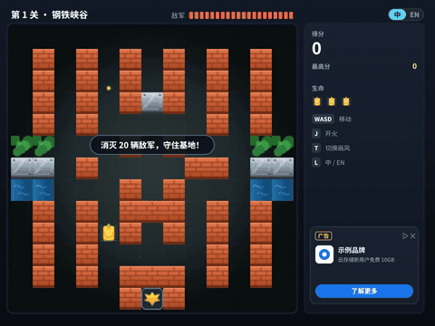
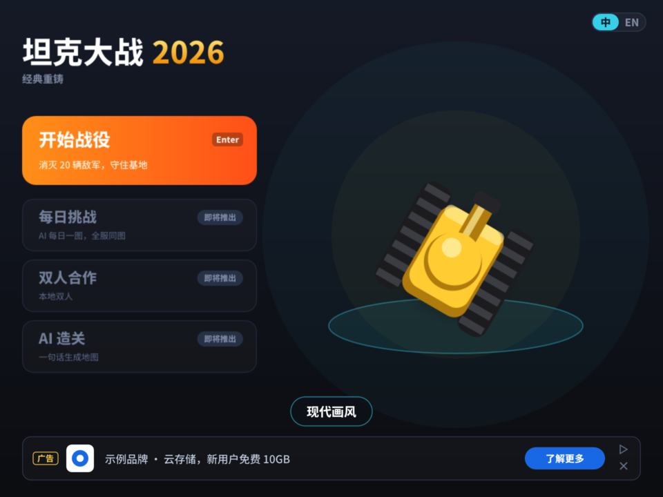
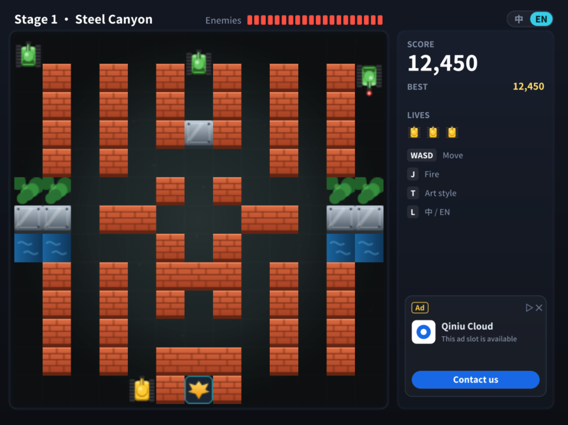
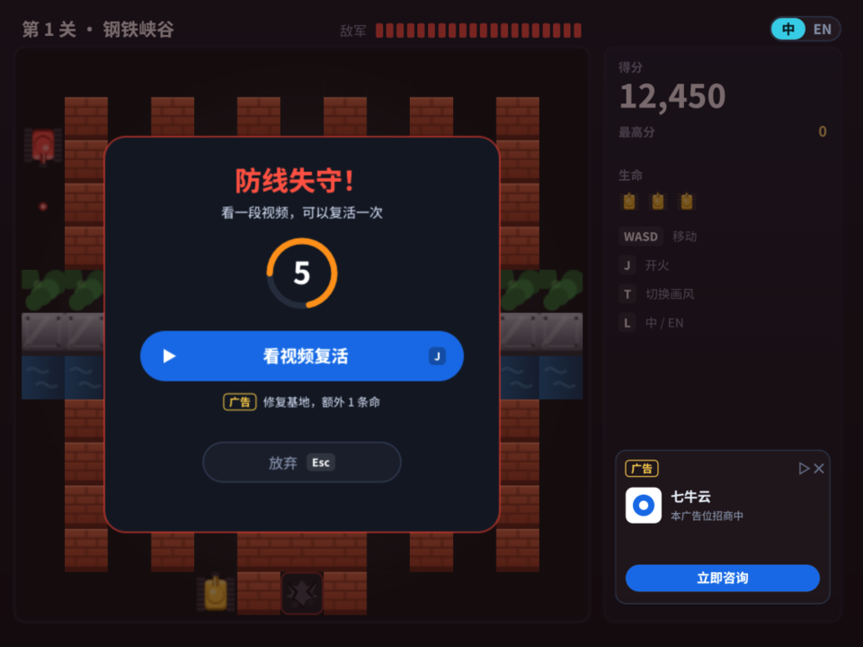
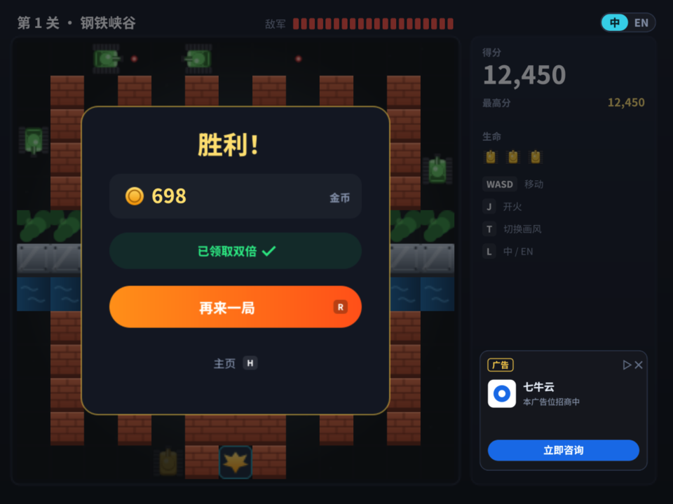
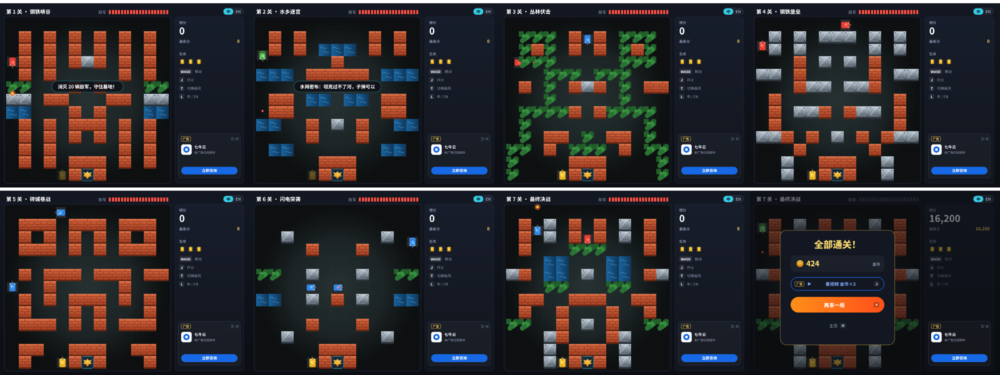

# 坦克大战 2026 · XBuilder 复刻重铸版

[x.qiniu.com](https://x.qiniu.com) | [下载 .xbp](TankBattle.xbp) | [演示视频](docs/demo/tankbattle-v2-demo.mp4) | [快速开始](#快速开始) | [玩法](#玩法) | [架构文档](docs/ARCHITECTURE.md) | [设计方案](docs/v2/DESIGN.md) | [XGo](https://xgo.dev) | [spx 引擎](https://github.com/goplus/spx)

[](#)
[](https://x.qiniu.com)
[](https://xgo.dev)
[](https://github.com/goplus/spx)
[](#素材与版权说明)

> 🏆 **第五届 1024 HACKATHON 参赛项目** · 这是一个 Builder 的时代 —— AI 放大执行，我们撬动价值

用 [XBuilder](https://x.qiniu.com) 把 1985 年的 FC 经典《坦克大战》重做成 2026 年的样子：保留“守住老鹰、打穿砖墙”的玩法内核，换上现代画风，支持中英文，并且设计了一套**干净、不打扰玩家**的广告商业化方案。

*Talk is cheap, show me what you build.*



> 动图截自[完整演示视频](docs/demo/tankbattle-v2-demo.mp4)（约 1 分钟，无声）。视频由 spx 引擎实际运行录制，用的是游戏内置的**路演演示模式**（主页按 P）：玩家坦克自动驾驶，脚本依次展示画风切换、中英文切换、复活、激励视频广告和结算。

| 主页 + 横幅广告 | 对局（English） | 复活询问（激励视频） | 结算（金币翻倍） |
|---|---|---|---|
|  |  |  |  |

## 快速开始

### 方式一：在 XBuilder 里运行（推荐，零安装）

1. 下载本仓库中的 [`TankBattle.xbp`](TankBattle.xbp)
2. 打开 <https://x.qiniu.com> 并登录
3. 点击「文件 → 导入」，选择 `TankBattle.xbp`
4. 点击右上角的「运行」按钮

### 方式二：在本地用 spx 运行

```sh
# 1. 安装 spx 运行时（需要 Git、Make、Go，详见 goplus/spx 的 README）
git clone https://github.com/goplus/spx.git && cd spx && make setup

# 2. 运行游戏
cd /path/to/zero/TankBattle
spx run .
```

## 玩法

| 按键 | 作用 |
|---|---|
| Enter / 空格 / 点击「开始战役」 | 从第 1 关开始 |
| 1 ~ 7 | 主页：直接进入对应关卡 |
| 方向键 / WASD | 移动坦克 |
| 空格 / J | 开火 |
| T | 切换 2026 现代画风 / 1985 经典像素风 |
| L / 点击右上角「中 \| EN」 | 切换中文 / English |
| J / Enter | 复活询问、结算时：看视频（激励广告） |
| Esc | 复活询问时：放弃 |
| R / H | 结算时：下一关（胜利）或再来一局（战败）/ 回到主页 |
| P | 主页：路演演示模式（无人值守自动展示） |

- **目标**：每关消灭 20 辆敌方坦克，同时保护好底部的老鹰基地。共 **7 关**，得分会带到下一关；战败后重打本关。
- **失败**：基地被击中，或者生命用完。**每局第一次战败**时，可以选择看一段视频复活（修复基地，额外 1 条命）。
- **地形**：砖墙要打两下才会碎；钢墙打不碎；**水面**坦克过不去、子弹能飞过；**草丛**能把坦克藏起来。
- 和原版一样，屏幕上同时只能有 **1 发**自己的子弹；子弹迎面相撞会互相抵消；出生时有 3 秒保护。
- **结算**：按得分折算金币，胜利额外加 100；可以看视频把金币翻倍。

| 敌人 | 外观（现代 / 经典） | 特点 | 分数 |
|---|---|---|---|
| 普通坦克 | 红色 / 银色 | 速度中等 | 100 |
| 快速坦克 | 蓝色 / 蓝色 | 速度快 | 200 |
| 重型坦克 | 绿色 / 绿色 | 要打 3 发才会被消灭 | 400 |

| 关卡 | 特点 | 敌军配置 |
|---|---|---|
| 1 钢铁峡谷 | 经典布局，砖墙夹道 | 标准 |
| 2 水乡迷宫 | 大片水面分割战场，坦克要绕路，子弹能隔河对射 | 标准 |
| 3 丛林伏击 | 草丛遍地，敌人藏在草里 | 快速坦克占 60% |
| 4 钢铁堡垒 | 钢墙林立，射击角度很少 | 重型坦克占 50% |
| 5 砖城巷战 | 密集的砖墙街区，要自己打出一条路 | 出兵更快 |
| 6 闪电突袭 | 开阔地，几乎无处可躲 | 快速坦克占 70%，出兵最快，场上最多 5 辆 |
| 7 最终决战 | 水面、草丛、钢墙都有，基地两侧有钢墙 | 重型和快速各 40%，场上最多 5 辆 |



## v2.0 做了什么

| 方向 | 内容 |
|---|---|
| 画面 | 「微缩战场」现代画风（伪 3D 墙体、发光子弹、爆炸粒子、暗角），默认开启；按 T 回到 1985 像素风 |
| 界面 | 全新 HUD：关卡名、敌军剩余、得分（千分位）、最高分、生命、按键提示、提示条 |
| 语言 | 中文 / English 随时切换。所有文字都被**烘焙成矢量路径**，运行时不依赖字体，从根本上杜绝乱码 |
| 玩法 | 主页、复活机制、结算与金币、草丛和水面地形 |
| 商业化 | 4 个广告位全部在战场之外：主页横幅、原生广告卡、复活激励视频、结算金币 ×2 激励视频。统一使用 Google 风格（「广告」标识、AdChoices、关闭按钮、Google 蓝按钮） |
| 路演 | 路演演示模式（P）：自动驾驶 + 脚本，在展台上无人值守地循环展示 |

广告位目前用「七牛云 · 广告位招商」的文案做模拟展示。广告的设计原则和收入结构见[设计方案](docs/v2/DESIGN.md#四广告干净不打扰)。目前的广告是**游戏内的模拟广告位**（画面上标明了「模拟广告位」）；正式上线的接入方案见[架构文档](docs/ARCHITECTURE.md#8-广告)。

## 文档

| 文档 | 内容 |
|---|---|
| [架构文档](docs/ARCHITECTURE.md) | 模块规格、消息表、流程状态机、资源管线、spx 解释器的限制与对策、测试方法、分工 |
| [设计方案](docs/v2/DESIGN.md) | 2026 年的玩法、画风、商业化设计，附中英文效果图 |
| [演示视频](docs/demo/tankbattle-v2-demo.mp4) | 约 1 分钟的完整流程演示 |

## 项目结构

```
TankBattle.xbp            # 可直接导入 XBuilder 的项目包（tools/package_xbp.sh 生成）
TankBattle/               # 游戏工程（XGo / spx）
├── main.spx              # 舞台：地图、规则、流程状态机、HUD 布局、路演演示
├── Player.spx            # 玩家坦克：键盘控制 / 自动驾驶、开火、引擎声
├── Enemy.spx             # 敌人坦克：随机转向、偏向基地、定时开火
├── PBullet.spx / EBullet.spx   # 玩家子弹 / 敌人子弹
├── Boom.spx              # 爆炸动画
├── Tile.spx              # 地图格子：砖墙、钢墙、水面、草丛、基地
├── UI.spx                # 所有界面元素：标签、数字、图标、提示条、广告位、弹窗画面
└── assets/               # 造型（SVG，大部分由生成器产出）、音效（WAV）
tools/
├── assets/               # 美术与文案生成器：build.py、textpath.py、strings.py（中英文案表）
├── dev/                  # 本地截图、录制演示视频的脚本
├── levels/check.py       # 关卡地图检查：出生点、基地、连通性
└── package_xbp.sh        # 打包 TankBattle.xbp
docs/
├── ARCHITECTURE.md       # 架构文档
├── v2/                   # 设计方案、效果图、实机截图
├── v3/stages/            # v3.0 的 7 个关卡截图
└── demo/                 # 演示视频和动图
```

## 开发

```sh
# 修改了文案（tools/assets/strings.py）或美术代码之后，重新生成造型
pip install -r tools/assets/requirements.txt
python3 tools/assets/build.py

# 修改了关卡地图（main.spx 的 levelMap）之后，检查地图是否合法
python3 tools/levels/check.py

# 本地运行
cd TankBattle && spx run .

# 重新打包 .xbp，导入 XBuilder
./tools/package_xbp.sh

# 重新录制演示视频（需要 ffmpeg）
./tools/dev/record_demo.sh
```

开发规范：每次改动都通过 Pull Request 合入，详见[架构文档的开发流程](docs/ARCHITECTURE.md#11-开发流程与分工)。

## 代码里的教学要点

| 知识点 | 在哪里 | 说明 |
|---|---|---|
| 数组 | `main.spx` 中的 `grid`、`levelMap()` | 地图是一个 13×13 的数组：0 空地、1 砖墙、2 钢墙、3 裂开的砖墙、4 水面、5 草丛、9 基地 |
| 克隆 | `Tile.build`、`Enemy.spawn`、`UI.label` | 先设置好“模板精灵”的变量，再调用 `clone`；克隆体在 `onCloned` 里开始工作 |
| 消息 | `broadcast` / `onMsg` | 例如砖墙被打中后广播 `"gridChanged"`，每块砖自己对照 `grid` 更新 |
| 状态机 | `main.spx` 中的 `state` | 主页 → 对局 → 复活询问 → 播放广告 → 结算，每个按键在不同状态下含义不同 |
| 按帧移动 | `waitNextFrame` + `deltaTime` | 移动距离 = 速度 × 每帧时间，在快电脑和慢电脑上速度一样 |
| 碰撞 | `tankBlocked`、`bulletHit` | 撞墙通过查格子数组判断；坦克之间、子弹之间用 `touching` 判断 |
| 简单 AI | `Enemy.spx` 的 `pickFace`、`main.spx` 的 `autopilotDir` | 敌人随机转向并偏向基地；自动驾驶先和最近的敌人对齐，再开火 |
| 逻辑与表现分离 | `look()`、`langCode()` | 画风和语言都只是一个变量：造型按名字加 `_m` 或 `_zh` / `_en` 后缀切换，游戏逻辑一行不改 |

## 素材与版权说明

- **图片**：所有造型和背景都是原创。v2 的现代画风造型、界面和文字由 `tools/assets/build.py` 用代码生成。
- **音效**：经典版用程序模拟 FC 音源合成，现代版用滤波噪声、低频冲击和铜管音色合成，全部原创，**没有**使用 Namco 原版的音乐或采样。
- **字体**：界面文字由 [Noto Sans SC](https://github.com/google/fonts/tree/main/ofl/notosanssc)（SIL Open Font License 1.1）的字形轮廓生成，游戏运行时不再携带字体文件。
