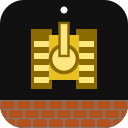
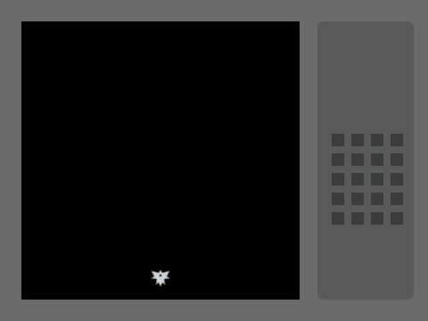

<div align="center">



<h1>坦克大战 · XBuilder 复刻版</h1>

<hr>

[x.qiniu.com](https://x.qiniu.com) | [下载 .xbp](TankBattle.xbp) | [快速开始](#快速开始) | [玩法](#玩法) | [教学要点](#代码里的教学要点) | [动手改编](#动手改编) | [XGo](https://xgo.dev) | [spx 引擎](https://github.com/goplus/spx)

[](#)
[](https://x.qiniu.com)
[](https://xgo.dev)
[](https://github.com/goplus/spx)
[](#素材与版权说明)

</div>

> 🏆 **第五届 1024 HACKATHON 参赛项目** · 这是一个 Builder 的时代 —— AI 放大执行，我们撬动价值

用 [XBuilder](https://x.qiniu.com) 复刻 1985 年 FC 经典游戏《坦克大战》。人定方向，AI 执行，从想法到可以玩的产品。

*Talk is cheap, show me what you build.*



> 动图由 spx 引擎实际运行录制，演示中的玩家坦克由脚本自动驾驶。

## 快速开始

1. 下载本仓库中的 [`TankBattle.xbp`](TankBattle.xbp)
2. 打开 <https://x.qiniu.com> 并登录
3. 点击「文件 → 导入」，选择 `TankBattle.xbp`
4. 点击右上角的「运行」按钮，开始游戏

## 玩法

| 按键 | 作用 |
|---|---|
| 方向键 / WASD | 移动坦克 |
| 空格 / J | 开火 |
| R | 游戏结束后重新开始 |

- **目标**：消灭全部 20 辆敌方坦克，同时保护好底部的老鹰基地。
- **失败**：基地被击中，或者 3 条命全部用完。
- **砖墙**要打两下才会碎（第一下裂开），**钢墙**打不碎。
- 和原版一样，屏幕上同时只能有 **1 发**自己的子弹；子弹迎面相撞会互相抵消。
- 每次出生有 3 秒闪烁保护，期间不会被击毁。

| 敌人 | 外观 | 特点 | 分数 |
|---|---|---|---|
| 普通坦克 | 银色 | 速度中等 | 100 |
| 快速坦克 | 蓝色 | 速度快 | 200 |
| 重型坦克 | 绿色 | 要打 3 发才会被消灭 | 400 |

场上最多同时有 4 辆敌人，它们轮流从左上、中上、右上三个出生点出场。

## 项目结构

```
TankBattle.xbp            # 可直接导入 XBuilder 的项目包（即 TankBattle/ 目录的 zip）
TankBattle/
├── main.spx              # 舞台：地图、计分、出敌人、胜负判断、音效
├── Player.spx            # 玩家坦克：键盘控制、开火、引擎声、被击中
├── Enemy.spx             # 敌人坦克：随机转向、偏向基地、定时开火
├── PBullet.spx           # 玩家子弹
├── EBullet.spx           # 敌人子弹
├── Brick.spx             # 砖墙（克隆出来的）
├── Steel.spx             # 钢墙（克隆出来的）
├── Boom.spx              # 爆炸动画
├── Base.spx / Tip.spx    # 老鹰基地 / 提示文字
└── assets/
    ├── index.json        # 舞台配置：背景、监视器、字体
    ├── sprites/          # 各精灵的造型（SVG）
    ├── sounds/           # 音效（WAV）
    └── fonts/            # 中文字体子集
docs/tankbattle.gif       # README 演示动图
```

## 代码里的教学要点

| 知识点 | 在哪里 | 说明 |
|---|---|---|
| 数组 | `main.spx` 中的 `grid`、`levelMap()` | 地图是一个 13×13 的数组：0 空地、1 砖墙、2 钢墙、3 裂开的砖墙、9 基地 |
| 克隆 | `Brick.build`、`Enemy.spawn`、`PBullet.fire` | 先把"模板精灵"移到目标位置，再调用 `clone`；克隆体在 `onCloned` 里开始工作 |
| 消息 | `broadcast` / `onMsg` | 例如打碎砖墙时广播 `"brickBroken"`，并带上格子编号作为数据 |
| 按帧移动 | `waitNextFrame` + `deltaTime` | 移动距离 = 速度 × 每帧时间，在快电脑和慢电脑上速度一样 |
| 碰撞 | `tankBlocked`、`bulletHit` | 撞墙通过查格子数组判断；坦克之间、子弹之间用 `touching` 判断 |
| 简单 AI | `Enemy.spx` 中的 `pickFace` | 随机选择方向，向下（基地方向）的概率更大 |

**为什么移动不用 `step`？** 在 spx 引擎里，`step` 是一段需要等它走完的动画，适合"走过去打招呼"这类剧情动画。坦克需要每一帧都能响应操作，所以这里用的是 `changeXYpos`。

## 动手改编

- **改地图**：修改 `main.spx` 里 `levelMap()` 的 13 行字符。`B` 是砖墙，`S` 是钢墙，`.` 是空地，`E` 是基地。
- **调难度**：修改 `main.spx` 中的 `totalEnemy`（敌人总数）和 `maxAlive`（同时在场的最多敌人数），或者修改 `Enemy.spx` 中的速度 `spd` 和开火间隔 `fireCD`。
- **换素材**：在 XBuilder 的「造型」页上传或用 AI 生成新的图片；在「声音」页保持同名替换，或者用「录制」录一段自己的声音。

### 在本地编辑代码

`.xbp` 文件其实就是 zip 包。在本地修改 `TankBattle/` 目录后，可以重新打包：

```sh
cd TankBattle
zip -r ../TankBattle.xbp . -x '.*'
```

然后在 XBuilder 里重新导入即可。

## 素材与版权说明

- **图片**：所有造型和背景都是原创的 SVG 矢量图。
- **音效**：用程序模拟 FC 音源（方波、三角波、噪声）合成的原创 8-bit 音效，**没有**使用 Namco 原版的音乐或采样。
- **字体**：`assets/fonts/basic-chinese` 来自 [goplus/spx](https://github.com/goplus/spx) 的 `basic-chinese` 字体，它源自 Adobe 的 Source Han Sans（思源黑体），采用 Apache License 2.0。这里只保留了 3755 个常用汉字（GB2312 一级字）和项目中用到的字。详见该目录下的 LICENSE 和 NOTICE 文件。用到不在字库里的生僻字时，会显示成方框。
- 《坦克大战》（Battle City）是 Bandai Namco 的作品。本项目是用于编程教学的非商业复刻，与 Bandai Namco 没有任何关联。
