<div align="center">

# 坦克大战 2026 · Brickline Tanks

<h3><i>“Talk is cheap, show me what you build.”</i></h3>

**守住老鹰，打穿砖墙** —— 用 XBuilder 重铸的经典坦克游戏

[](#)
[](https://x.qiniu.com)
[](https://github.com/Qiniu-ERE/zero/releases/latest)
[](docs/v6/TEST_PLAN.md)
[](docs/v6/TEST_PLAN.md#一要求和怎么检查)

**[⬇️ 下载安装包](https://github.com/Qiniu-ERE/zero/releases/latest)** · **[▶️ 演示视频](docs/demo/tankbattle-v6-demo.mp4)** · [下载 .xbp](TankBattle.xbp) · [快速开始](#快速开始) · [要等服务器的功能](#哪些功能要等服务器或平台才能用) · [玩法](#玩法) · [v6.0 新内容](#v60-做了什么) · [架构文档](docs/ARCHITECTURE.md) · [更新记录](CHANGELOG.md)

</div>

> 🏆 **第五届 1024 HACKATHON 参赛项目** · 这是一个 Builder 的时代 —— AI 放大执行，我们撬动价值

用 [XBuilder](https://x.qiniu.com) 把 1985 年的 FC 经典《坦克大战》重做成 2026 年的样子（XBuilder 复刻重铸版，英文名 **Brickline Tanks**）：保留“守住老鹰、打穿砖墙”的玩法内核，换上现代画风，支持中英文，并设计了一套**干净、不打扰玩家**的广告方案。v6.0 让玩家**明天还想回来**：打精英坦克升级自己、车库、全球同图的每日挑战、赛季和排行榜。

| 版本 | 做了什么 |
|---|---|
| **v6.0** | **敌我区分、打精英升级、每日挑战、排行榜**：敌方统一枪灰车身 + 红色标识；击毁精英坦克掉芯片、三选一升级；车库（指挥官等级、涂装、每日任务）、每日挑战（全球同图）、赛季、分享战报、助战码，手机上都能点；自建全球榜（服务端 + 客户端 + 部署文件）；131 个用例 ID 全覆盖（[v6.0 做了什么](#v60-做了什么)） |
| v5.0 | **商业化落地探索**：评估 Steam、Xbox、App Store、Google Play，定下盈利方案（免费 + 激励视频、$0.99 去广告，PC $0.99 买断）和回本测算（投入 ¥3350，基准半年回本）；主页加“选择关卡”，复活更有用，修了一批审查发现的问题 |
| v4.0 | **测试与质量**：每条游戏规则都有自动化测试，合入前一条命令跑完 |
| v3.0 | **8 个关卡、双人合作、自己做地图**，打包成六个平台的安装包 |
| v2.0 | 现代画风、中英文、主页 / 复活 / 结算、不打扰玩家的广告设计 |

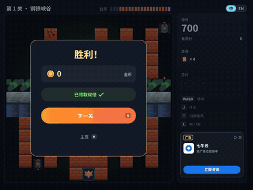

> 动图：v6 的精英掉芯片 → 三选一升级 → 车库 → 每日挑战 → 新关卡。截自 v6.0 的[完整演示视频](docs/demo/tankbattle-v6-demo.mp4)（约 1 分 50 秒，无声：对局、画风和语言切换、复活、结算，v6 的芯片、车库、每日挑战，v3 的关卡、双人合作、编辑器；以前的版本：[v5.0](docs/demo/tankbattle-v5-demo.mp4)、[v3.0](docs/demo/tankbattle-v3-demo.mp4)、[v2.0](docs/demo/tankbattle-v2-demo.mp4)），由游戏内置的**路演演示模式**（主页按 P）在真实引擎里录制。

| 主页 | 对局：敌我区分、精英、芯片 | 打精英后三选一 | 车库 |
|---|---|---|---|
| 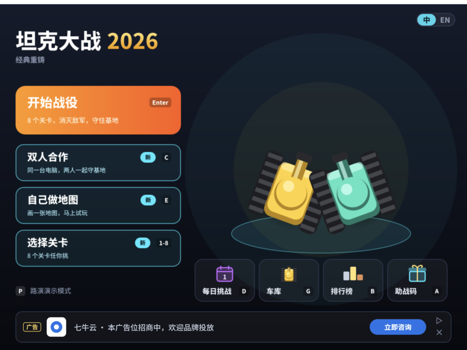 | 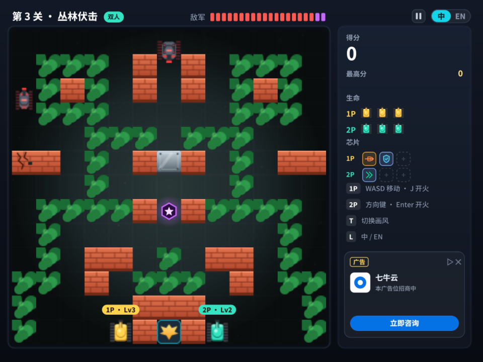 | 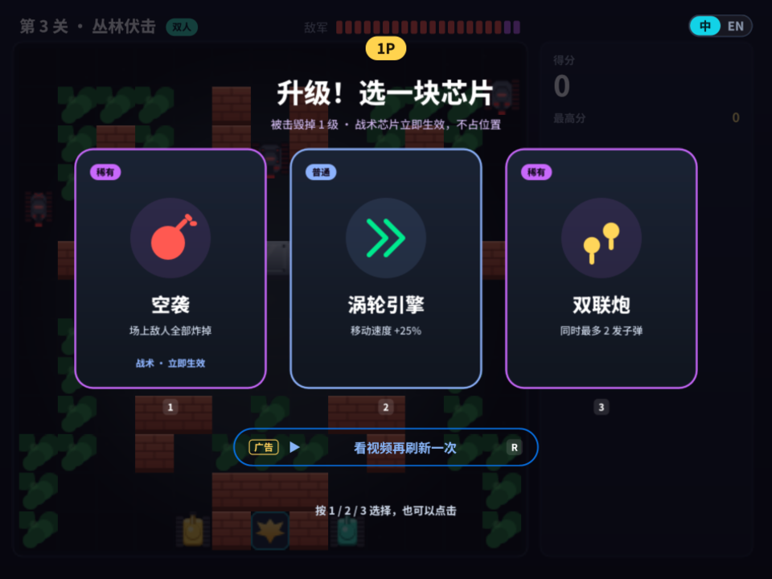 | 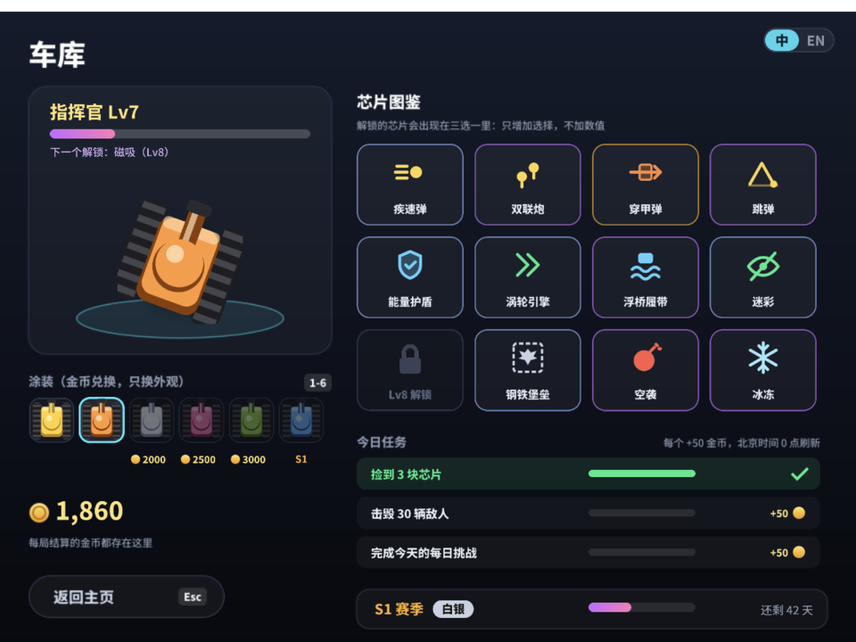 |
| **每日挑战结算** | **排行榜** | **English** | **1985 像素风（按 T）** |
| 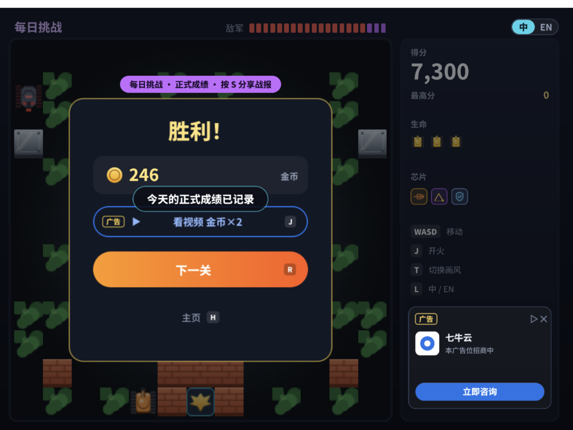 | 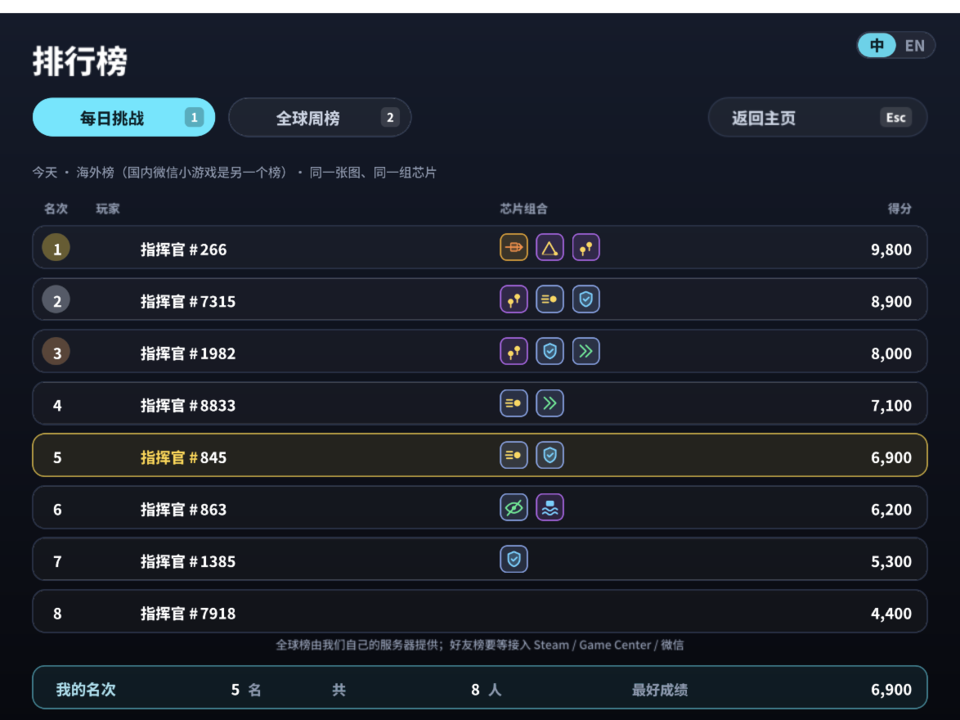 | 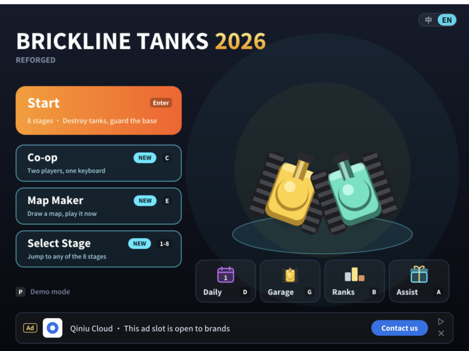 | 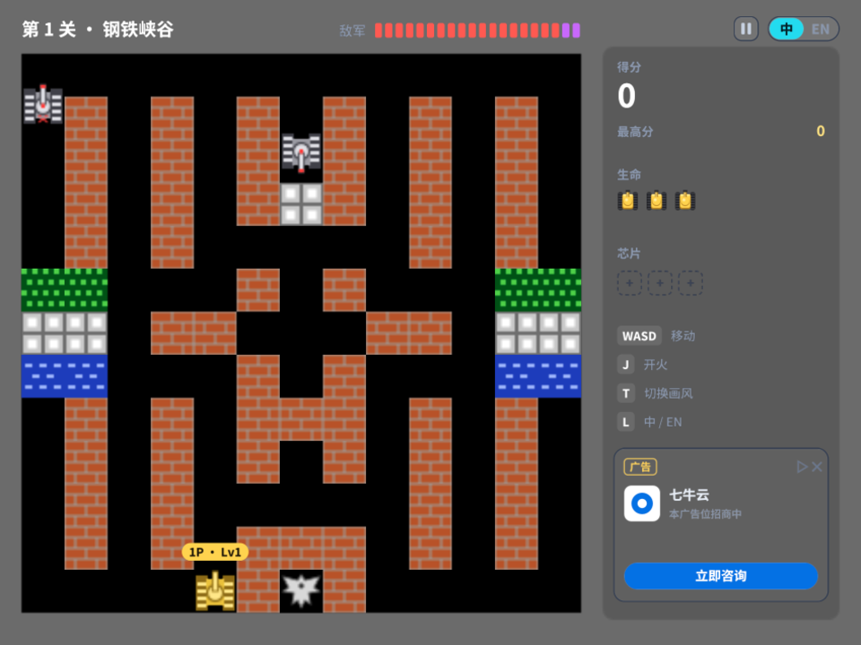 |

> 以上都是 v6.0 的实机截图（2026-11-01；排行榜是本机临时起的排行榜服务的真实数据）。v5.0 的截图（选关、双人、编辑器等）见 [docs/v5/screens](docs/v5/screens/)。右侧面板和主页底部的广告是**模拟广告位**，只在路演版里展示；以后手机和微信小游戏的免费版换成真实的激励视频和战场外横幅（$0.99 可去掉），PC 买断版没有广告（见 [v5.0 盈利方案](docs/v5/MONETIZATION.md)）。

## 下载安装

到 [Releases](https://github.com/Qiniu-ERE/zero/releases/latest) 下载，文件名是 `TankBattle-版本号-平台`，每个包里都有 `README.txt` 安装说明。

| 平台 | 文件 | 怎么打开 |
|---|---|---|
| Windows 10 / 11 | `windows-x64.zip` | 双击 `TankBattle.exe` |
| macOS（Apple 芯片） | `macos-arm64.zip` | 第一次右键 → 打开 |
| Linux | `linux-x64.tar.gz` | 运行 `./TankBattle` |
| 网页版 / 手机浏览器 | `web.zip` | 放到 HTTPS 网站，手机“添加到主屏幕” |
| Android | `android.apk` | 直接安装；提示签名不一致时先卸载旧版（只需一次） |
| iPhone / iPad | `ios-unsigned.ipa` | 用 Sideloadly / AltStore 签名安装 |

安装包从 v3.0.2 起在一台 Mac 上本机打包（现在用 `tools/export/build_local.sh` + `release_local.sh`），GitHub Actions 只能手动触发，详见[跨平台文档](docs/v3/CROSS_PLATFORM.md#七实现结果)。

> **Windows 和 iOS 暂时没有新包**：这台 Mac 打不了这两个平台，最新的包还是 [v3.0.1](https://github.com/Qiniu-ERE/zero/releases/tag/v3.0.1)（最新版的下载说明里也指向它）。v3.0.1 **不含**之后的修复、v5.0 和 v6.0 的新功能（选择关卡、芯片、车库、每日挑战等）。想玩最新版可以用网页版。

> **v6 的存档**是本机的 `TankBattle/save.txt`，在系统的用户配置目录里（例如 macOS 的 `~/Library/Application Support`；Android 在 App 自己的私有目录）；**网页版没有文件系统，进度只在这次打开时有效**。

### 哪些功能要等服务器或平台才能用

排行榜服务的代码、部署文件和本机模拟都已完成（[server/README.md](server/README.md)），但**还没有正式上线**：要一台服务器和一个域名，上线后用 `LB_URL` 重新打包。在那之前：

| 功能 | 现在 | 要什么才能用 | 没有时游戏里怎样 |
|---|---|---|---|
| **排行榜**（主页 B：每日挑战榜、全球周榜） | ❌ 所有平台 | 排行榜服务上线（服务器 + 域名 + HTTPS），用 `LB_URL` 重新打包 | 显示“排行榜服务还没上线：成绩只记在本机，不会上传”；以后上线了也不会补传之前的成绩 |
| 分享战报上的**全球名次** | ❌ 所有平台 | 同上 | 显示“联网后显示”；期数、得分、用时、连续打卡、芯片、助战码照常 |
| **国内榜**（微信小游戏） | ❌ | 境内服务器 + 完成 ICP 备案的域名（或微信云开发），加进小程序的 request 合法域名；还要先做出微信小游戏版本 | — |
| **网页版的每日挑战** | ❌ 网页版 | 网页版拿不到本机时间，靠排行榜服务器告诉今天是哪天 | 提示“拿不到今天的日期，暂时不能挑战” |
| 网页版的**赛季**、每日任务换日 | ❌ 网页版 | 同上 | 车库不显示赛季；每日任务一直是同一组 |
| 网页版的**存档**（车库进度、金币、涂装、自制地图） | ❌ 网页版 | 和服务器无关：浏览器里没有文件系统（以后可以改存到浏览器的本地存储） | 关掉页面就没了；保存地图提示失败 |
| **好友榜** | ❌ | 各平台的 SDK（Steam、Game Center、微信开放数据域） | — |
| **一键分享到微信** | ❌ | 微信 SDK | 分享战报是一张卡片，玩家自己截图分享 |
| **真实的激励视频和横幅广告** | ❌ | 广告 SDK（Google H5 Games Ads、AdMob、微信广告） | 现在是**模拟广告位**：“看视频”倒计时 5 秒后直接给奖励 |
| **内购去广告**（$0.99） | ❌ | 商店的支付接口 | 没有入口 |
| 平台账号、换设备同步进度 | ❌ | 平台账号（Game Center、Play 游戏服务、微信、Steam） | 用本机生成的随机 ID，进度只在这台设备上 |

**不需要服务器、现在就能用的**：战役 8 关、双人合作、自己做地图、打精英升级（芯片三选一）、车库（指挥官等级、金币、涂装、每日任务）、赛季、助战码、分享战报（除全球名次）、每日挑战（桌面版和手机 App：用本机日期，全世界同一张图，正式成绩记在本机，排行榜上线后才上传）。

## 快速开始

### 方式一：在 XBuilder 里运行（零安装）

1. 下载本仓库中的 [`TankBattle.xbp`](TankBattle.xbp)
2. 打开 <https://x.qiniu.com> 并登录
3. 点击「文件 → 导入」，选择 `TankBattle.xbp`
4. 点击右上角的「运行」按钮

### 方式二：在本地用 spx 运行

```sh
# 1. 安装 spx 运行时（需要 Git、Go、Python 3）
#    推荐用仓库里的脚本：装的是固定版本（spx v4.0.0 正式版），和打包、测试用的一样
cd /path/to/zero
tools/export/setup_spx.sh
export PATH="$(go env GOPATH)/bin:$PATH"   # spx 装在这里

#    也可以手动装，但一定要切到同一个提交（spx 的主分支在变，最新版不一定兼容）：
#    git clone https://github.com/goplus/spx.git && cd spx && git checkout v4.0.0 && make setup

# 2. 运行游戏
cd /path/to/zero/TankBattle
spx run .
```

## 玩法

**主页**

| 按键 | 作用 |
|---|---|
| Enter / 空格 | 从第 1 关开始 |
| 1 ~ 8 | 直接进入对应关卡 |
| 点「选择关卡」 | 选关画面：点关卡卡片或按 1 ~ 8 开局（单人），Esc 回主页 |
| C | 双人合作 |
| E | 自己做地图 |
| P | 路演演示模式（无人值守，按 Esc 退出） |
| D | 每日挑战（v6：全世界同一张图，今天第一局是正式成绩） |
| G / B | 车库 / 排行榜（v6） |
| A | 输入好友的助战码（v6） |

**对局**

| 按键 | 作用 |
|---|---|
| 方向键 / WASD | 移动 |
| 空格 / J | 开火 |
| Esc / 顶栏 Ⅱ | 暂停：继续、重新开始、返回主页 |
| T | 切换现代画风 / 1985 像素风 |
| L / 右上角「中 \| EN」 | 切换中文 / English |
| 双人合作 | 1P：WASD + J；2P：方向键 + Enter |

**地图编辑器**

| 按键 | 作用 |
|---|---|
| 鼠标点击 / 拖动 | 画格子（触屏也可以） |
| 1 ~ 5 | 砖墙、钢墙、水面、草丛、橡皮擦 |
| M | 对称绘制开关 |
| Enter / P | 试玩 / 双人试玩 |
| R / K / C | 随机起点 / 复制关卡 / 清空 |
| S / Esc | 保存（PC 版）/ 返回主页 |

**弹窗**

| 画面 | 按键 |
|---|---|
| 复活询问 | J / Enter 看视频复活，Esc 放弃（都要等弹窗出现后才算） |
| 结算 | J 金币翻倍，R 下一关 / 再来一局，H 主页 |
| 暂停 | Esc / Enter 继续，R 重来，H 主页（试玩时回编辑） |
| 三选一（v6） | 1 / 2 / 3 选芯片，R 刷新（每关一次） |
| 车库（v6） | 1 ~ 6 换 / 买涂装，Esc 回主页 |
| 排行榜（v6） | 1 每日挑战，2 全球周榜，Esc 回主页 |
| 每日挑战结算（v6） | S 分享战报（手机上点“正式成绩”标签），分享战报里 Esc 或点一下回到结算 |
| 助战码（v6） | 数字键或屏幕数字键盘输入，Backspace 删除，Enter 确认，Esc 返回 |

- **目标**：每关消灭 20 辆敌方坦克，保护好底部的老鹰。共 **8 关**，得分带到下一关；战败后重打本关。
- **失败**：基地被击中（自己的子弹也算），或者生命用完。**每关第一次战败**可以看视频复活一次。
- **复活**：修好基地、加 1 条命，敌人的子弹全部消失，基地 3 格以内的敌人也消失（之后重新出场，精英还是精英），碎了的护墙补回来，基地有 3 秒保护。暂停菜单里“重新开始本关”**不会**再给一次复活；输了以后在结算画面重打本关，可以再复活一次。基地和最后一辆敌人在同一刻没了，算战败。
- **地形**：砖墙打两下才碎；钢墙打不碎；**水面**坦克过不去、子弹能飞过；**草丛**能藏身。
- 和原版一样，同时只能有 **1 发**自己的子弹；子弹相撞会互相抵消；出生时有 3 秒保护。双人时只有打中敌人的那一发子弹消失，不影响另一个人的子弹。
- **生命**：超过 3 条时右侧面板显示“图标 ×N”。
- **手机 App（触屏）**：按住战场或方向键开火，点按钮不会开火；手机 App 不支持双人合作（请用电脑版或网页版）。网页版在手机上打开时有虚拟按键，单人时 1P 方向键发的是方向键，打开“双人按键”后 1P 用 WASD、2P 用方向键。v6 的画面都能点：主页的每日挑战、车库、排行榜、助战码卡片，助战码用屏幕数字键盘输入，每日挑战结算点“正式成绩”标签打开分享战报。
- **结算**：按本关得分折算金币，胜利额外加 100；可以看视频把金币翻倍。

- **v6 升级**：每关第 4、11 辆（第 4 关起还有第 18 辆）是紫色**精英**，击毁后掉芯片，10 秒内开过去捡，三选一升级（最高 Lv4，被击毁掉 1 级），详见 [v6.0 做了什么](#v60-做了什么)。

| 敌人（v6 起统一枪灰车身 + 红色标识，看外形分种类） | 外形 | 特点 | 分数 |
|---|---|---|---|
| 普通坦克 | 标准车身 | 速度中等 | 100 |
| 快速坦克 | 窄车身、车尾两道箭头 | 速度快 | 200 |
| 重型坦克 | 宽车身、两侧装甲板、粗炮管 | 要打 3 发 | 400 |
| 精英（v6） | 同上，标识换成紫色 | 多 1 发血、快 15%，掉芯片 | +300 |

| 关卡 | 地形 | 敌军 |
|---|---|---|
| 1 钢铁峡谷 | 砖墙夹道 | 标准 |
| 2 水乡迷宫 | 水面分割，隔河对射 | 标准 |
| 3 丛林伏击 | 草丛遍地 | 快速 60% |
| 4 钢铁堡垒 | 钢墙林立 | 重型 50% |
| 5 砖城巷战 | 密集砖墙街区 | 出兵更快 |
| 6 闪电突袭 | 开阔地 | 快速 70%，最多 5 辆 |
| 7 双子要塞 | 两座砖堡夹水渠 | 快速 50%，最多 5 辆 |
| 8 最终决战 | 水、草、钢都有 | 重型、快速各 45% |

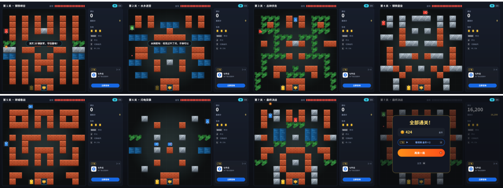

## v6.0 做了什么

v6.0 只解决一个问题：**让玩家明天还想回来**。全部功能不需要平台 SDK，详见 [v6.0 规划和实现](docs/v6/PLAN.md) 和 [v6 测试方案](docs/v6/TEST_PLAN.md)。

| 战斗：敌我区分、精英、芯片 | 三选一 | 车库 |
|---|---|---|
|  |  |  |
| **排行榜** | **每日挑战结算** | **分享战报** |
|  |  | 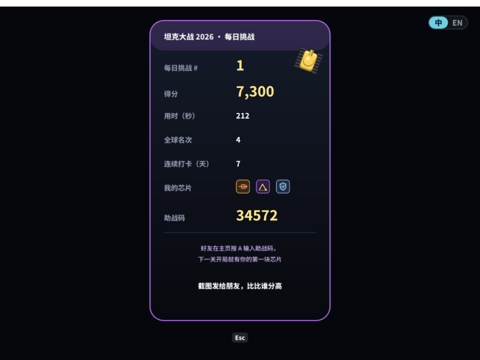 |

| 方向 | 做了什么 |
|---|---|
| 敌我区分 | 敌人统一枪灰色切角车身 + 红色警示条、炮口、“眼睛”，种类看外形，精英紫色；我方头顶“1P · Lv3”；子弹我黄敌红；经典画风同样分得清 |
| 局内升级 | 打精英掉芯片、三选一（看视频 / 免费刷新）、Lv1~Lv4；12 块芯片（9 块升级芯片 + 钢铁堡垒、空袭、冰冻 3 块战术芯片）、2 个连携 |
| 车库与存档 | `save.txt` 存档、指挥官等级解锁芯片（只加选择、不加数值）、金币钱包、涂装、每日任务 |
| 每日挑战 | 按日期生成全球同一张图、同一组敌人和芯片；一天一次正式成绩 |
| 赛季与分享 | 6 周一季的段位和免费赛季涂装、分享战报卡、5 位助战码送芯片 |
| 排行榜 | 自建服务（`server/`，Python 标准库）+ 游戏里的每日榜和周榜，后台上传、离线排队；部署文件已备好（Docker + 自动 HTTPS），本机模拟上线已跑通（`server/deploy/local.sh`），**还没正式上线**，好友榜要等 SDK |
| 测试全覆盖 | 131 个用例 ID 都有测试；新工具 Python 行覆盖 100%；克隆预算测试（spx 全部精灵最多 300 个克隆） |

## v5.0 做了什么

v5.0 回答一个问题：**这个游戏怎么真正赚到钱**。先只做文档和必要的修复，商店版、手柄、上架放在后面按计划做。

| 方向 | 结论 | 文档 |
|---|---|---|
| 平台 | Steam 首选，Microsoft Store（Xbox PC）一起做；App Store 中国区以外；Google Play 要等 spx 升级引擎；Xbox 主机只评估（spx 的游戏逻辑跑在 Go 里，Go 不支持主机） | [PLATFORMS](docs/v5/PLATFORMS.md) |
| 游戏体验 | 最大的缺口是**手柄**：Steam Deck 认证、远程同乐、手机双人都靠它；逐条对照各平台的认证要求 | [EXPERIENCE](docs/v5/EXPERIENCE.md) |
| 盈利 | **免费玩看广告，$0.99 一次性去广告**（欧美手机、微信小游戏）；Steam 不允许放广告，PC **$0.99 买断** | [MONETIZATION](docs/v5/MONETIZATION.md) |
| 推广 | **不买量**（¥0）：微信分享、双人合作拉朋友、地图编辑器做内容；Steam 的免费活动照样参加 | [MARKETING](docs/v5/MARKETING.md) |
| 盈利周期 | 总投入 **¥3350**（AI ¥1850 + 上架费 ¥1500）；基准每天 48 个新玩家，**第 6 个月回本、第一年净赚约 ¥5700**（保守第一年打平，乐观约 ¥3.2 万；都是推测） | [CASHFLOW](docs/v5/CASHFLOW.md) |
| 商店页 | 中英文案、素材规格、预告片脚本；英文名定为 **Brickline Tanks** | [STORE](docs/v5/STORE.md) |
| 全面审查 | 游戏 23 项、打包与工具 18 项、文档 15 项，第一批已经修完 | [REVIEW](docs/v5/REVIEW.md) |

已经做完的修复和功能：选择关卡画面、复活清场和 3 秒保护、双人子弹互相影响、触屏误开火、生命 ×N 显示、去掉每日挑战；打包发布更可靠（版本号核对、固定调试证书、发布前核对提交）；难度模拟工具。详见[更新记录](CHANGELOG.md#v500)。

## v4.0 做了什么

v4.0 不加新玩法，专门做**测试与质量**：每条游戏规则都有自动化测试，合入前在本地一条命令跑完，覆盖率只升不降。

| 方向 | 内容 |
|---|---|
| 引擎内测试 | `spx run -headless` 运行工程副本里的测试脚本，直接调用游戏函数检查结果，不改游戏代码。19 组、416 个断言：地图、子弹、出兵、得分、玩家、敌人、流程状态机、编辑器、双人合作、暂停菜单、触屏模式 |
| 工具和外壳 | 关卡检查、文案表、美术生成器（生成文件是否过期）、网页外壳的虚拟按键和布局；248 张地图上游戏和 `check.py` 的地图检查结论完全相同 |
| 兼容和打包 | 用 XBuilder 线上的 spx v3.3.0 编译检查（#18 那类问题合入前就能发现）；打出安装包后运行，确认能启动、开一局 |
| 覆盖率 | 函数 96%、`main.spx` 函数 99%、事件处理 100%、消息 100%（v4.0.1 修复子弹相撞后；v4.0 时事件处理 98%，子弹相撞抵消的处理受已知问题影响时有时无）；保存基线，覆盖率退步时检查失败 |
| 流程 | `tools/test/pr_check.sh` 本地检查（不依赖 GitHub Actions），报告贴在 PR 里；PR 模板 |
| 发现并修复的问题 | 子弹迎面相撞经常不抵消：测试发现，v4.0.1 修复（引擎里子弹的碰撞区域几乎只是一个点，改成按距离判断） |

演示视频：[一条命令跑完全部自动化测试](docs/demo/tankbattle-v4-tests.mp4)（真实运行 5 分 16 秒，7 倍速播放）。详见 [v4.0 规划](docs/v4/PLAN.md)、[测试方案](docs/v4/TEST_PLAN.md) 和 [更新记录](CHANGELOG.md#v400)。

## v3.0 做了什么

| 方向 | 内容 | 文档 |
|---|---|---|
| 关卡 | 8 关、选关、下一关、全部通关 | [PLAN](docs/v3/PLAN.md) |
| 双人合作 | 同一键盘两人一起守基地 | [COOP](docs/v3/COOP.md) |
| 自己做地图 | 画地图、实时检查、马上试玩 | [MAP_EDITOR](docs/v3/MAP_EDITOR.md) |
| 跨平台 | 六个平台的安装包（v3.0.0、v3.0.1 由 GitHub Actions 打包发布，v3.0.2 起本机打包） | [CROSS_PLATFORM](docs/v3/CROSS_PLATFORM.md) |
| 暂停（v3.0.1） | 对局中随时继续、重来或退出 | [CHANGELOG](CHANGELOG.md) |

| 8 个关卡 | 双人合作 | 自己做地图 | 手机网页版 |
|---|---|---|---|
| 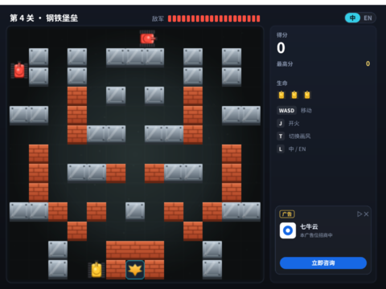 | 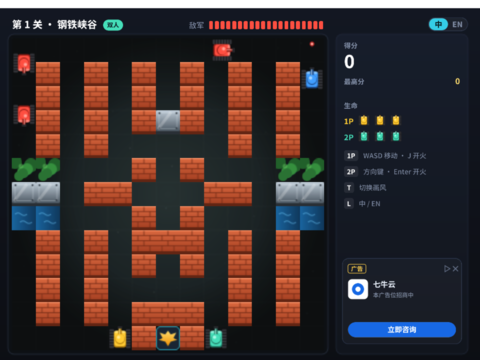 | 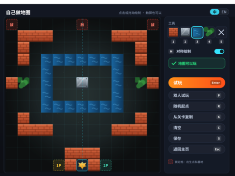 | 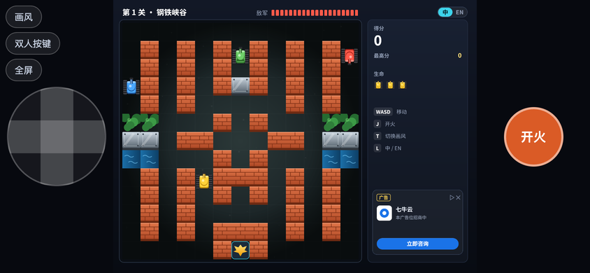 |

## v2.0 做了什么

| 方向 | 内容 |
|---|---|
| 画面 | 「微缩战场」现代画风，按 T 回到 1985 像素风 |
| 界面 | 新 HUD：关卡名、敌军剩余、得分、生命、提示条 |
| 语言 | 中英文切换；文字烘焙成矢量路径，不会乱码 |
| 玩法 | 主页、复活、结算与金币、草丛和水面 |
| 商业化 | 4 个广告位，全部在战场之外 |
| 路演 | 路演演示模式（P），展台无人值守循环 |

改版前（2026-10-23 的初版）是这样的：[初版玩法动图](docs/tankbattle.gif)。

广告位目前是**游戏内的模拟广告位**（画面上标明了“模拟广告位”），用「七牛云 · 广告位招商」的文案展示。设计原则见 [v2.0 规划](docs/v2/DESIGN.md#四广告干净不打扰)，正式接入方案见[架构文档](docs/ARCHITECTURE.md#8-广告)。

## 文档

| 文档 | 内容 |
|---|---|
| [架构文档](docs/ARCHITECTURE.md) | 模块规格、消息表、状态机、解释器限制、分工 |
| [v6.0 规划和实现](docs/v6/PLAN.md) | 敌我区分、精英与芯片、车库、每日挑战、赛季、分享战报、排行榜：规则、截图、和路演商业路线对照、还没做的部分；[v6 测试方案](docs/v6/TEST_PLAN.md)（131 个用例 ID）；[排行榜服务](server/README.md) |
| [v5.0 规划](docs/v5/PLAN.md) | 平台、体验、盈利、推广、盈利周期、商店页、全面审查清单 |
| [更新记录](CHANGELOG.md) | v0 → v2.0.0 → v3.0.0 → v3.0.x → v4.0.x → v5.0.x → v6.0.x |
| [v3.0 规划](docs/v3/PLAN.md) | 关卡、编辑器、双人、跨平台的方案和结果 |
| [v4.0 规划](docs/v4/PLAN.md) | 测试与质量：自动化测试、覆盖率、本地检查，[测试方案](docs/v4/TEST_PLAN.md)（测试分层、用例清单、覆盖率、测试发现的问题） |
| [跨平台](docs/v3/CROSS_PLATFORM.md) | 打包方法、实测截图、限制 |
| [微信小游戏](docs/v3/WECHAT_MINIGAME.md) | 可行性评估 |
| [v2.0 规划](docs/v2/DESIGN.md) | 玩法、画风、商业化设计和效果图 |
| [演示视频](docs/demo/tankbattle-v6-demo.mp4) | v6.0 完整流程（以前的版本：[v5.0](docs/demo/tankbattle-v5-demo.mp4)、[v3.0](docs/demo/tankbattle-v3-demo.mp4)、[v2.0](docs/demo/tankbattle-v2-demo.mp4)）；v4.0：[一条命令跑完全部测试](docs/demo/tankbattle-v4-tests.mp4) |

## 项目结构

```
TankBattle.xbp            # 可直接导入 XBuilder 的项目包（tools/package_xbp.sh 生成）
TankBattle/               # 游戏工程（XGo / spx）
├── main.spx              # 舞台：地图、规则、流程、双人、编辑器、暂停、路演演示；v6 芯片、车库、每日挑战、排行榜
├── Player.spx            # 玩家坦克（1P；双人时克隆出 2P）
├── Enemy.spx             # 敌人坦克
├── PBullet.spx / EBullet.spx   # 玩家子弹 / 敌人子弹
├── Boom.spx              # 爆炸动画
├── Tile.spx              # 地图格子：砖墙、钢墙、水面、草丛、基地
├── UI.spx                # 所有界面元素
└── assets/               # 造型（大部分由生成器产出）、音效
tools/
├── assets/               # 美术与文案生成器：build.py、strings.py
├── levels/check.py       # 关卡地图检查
├── levels/daily.py       # v6 每日挑战地图生成器（和游戏里的 dailyRows 同一个算法）
├── export/               # 各平台打包、网页版外壳、安装说明
├── dev/                  # 截图、录制演示视频、venv.sh（Python 虚拟环境）、clean.sh（清理临时文件）
├── test/                 # 测试工具：run_all.sh、run_spx.sh、pr_check.sh、覆盖率、XBuilder 兼容、安装包启动测试、难度模拟
└── package_xbp.sh        # 打包 TankBattle.xbp
server/                   # v6 自建排行榜服务（Python 标准库）和部署文件 deploy/（还没上线）
tests/                    # v4.0 起的自动化测试
├── spx/                  # 引擎内测试（每个文件一组）
├── tools/                # 构建工具测试（Python）
├── web/                  # 网页外壳测试（Node.js）
├── data/                 # 测试数据（248 张编辑器地图、365 天的每日挑战地图）
└── coverage-baseline.json  # 覆盖率基线
docs/
├── ARCHITECTURE.md       # 架构文档
├── v2/                   # v2.0 规划、截图
├── v3/                   # v3.0 规划和各方向的文档、截图
├── v4/                   # v4.0 规划：PLAN.md 总览、TEST_PLAN.md 测试方案
├── v5/                   # v5.0 规划和截图（screens/）
├── v6/                   # v6.0 规划和实现、测试方案、截图（screens/）、规划时的效果图（mockups/）
└── demo/                 # 演示视频和动图
```

## 开发

```sh
# 第一次：建 Python 虚拟环境 .venv（装好锁定版本的 fontTools，测试脚本会自动用它）
tools/dev/venv.sh

# 改了文案（tools/assets/strings.py）或美术代码：重新生成造型
.venv/bin/python tools/assets/build.py

# 改了关卡地图（main.spx 的 levelMap）：检查地图
python3 tools/levels/check.py

# 本地运行 / 打包 .xbp
cd TankBattle && spx run .
./tools/package_xbp.sh

# 自动化测试（见 docs/v4/TEST_PLAN.md；需要什么见下面的“跑测试需要什么”）
tools/test/run_all.sh               # 全部：构建工具 + 网页外壳 + 引擎内测试（约 11 分钟）
tools/test/run_spx.sh tests/spx/flow_revive.spx   # 只跑一组引擎内测试
tools/test/pr_check.sh --coverage   # PR 合入前：和 check.yml 相同的检查 + 全部测试 + 覆盖率，生成报告贴到 PR 里
tools/test/xbuilder_check.sh        # 用 XBuilder 线上的 spx v3.3.0 编译检查
tools/test/package_boot.sh          # 打出桌面安装包并运行启动测试
tools/test/dist_boot.sh dist/TankBattle-版本-macos-arm64.zip   # 直接运行要发出去的安装包（B14）
tools/test/update_baseline.sh       # 覆盖率提高后更新基线（约 25 分钟；有测试失败就停下）
python3 server/leaderboard.py       # v6 排行榜服务在本机运行（部署见 server/README.md）
server/deploy/local.sh up           # 本机模拟排行榜上线：Docker + Caddy HTTPS + 模拟玩家；local.sh game 起一份连本机服务的游戏，local.sh down 收尾
tools/dev/clean.sh                  # 磁盘紧时：先列出测试和打包留下的临时文件，加 --yes 才删

# 打安装包：全部在本地，不用 GitHub Actions（见 docs/v3/CROSS_PLATFORM.md「本地打包」）
tools/export/setup_spx.sh android   # 第一次：spx、xgo、运行时、安卓模板
tools/export/linux_vm.sh setup      # 第一次：Linux 打包用的 OrbStack 虚拟机
tools/export/build_local.sh         # 打本机能打的全部平台并逐个检查（macOS、网页版、Android、Linux；Windows、iOS 暂时空着）
tools/export/build.sh desktop --store   # 商店版（还有 --demo 试玩版），包放在 dist/store/ 等子目录，不会被发布
LB_URL=https://lb.example.com tools/export/build_local.sh   # 排行榜上线后：把服务地址打进包里（国内的包再加 LB_REGION=cn）

# 发布：先在 CHANGELOG.md 写好这个版本，在 main 上打标签并推送，在这个提交上打包，再用 dist/ 发布
# 标签推上去以后不能修改（仓库规则），所以一律用附注标签，推之前确认提交没错
git tag -a v6.1.0 -m "v6.1.0" && git push origin v6.1.0
DRY_RUN=1 tools/export/release_local.sh   # 先看发布说明和检查结果（不发布）
tools/export/release_local.sh             # 版本号或提交号不对、打包时工作区不干净、表里有 ❌，都会停下
tools/export/release_local.sh --append    # 以后给已有的 Release 补包（例如 Windows / iOS）

# 重新录制演示视频（需要 ffmpeg）
./tools/dev/record_demo.sh           # 输出 docs/demo/tankbattle-v6-demo.mp4 和 tankbattle-v6.gif（DEMO_NAME 改名字，GIF_START / GIF_LEN 改动图截哪一段）
```

**跑测试需要什么**：缺了某样东西时，有的测试会**跳过**。`run_all.sh` 会逐项列出“⚠️ 跳过”；`pr_check.sh` 有跳过时**不算通过**（退出码 2）。

| 测试 | 需要 | 没有时 |
|---|---|---|
| 引擎内测试（`tests/spx`） | spx（见[快速开始](#方式二在本地用-spx-运行)），只支持 macOS / Linux | 用 `SKIP_SPX=1 tools/test/run_all.sh` 只跑其他测试 |
| 网页外壳测试（`tests/web`） | Node.js 18 以上（用自带的 `node --test`） | 跳过，只打印一行“跳过：没有 node” |
| 美术生成器测试、`pr_check.sh` 的“生成的素材”一项 | Python 的 fontTools：运行 `tools/dev/venv.sh` 建 `.venv`（没设 `PYTHON` 时测试脚本自动用它）；第一次运行会下载字体（要联网） | 跳过。用别的虚拟环境时用 `PYTHON=虚拟环境/bin/python` 指定 |
| XBuilder 兼容检查（`xbuilder_check.sh`，T09） | Go 1.25 以上和网络（第一次要下载 spx v3.3.0 和 xgo） | 没有 Go 时跳过；有 Go 但没网络会失败 |
| 安装包启动测试（`package_boot.sh`） | 先运行一次 `tools/export/setup_spx.sh` | — |

- **版本标签**：`v0` 是导入的基础版本（初版坦克大战），之后的提交都是在它之上新增的；`v1.0.0` 是 v0 之后当天上午的第一批改动（直接提交到 main，见[更新记录](CHANGELOG.md#v100)）；`v2.0.0`、`v3.0.0`、`v3.0.1`、`v3.0.2`、`v4.0.0`、`v4.0.1`、`v5.0.0`、`v5.0.1`、`v6.0.0`、`v6.0.1` 是发布版本。`v6.0.0` 只有标签（打包前发现一批问题，安装包见 v6.0.1）；`v4.0.0` 只有标签、没有安装包，安装包见 [v4.0.1](https://github.com/Qiniu-ERE/zero/releases/tag/v4.0.1)。
- **GitHub 上的红叉**：main 上有几次 Actions 运行显示失败（#22、#23、#50 合入时，还有 v3.0.2、v4.0.0 的标签），都是组织的 Actions 额度用完、任务没启动（3~5 秒就结束），不是代码问题。现在工作流都只能手动触发，检查以 PR 里贴的本地检查报告（`pr_check.sh`）为准。
- **Android 调试证书**：在仓库外的 `~/.config/tankbattle/debug.keystore`。证书换了，玩家就没法覆盖升级，**请备份**；换电脑打包时拷过去。见[跨平台文档](docs/v3/CROSS_PLATFORM.md#71-发布了哪些包)。
- **开发规范**：v2.0 起每次改动都通过 Pull Request 合入（v1.0.0 的 5 个提交是例外），详见[架构文档](docs/ARCHITECTURE.md#11-开发流程与分工)。

## 代码里的教学要点

| 知识点 | 在哪里 | 一句话说明 |
|---|---|---|
| 数组 | `grid`、`levelMap()` | 地图是 13×13 的数组 |
| 克隆 | `Tile.build`、`Enemy.spawn` | 先设好模板变量，再 `clone` |
| 消息 | `broadcast` / `onMsg` | 砖墙被打中后广播 `gridChanged` |
| 状态机 | `main.spx` 的 `state` | 同一个键在不同画面含义不同 |
| 按帧移动 | `deltaTime` | 距离 = 速度 × 每帧时间 |
| 碰撞 | `tankBlocked`、`bulletHit` | 撞墙查格子，坦克之间用 `touching` |
| 简单 AI | `pickFace`、`autopilotDir` | 敌人偏向基地，自动驾驶追最近的敌人 |
| 搜索 | `reachable()` | 广度优先搜索：能不能开到基地 |
| 表现分离 | `look()`、`langCode()` | 画风、语言只是一个变量 |
| 伪随机数（v6） | `dailyRand`、`tools/levels/daily.py` | 线性同余：同一个种子（日期）在所有设备上得到同一张图，Python 版逐格相同 |
| 加权抽取（v6） | `pickRoll`、`chipRarity` | 三选一按稀有度 6 : 3 : 1 抽卡，不重复 |
| 后台任务（v6） | `lbFlush` → `go lbSendAll(...)` | 上传成绩放在 goroutine 里，不卡画面；没网时排队 |
| 资源上限（v6） | `panelOff` | spx 最多 300 个克隆：画面的小部件用时才创建，离开就删 |
| 服务端（v6） | `server/leaderboard.py` | 只用 Python 标准库：HTTP 接口、sqlite、校验和限频 |

## 素材与版权说明

- **图片**：所有造型和背景都是原创。v2 的现代画风造型、界面和文字由 `tools/assets/build.py` 用代码生成。
- **音效**：经典版用程序模拟 FC 音源合成，现代版用滤波噪声、低频冲击和铜管音色合成，全部原创，**没有**使用 Namco 原版的音乐或采样。
- **字体**：界面文字由 [Noto Sans SC](https://github.com/google/fonts/tree/main/ofl/notosanssc)（SIL Open Font License 1.1）的字形轮廓生成，游戏运行时不再携带字体文件。
