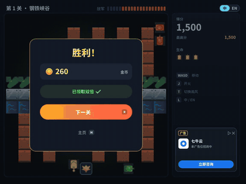
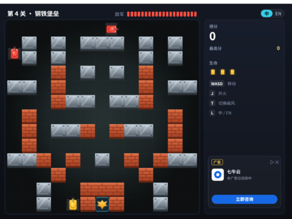
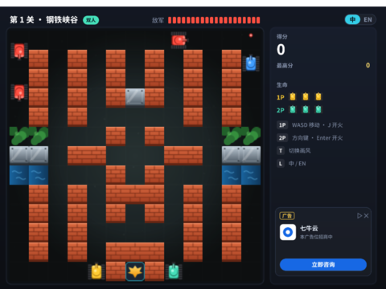

# 坦克大战 2026 · XBuilder 复刻重铸版

**[下载安装包](https://github.com/Qiniu-ERE/zero/releases/latest)** · [下载 .xbp](TankBattle.xbp) · [演示视频](docs/demo/tankbattle-v3-demo.mp4) · [快速开始](#快速开始) · [玩法](#玩法) · [更新记录](CHANGELOG.md)

[架构文档](docs/ARCHITECTURE.md) · [v2.0 设计方案](docs/v2/DESIGN.md) · [v3.0 规划](docs/v3/PLAN.md) · [XBuilder](https://x.qiniu.com)

[](#)
[](https://x.qiniu.com)
[](https://xgo.dev)
[](https://github.com/goplus/spx)
[](#素材与版权说明)
[](docs/v4/TEST_PLAN.md)
[](docs/v4/TEST_PLAN.md#四覆盖率怎么算)

> 🏆 **第五届 1024 HACKATHON 参赛项目** · 这是一个 Builder 的时代 —— AI 放大执行，我们撬动价值

用 [XBuilder](https://x.qiniu.com) 把 1985 年的 FC 经典《坦克大战》重做成 2026 年的样子：保留“守住老鹰、打穿砖墙”的玩法内核，换上现代画风，支持中英文，并设计了一套**干净、不打扰玩家**的广告方案。

v3.0 加入了 **8 个关卡、双人合作、自己做地图**，并打包成 **Windows / macOS / Linux / 网页版 / Android / iOS** 安装包。

*Talk is cheap, show me what you build.*



> 动图：新关卡 → 双人合作 → 暂停菜单 → 编辑器里画地图并试玩。截自[完整演示视频](docs/demo/tankbattle-v3-demo.mp4)（约 1 分半，无声，[v2.0 版](docs/demo/tankbattle-v2-demo.mp4)），由游戏内置的**路演演示模式**（主页按 P）在真实引擎里录制。

| 主页 | 对局（English） | 复活（激励视频） | 结算（金币翻倍） |
|---|---|---|---|
|  |  |  |  |

## 下载安装

到 [Releases](https://github.com/Qiniu-ERE/zero/releases/latest) 下载，文件名是 `TankBattle-版本号-平台`，每个包里都有 `README.txt` 安装说明。

| 平台 | 文件 | 怎么打开 |
|---|---|---|
| Windows 10 / 11 | `windows-x64.zip` | 双击 `TankBattle.exe` |
| macOS（Apple 芯片） | `macos-arm64.zip` | 第一次右键 → 打开 |
| Linux | `linux-x64.tar.gz` | 运行 `./TankBattle` |
| 网页版 / 手机浏览器 | `web.zip` | 放到 HTTPS 网站，手机“添加到主屏幕” |
| Android | `android.apk` | 直接安装 |
| iPhone / iPad | `ios-unsigned.ipa` | 用 Sideloadly / AltStore 签名安装 |

安装包从 v3.0.2 起在一台 Mac 上本机打包（现在用 `tools/export/build_local.sh` + `release_local.sh`），GitHub Actions 只能手动触发，详见[跨平台文档](docs/v3/CROSS_PLATFORM.md#七实现结果)。

> **Windows 和 iOS 暂时没有新包**：这台 Mac 打不了这两个平台，最新的包还是 [v3.0.1](https://github.com/Qiniu-ERE/zero/releases/tag/v3.0.1)（最新版的下载说明里也指向它）。v3.0.1 **不含**之后的修复，例如误点“看视频”（v3.0.2）、子弹迎面相撞不抵消（v4.0.1）。想玩最新版可以用网页版。

## 快速开始

### 方式一：在 XBuilder 里运行（零安装）

1. 下载本仓库中的 [`TankBattle.xbp`](TankBattle.xbp)
2. 打开 <https://x.qiniu.com> 并登录
3. 点击「文件 → 导入」，选择 `TankBattle.xbp`
4. 点击右上角的「运行」按钮

### 方式二：在本地用 spx 运行

```sh
# 1. 安装 spx 运行时（需要 Git、Make、Go，详见 goplus/spx 的 README）
git clone https://github.com/goplus/spx.git && cd spx && make setup

# 2. 运行游戏
cd /path/to/zero/TankBattle
spx run .
```

## 玩法

**主页**

| 按键 | 作用 |
|---|---|
| Enter / 空格 | 从第 1 关开始 |
| 1 ~ 8 | 直接进入对应关卡 |
| C | 双人合作 |
| E | 自己做地图 |
| P | 路演演示模式（无人值守） |

**对局**

| 按键 | 作用 |
|---|---|
| 方向键 / WASD | 移动 |
| 空格 / J | 开火 |
| Esc / 顶栏 Ⅱ | 暂停：继续、重新开始、返回主页 |
| T | 切换现代画风 / 1985 像素风 |
| L / 右上角「中 \| EN」 | 切换中文 / English |
| 双人合作 | 1P：WASD + J；2P：方向键 + Enter |

**地图编辑器**

| 按键 | 作用 |
|---|---|
| 鼠标点击 / 拖动 | 画格子（触屏也可以） |
| 1 ~ 5 | 砖墙、钢墙、水面、草丛、橡皮擦 |
| M | 对称绘制开关 |
| Enter / P | 试玩 / 双人试玩 |
| R / K / C | 随机起点 / 复制关卡 / 清空 |
| S / Esc | 保存（PC 版）/ 返回主页 |

**弹窗**

| 画面 | 按键 |
|---|---|
| 复活询问 | J / Enter 看视频复活，Esc 放弃 |
| 结算 | J 金币翻倍，R 下一关 / 再来一局，H 主页 |
| 暂停 | Esc / Enter 继续，R 重来，H 主页（试玩时回编辑） |

- **目标**：每关消灭 20 辆敌方坦克，保护好底部的老鹰。共 **8 关**，得分带到下一关；战败后重打本关。
- **失败**：基地被击中（自己的子弹也算），或者生命用完。**每局第一次战败**可以看视频复活一次。
- **地形**：砖墙打两下才碎；钢墙打不碎；**水面**坦克过不去、子弹能飞过；**草丛**能藏身。
- 和原版一样，同时只能有 **1 发**自己的子弹；子弹相撞会互相抵消；出生时有 3 秒保护。
- **结算**：按本关得分折算金币，胜利额外加 100；可以看视频把金币翻倍。

| 敌人 | 现代 / 经典 | 特点 | 分数 |
|---|---|---|---|
| 普通坦克 | 红 / 银 | 速度中等 | 100 |
| 快速坦克 | 蓝 / 蓝 | 速度快 | 200 |
| 重型坦克 | 绿 / 绿 | 要打 3 发 | 400 |

| 关卡 | 地形 | 敌军 |
|---|---|---|
| 1 钢铁峡谷 | 砖墙夹道 | 标准 |
| 2 水乡迷宫 | 水面分割，隔河对射 | 标准 |
| 3 丛林伏击 | 草丛遍地 | 快速 60% |
| 4 钢铁堡垒 | 钢墙林立 | 重型 50% |
| 5 砖城巷战 | 密集砖墙街区 | 出兵更快 |
| 6 闪电突袭 | 开阔地 | 快速 70%，最多 5 辆 |
| 7 双子要塞 | 两座砖堡夹水渠 | 快速 50%，最多 5 辆 |
| 8 最终决战 | 水、草、钢都有 | 重型、快速各 45% |


## v4.0 做了什么

v4.0 不加新玩法，专门做**测试与质量**：每条游戏规则都有自动化测试，合入前在本地一条命令跑完，覆盖率只升不降。

| 方向 | 内容 |
|---|---|
| 引擎内测试 | `spx run -headless` 运行工程副本里的测试脚本，直接调用游戏函数检查结果，不改游戏代码。21 组、416 个断言：地图、子弹、出兵、得分、玩家、敌人、流程状态机、编辑器、双人合作、暂停菜单、触屏模式 |
| 工具和外壳 | 关卡检查、文案表、美术生成器（生成文件是否过期）、网页外壳的虚拟按键和布局；248 张地图上游戏和 `check.py` 的地图检查结论完全相同 |
| 兼容和打包 | 用 XBuilder 线上的 spx v3.3.0 编译检查（#18 那类问题合入前就能发现）；打出安装包后运行，确认能启动、开一局 |
| 覆盖率 | 函数 96%、`main.spx` 函数 99%、事件处理 100%、消息 100%（v4.0.1 修复子弹相撞后；v4.0 时事件处理 98%，子弹相撞抵消的处理受已知问题影响时有时无）；保存基线，覆盖率退步时检查失败 |
| 流程 | `tools/test/pr_check.sh` 本地检查（不依赖 GitHub Actions），报告贴在 PR 里；PR 模板 |
| 发现并修复的问题 | 子弹迎面相撞经常不抵消：测试发现，v4.0.1 修复（引擎里子弹的碰撞区域几乎只是一个点，改成按距离判断） |

演示视频：[一条命令跑完全部自动化测试](docs/demo/tankbattle-v4-tests.mp4)（真实运行 5 分 16 秒，7 倍速播放）。详见 [v4.0 规划](docs/v4/PLAN.md)、[测试方案](docs/v4/TEST_PLAN.md) 和 [更新记录](CHANGELOG.md#v400)。

## v3.0 做了什么

| 方向 | 内容 | 文档 |
|---|---|---|
| 关卡 | 8 关、选关、下一关、全部通关 | [PLAN](docs/v3/PLAN.md) |
| 双人合作 | 同一键盘两人一起守基地 | [COOP](docs/v3/COOP.md) |
| 自己做地图 | 画地图、实时检查、马上试玩 | [MAP_EDITOR](docs/v3/MAP_EDITOR.md) |
| 跨平台 | 六个平台的安装包（v3.0.0、v3.0.1 由 GitHub Actions 打包发布，v3.0.2 起本机打包） | [CROSS_PLATFORM](docs/v3/CROSS_PLATFORM.md) |
| 暂停（v3.0.1） | 对局中随时继续、重来或退出 | [CHANGELOG](CHANGELOG.md) |

| 8 个关卡 | 双人合作 | 自己做地图 | 手机网页版 |
|---|---|---|---|
|  |  |  |  |

## v2.0 做了什么

| 方向 | 内容 |
|---|---|
| 画面 | 「微缩战场」现代画风，按 T 回到 1985 像素风 |
| 界面 | 新 HUD：关卡名、敌军剩余、得分、生命、提示条 |
| 语言 | 中英文切换；文字烘焙成矢量路径，不会乱码 |
| 玩法 | 主页、复活、结算与金币、草丛和水面 |
| 商业化 | 4 个广告位，全部在战场之外 |
| 路演 | 路演演示模式（P），展台无人值守循环 |

广告位目前是**游戏内的模拟广告位**（画面上标明了“模拟广告位”），用「七牛云 · 广告位招商」的文案展示。设计原则见[设计方案](docs/v2/DESIGN.md#四广告干净不打扰)，正式接入方案见[架构文档](docs/ARCHITECTURE.md#8-广告)。

## 文档

| 文档 | 内容 |
|---|---|
| [架构文档](docs/ARCHITECTURE.md) | 模块规格、消息表、状态机、解释器限制、分工 |
| [更新记录](CHANGELOG.md) | v0 → v2.0.0 → v3.0.0 → v3.0.x |
| [v3.0 规划](docs/v3/PLAN.md) | 关卡、编辑器、双人、跨平台的方案和结果 |
| [v4.0 规划](docs/v4/PLAN.md) | 测试与质量：自动化测试、覆盖率、本地检查，[测试方案](docs/v4/TEST_PLAN.md)（测试分层、用例清单、覆盖率、测试发现的问题） |
| [跨平台](docs/v3/CROSS_PLATFORM.md) | 打包方法、实测截图、限制 |
| [微信小游戏](docs/v3/WECHAT_MINIGAME.md) | 可行性评估 |
| [v2.0 设计方案](docs/v2/DESIGN.md) | 玩法、画风、商业化设计和效果图 |
| [演示视频](docs/demo/tankbattle-v3-demo.mp4) | v3.0 完整流程（[v2.0 版](docs/demo/tankbattle-v2-demo.mp4)） |

## 项目结构

```
TankBattle.xbp            # 可直接导入 XBuilder 的项目包（tools/package_xbp.sh 生成）
TankBattle/               # 游戏工程（XGo / spx）
├── main.spx              # 舞台：地图、规则、流程、双人、编辑器、暂停、路演演示
├── Player.spx            # 玩家坦克（1P；双人时克隆出 2P）
├── Enemy.spx             # 敌人坦克
├── PBullet.spx / EBullet.spx   # 玩家子弹 / 敌人子弹
├── Boom.spx              # 爆炸动画
├── Tile.spx              # 地图格子：砖墙、钢墙、水面、草丛、基地
├── UI.spx                # 所有界面元素
└── assets/               # 造型（大部分由生成器产出）、音效
tools/
├── assets/               # 美术与文案生成器：build.py、strings.py
├── levels/check.py       # 关卡地图检查
├── export/               # 各平台打包、网页版外壳、安装说明
├── dev/                  # 截图、录制演示视频
├── test/                 # 测试工具：run_all.sh、run_spx.sh、pr_check.sh、覆盖率、XBuilder 兼容、安装包启动测试
└── package_xbp.sh        # 打包 TankBattle.xbp
tests/                    # v4.0 的自动化测试
├── spx/                  # 引擎内测试（每个文件一组）
├── tools/                # 构建工具测试（Python）
├── web/                  # 网页外壳测试（Node.js）
├── data/                 # 测试数据（248 张编辑器地图）
└── coverage-baseline.json  # 覆盖率基线
docs/
├── ARCHITECTURE.md       # 架构文档
├── v2/                   # v2.0 设计方案、截图
├── v3/                   # v3.0 规划和各方向的文档、截图
├── v4/                   # v4.0 规划：PLAN.md 总览、TEST_PLAN.md 测试方案
└── demo/                 # 演示视频和动图
```

## 开发

```sh
# 改了文案（tools/assets/strings.py）或美术代码：重新生成造型
pip install -r tools/assets/requirements.txt
python3 tools/assets/build.py

# 改了关卡地图（main.spx 的 levelMap）：检查地图
python3 tools/levels/check.py

# 本地运行 / 打包 .xbp
cd TankBattle && spx run .
./tools/package_xbp.sh

# 自动化测试（见 docs/v4/TEST_PLAN.md；需要 spx，美术生成器的测试需要 pip install -r tools/assets/requirements.txt）
tools/test/run_all.sh               # 全部：构建工具 + 网页外壳 + 引擎内测试（约 6 分钟）
tools/test/run_spx.sh tests/spx/flow_revive.spx   # 只跑一组引擎内测试
tools/test/pr_check.sh --coverage   # PR 合入前：和 check.yml 相同的检查 + 全部测试 + 覆盖率，生成报告贴到 PR 里
tools/test/xbuilder_check.sh        # 用 XBuilder 线上的 spx v3.3.0 编译检查
tools/test/package_boot.sh          # 打出桌面安装包并运行启动测试
tools/test/update_baseline.sh       # 覆盖率提高后更新基线

# 打安装包：全部在本地，不用 GitHub Actions（见 docs/v3/CROSS_PLATFORM.md「本地打包」）
tools/export/setup_spx.sh android   # 第一次：spx、xgo、运行时、安卓模板
tools/export/linux_vm.sh setup      # 第一次：Linux 打包用的 OrbStack 虚拟机
tools/export/build_local.sh         # 打本机能打的全部平台并逐个检查（macOS、网页版、Android、Linux；Windows、iOS 暂时空着）

# 发布：先在 CHANGELOG.md 写好这个版本，在 main 上打标签并推送，再用 dist/ 发布
git tag v4.1.0 && git push origin v4.1.0
tools/export/release_local.sh

# 重新录制演示视频（需要 ffmpeg）
./tools/dev/record_demo.sh
```

- **版本标签**：`v0` 是导入的基础版本（初版坦克大战），之后的提交都是在它之上新增的；`v2.0.0`、`v3.0.0`、`v3.0.1` 是发布版本。
- **开发规范**：每次改动都通过 Pull Request 合入，详见[架构文档](docs/ARCHITECTURE.md#11-开发流程与分工)。

## 代码里的教学要点

| 知识点 | 在哪里 | 一句话说明 |
|---|---|---|
| 数组 | `grid`、`levelMap()` | 地图是 13×13 的数组 |
| 克隆 | `Tile.build`、`Enemy.spawn` | 先设好模板变量，再 `clone` |
| 消息 | `broadcast` / `onMsg` | 砖墙被打中后广播 `gridChanged` |
| 状态机 | `main.spx` 的 `state` | 同一个键在不同画面含义不同 |
| 按帧移动 | `deltaTime` | 距离 = 速度 × 每帧时间 |
| 碰撞 | `tankBlocked`、`bulletHit` | 撞墙查格子，坦克之间用 `touching` |
| 简单 AI | `pickFace`、`autopilotDir` | 敌人偏向基地，自动驾驶追最近的敌人 |
| 搜索 | `reachable()` | 广度优先搜索：能不能开到基地 |
| 表现分离 | `look()`、`langCode()` | 画风、语言只是一个变量 |

## 素材与版权说明

- **图片**：所有造型和背景都是原创。v2 的现代画风造型、界面和文字由 `tools/assets/build.py` 用代码生成。
- **音效**：经典版用程序模拟 FC 音源合成，现代版用滤波噪声、低频冲击和铜管音色合成，全部原创，**没有**使用 Namco 原版的音乐或采样。
- **字体**：界面文字由 [Noto Sans SC](https://github.com/google/fonts/tree/main/ofl/notosanssc)（SIL Open Font License 1.1）的字形轮廓生成，游戏运行时不再携带字体文件。
