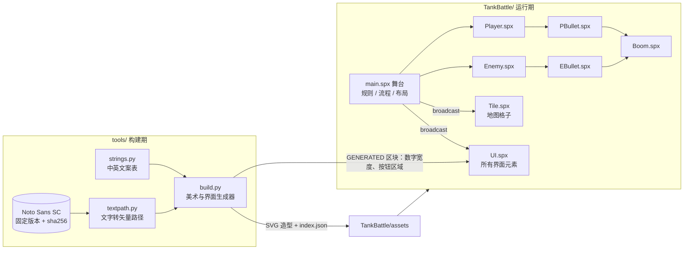
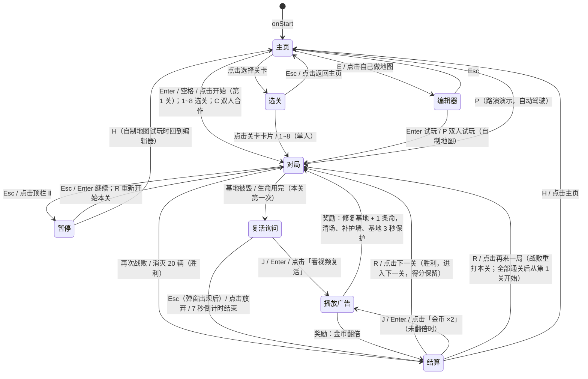

# 坦克大战 2026 · 架构文档

本文说明游戏（当前版本 v5.0.0）的整体结构、每个模块的职责和接口、关键的技术约束，以及开发流程与分工。玩法和商业化的设计思路见 [v2 设计方案](v2/DESIGN.md)，v3.0 的关卡、双人合作、自己做地图和跨平台见 [v3.0 规划](v3/PLAN.md)，v4.0 的自动化测试见 [v4.0 规划](v4/PLAN.md) 和[第 10 节](#10-测试与演示视频)，v5.0 的商业化规划见 [v5.0 规划](v5/PLAN.md)。

## 目录

1. [技术栈与运行环境](#1-技术栈与运行环境)
2. [总体结构](#2-总体结构)
3. [模块规格](#3-模块规格)
4. [消息表](#4-消息表)
5. [游戏流程状态机](#5-游戏流程状态机)
6. [坐标与布局](#6-坐标与布局)
7. [文字、多语言与防乱码](#7-文字多语言与防乱码)
8. [广告](#8-广告)
9. [spx 解释器的限制与对策（重要）](#9-spx-解释器的限制与对策重要)
10. [测试与演示视频](#10-测试与演示视频)
11. [开发流程与分工](#11-开发流程与分工)

## 1. 技术栈与运行环境

| 项目 | 说明 |
|---|---|
| 语言 | [XGo](https://xgo.dev)（`.spx` 类文件：`main.spx` 是舞台，其他每个文件是一个精灵） |
| 引擎 | [spx 4.0](https://github.com/goplus/spx)，底层是 Godot 4.4，SVG 由 LunaSVG 光栅化 |
| 运行方式 | ① [XBuilder](https://x.qiniu.com) 网页版：导入 `TankBattle.xbp` 运行；② 本地：`spx run .`（解释执行）；③ 各平台安装包：`tools/export/`，见 [跨平台文档](v3/CROSS_PLATFORM.md#七实现结果)。注意：XBuilder 线上的解释器基于 spx v3.3.0（[goplus/builder](https://github.com/goplus/builder) 的 `tools/ispx`），本地和安装包用的是 spx 4.0，同属 ispx 解释器。v4.0 起用 `tools/test/xbuilder_check.sh`（T09）在 spx v3.3.0 上做编译检查，v4.0.1 发布前通过；运行时的行为差别仍要在 x.qiniu.com 导入 `.xbp` 实际玩一次（[测试方案第七节](v4/TEST_PLAN.md#七发布前手工检查表)） |
| 画布 | 480×360（XBuilder 固定的运行尺寸，见[设计方案](v2/DESIGN.md#一技术确认画布尺寸)） |
| 资源生成 | Python 3 + fontTools：`tools/assets/build.py` 用代码生成 SVG 造型，`strings.py` 是中英文案表 |

## 2. 总体结构

设计原则：

- **舞台持有全部状态**（`grid`、分数、生命、`state`、语言、画风），精灵只负责表现和自己的运动；精灵之间不直接互相改状态，而是调用舞台的函数或者广播消息。
- **逻辑与表现分离**：画风、语言都只是一个变量。造型名按约定加后缀（`brick` / `brick_m`，`score_zh` / `score_en`），切换时只换造型，不改逻辑。
- **能生成的就不手画**：造型、界面文字、数字宽度、按钮点击区域都由 `build.py` 生成，改布局或文案时不会出现“画面和代码对不上”。

## 3. 模块规格

### 3.1 舞台 `main.spx`

| 分组 | 主要内容 |
|---|---|
| 状态 | `grid []int`（0 空地 1 砖 2 钢 3 裂砖 4 水 5 草 9 基地）、`stage`（当前关卡 1~8）`stageScore`（进关时的得分）、`coop` `p2Exists` `lives2` `pbCount2` `p1x/p1y/p2x/p2y` `hitWho`（双人合作）、`ed` `edTool` `edMirror` `edProblem` `edMark` `edCursor`（地图编辑器）、`score` `best` `lives` `killed` `spawned`、`theme`（0 经典 1 现代）、`lang`（0 中 1 英）、`state`、`screen`、`revived` `reviveStage`（在哪一关复活过）`baseSafe`（复活后基地还有几秒打不掉）`coins` `doubled`、`pbHitX/pbHitY`（刚被玩家子弹打中的敌人在哪）、广告关闭状态、自动驾驶状态 |
| 地图 | `levelMap()`（按 `stage` 返回 8 张地图之一）、`stageTune()`（本关的重型 / 快速坦克占比、出兵间隔、场上上限）、`stageTip()`、`buildMap()`、`cellX/cellY/cellIndex/cellAt`、`tankBlocked()`、`blocksTank()` |
| 子弹判定 | `bulletHit()`（弹头左右两个检测点）→ `hitPoint()` → `breakBrick()` / `baseDestroyed()` |
| 规则 | `spawnEnemy()`（左中右轮流出生，类型和数量按 `stageTune()`）、`enemyKilled()`、`defeat()`、`endGame()` |
| 地图编辑器 | `openEditor()`、`edPaint()`、`edCheck()`（规则同 `check.py`）、`edRebuild()`、`edRandom()`、`edSave()` / `edLoad()`（PC 版存到 `os.UserConfigDir()/TankBattle/maps.txt`）、`edCommand()`、`playCustom()` |
| 暂停 | `pauseGame()`（`gameOver = true` 冻结战场）、`resumeGame()`、`quitFromPause()`（自制地图回编辑器，其他回主页） |
| 流程 | `goHome()`、`openLevels()`（选关画面）、`newGame(n, two)`、`playStage(n)`、`startGame()`、`again()`（结算后：下一关 / 重打本关 / 全部通关后回到第 1 关）、`watchAd()`、`revive()`（清场、补护墙、基地保护，见[第 5 节](#5-游戏流程状态机)）、`showResult()`、`setScreen()`、`confirm()`、`escKey()`（Esc 在各个画面做什么） |
| 表现 | `look()`（画风后缀）、`langCode()`、`switchTheme()`、`switchLang()`、`toast()`、`shake()`、基地特写镜头、`lifeLook(n, slot, p2)`（生命图标用哪个造型：超过 3 条显示“图标 ×N”） |
| 触屏 | `touchZone(x, y)`：手指按在哪里做什么。方向键范围内返回方向（移动并开火），战场内返回 1（只开火），顶栏和右侧面板返回 -1（不开火，按钮都在这里） |
| 界面布局 | `buildHud()`：创建所有 UI 克隆，坐标见[第 6 节](#6-坐标与布局) |
| 路演演示 | `demoFlow` 消息处理（v2 内容之后调用 `demoV3()`：新关卡、双人合作、暂停菜单、编辑器里画地图并试玩）、`autopilotDir()`、`seeEnemy()`、`autopilotBlocked()`、`waitState()` |

### 3.2 精灵

| 精灵 | 职责 | 对外接口 | 字段大小 |
|---|---|---|---|
| `Player` | 玩家坦克：键盘 / 自动驾驶移动、开火（每人同时只能 1 发）、出生保护闪烁、死后倒计时重生、引擎声。原型是 1P，双人合作时克隆一个当 2P（`isCloned` 区分按键、颜色、出生点）。`fireHeld`：2P 的开火键要松开再按；1P 触屏时手指要先松开才开火（开局时为 true） | `respawn()`、`spawnP2()`；收 `playerHit` `p2respawn` `p2off` `themeChanged` | 32 B |
| `Enemy` | 敌人坦克：三种类型，随机转向且偏向基地，定时开火；重型坦克 3 发 | `spawn(x, y, kind)`；收 `themeChanged` `clear` `reviveClear` | 56 B |
| `PBullet` / `EBullet` | 子弹：飞行、撞墙（交给 `bulletHit`）、互相抵消、命中坦克。2P 的子弹把朝向加 1000 记录发射者（`bulletDir()` 还原）；敌人子弹用 `nearestPlayer()` 判断打中了谁 | `PBullet.fire(x, y, dir, who)`、`EBullet.fire(x, y, dir)`；PBullet 收 `pbHit`，EBullet 收 `reviveClear` | 16 B |
| `Boom` | 爆炸动画（3 帧），大爆炸触发震屏 | `explodeAt(x, y, size)` | 1 B |
| `Tile` | 地图格子的显示：砖、钢、水、草、基地。碰撞全部由舞台的 `grid` 判断 | `build(x, y, kind, idx)`；收 `gridChanged` `themeChanged` `baseChanged` `clear` | 16 B |
| `UI` | **所有界面元素**，用 `kind` 区分（见下表） | `label` `number` `icon` `langButton` `toastBar` `adSlot` `screenLayer` | 56 B |

“字段大小”是精灵自己声明的变量的总字节数，它会影响解释器能否启动，见[第 9 节](#9-spx-解释器的限制与对策重要)。

### 3.3 `UI` 的 kind

| kind | 用途 | 造型名 | 刷新时机 |
|---|---|---|---|
| `kLabel` | 文字标签；key 为 `stage` 时显示当前关卡名 | `<key>_<zh\|en>`、`stage.<n>_<zh\|en>` | `langChanged`、`hud` |
| `kScore` / `kBest` / `kCoin` | 数字的一个字符位（每个数字由多个克隆组成） | `S0`…`S9` `Scomma`，`B…`，`C…` | `hud` |
| `kPip` / `kLife` | 敌军剩余格子 / 生命图标（超过 3 条：图标、`lifex<N>`、不显示，由 `lifeLook` 决定） | `pip_on/off`、`life_on/off`、`lifex4`…`lifex9` | `hud` |
| `kLang` | 中 \| EN 按钮（可点击） | `toggle_<lang>` | `langChanged`、`screen` |
| `kToast` | 提示条（自动隐藏） | `msg.*_<lang>` | `toast` |
| `kAd` | 广告位：原生广告卡 `card` / 主页横幅 `banner`（可点击、可关闭） | `card_<lang>`、`banner_<lang>` | `screen`、`langChanged` |
| `kLife2` | 2P 的生命图标 | `life2_on/off`、`lifex4`…`lifex9` | `hud` |
| `kPauseBtn` | 顶栏的暂停按钮（对局中显示，可点击） | `pausebtn` | `screen` |
| `kTouchPad` | 触屏模式（手机 App，`touchUI` 为 true）的方向键，替换右侧的按键说明 | `touchpad_<lang>` | `hud`、`screen` |
| `kEdSel` `kEdSwitch` `kEdStatus` `kEdCursor` `kEdMark` | 地图编辑器的小部件：工具选中框、对称开关和对称线、检查结果、光标、问题标记 | `edsel` `edsw_on/off` `edline` `edok/edbad1/edbad2_<lang>` `edcursor` `edmark` | `edit`、`edCursor` |
| `kScreen` | 全屏 / 弹窗画面（可点击） | `home`、`levels`（选关画面，点击区域 `lv.1`~`lv.8`、`lv.back`）、`editor`、`pause`、`pause_edit`、`revive_<n>`、`adplay_<n>`、`result_<win\|final\|lose\|ewin\|elose>_<plain\|done>`，再加 `_<lang>` | `screen` |

### 3.4 构建工具 `tools/`

| 文件 | 职责 |
|---|---|
| `assets/strings.py` | 中英文案表（唯一来源），游戏和效果图共用 |
| `assets/textpath.py` | 把文字转成 SVG 路径；字体固定到 google/fonts 的某个提交并校验 sha256；缺字直接报错 |
| `assets/build.py` | 生成：两套背景、现代画风的所有造型、经典画风的水面和草丛、`UI` 精灵的全部造型和 `index.json`、`UI.spx` 里的 `GENERATED widths` / `GENERATED hit` 区块 |
| `levels/check.py` | 检查 `levelMap()` 里的每一关：13×13、出生点和基地位置、从出生点能到达基地、玩家能到达出生点、基地旁边没有钢墙和水面，1P / 2P 出生点都要能开到敌人出生点。地图编辑器的实时检查（`edCheck`）用同一套规则 |
| `package_xbp.sh` | 打包 `TankBattle.xbp` |
| `export/setup_spx.sh` | 准备打包环境：固定提交的 spx 源码（每次先恢复干净，再按顺序打 `export/patches/` 里的补丁）、`patch_spx.py` 改模板（包名、版本、图标、iOS 不签名）、xgo、`buildctl setup`；Go 版本和 `env.sh` 不一样时提醒（`GO_STRICT=1` 报错） |
| `export/patches/` | 给 spx 源码打的补丁（`*.patch`，按文件名顺序打，打不上就停下），说明见里面的 `README.md`；`build.sh` 核对补丁改了而 spx 没重装时报错。目前没有补丁 |
| `export/build.sh` | `build.sh <desktop\|web\|android\|ios> [--store] [--demo]`：`desktop`（buildlauncher 单文件，macOS 包成 .app）、`web`（exportweb + 外壳页面）、`android`（APK，触屏模式；先核对模板版本号，`SPX_REPATCH=1` 自动重装；调试证书在 `~/.config/tankbattle/debug.keystore`；Godot 编辑器设置里的 SDK 路径每次改成当前的）、`ios`（不签名 IPA，触屏模式；MoltenVK 核对 sha256）。`--store` / `--demo` 在副本里把 `storeBuild` / `demoBuild` 改成 true，包放 `dist/store/`、`dist/demo/`、`dist/store-demo/` |
| `export/web/` | 网页版外壳：自动启动、4:3 铺满、多点触控虚拟按键、PWA |
| `.github/workflows/release.yml` | 在云端打包（v3.0.0、v3.0.1 用它发布）。2026-10-25 起只能手动触发；输入 `platforms`（只打几个平台）、`upload_to`（补进已有的 Release）、`create_release`（在标签上新建 Release），**都不选时不发布**；第三方 Action 锁定到提交 SHA。平时用下面的 `build_local.sh` + `release_local.sh` 本机打包发布 |
| `export/build_local.sh` | 本地打本机能打的全部平台（macOS、网页版、Android、Linux），每个包都检查（启动测试、直接运行安装包、PWA 文件、APK 签名和版本号），打不了的平台空着并写明原因，结果写在 `dist/BUILD_LOCAL.md`（记下提交号和工作区是否干净）；打包前删掉这次要打的平台的同版本旧包 |
| `export/linux_vm.sh` | 在 OrbStack 的 x86_64 Ubuntu 虚拟机里打 Linux 包并做启动测试（`setup` / `build` / `delete`） |
| `export/release_local.sh` | 把本机 `dist/` 里的包发布成 Release；缺的平台在说明里指向最近一个有这个平台安装包的旧版本（按版本号找）。发布前核对 `BUILD_LOCAL.md`：版本号、提交号等于标签的提交、打包时工作区干净、没有 ❌（别的机器打的包用 `SKIP_BUILD_CHECK=1`）。`--append` 给已有的 Release 补包（只传缺的文件、合并 `SHA256SUMS.txt`、重新生成说明）；`DRY_RUN=1` 只检查和打印，不发布 |
| `dev/shot.sh` | 本地运行游戏，只截取游戏窗口（不截整个屏幕），自动裁出 4:3 画面 |
| `dev/record_demo.sh` | 录制路演演示视频（见[第 10 节](#10-测试与演示视频)） |
| `dev/venv.sh` | 在仓库里建 Python 虚拟环境 `.venv`，装 `tools/assets/requirements.txt` 里锁定版本的依赖；`pr_check.sh`、`run_all.sh` 不设 `PYTHON` 时自动用它 |
| `dev/clean.sh` | 清理这个仓库的测试和打包临时文件：默认只列出和大小，`--yes` 才删，`--legacy` 连旧版脚本留下的、不带校验和的目录一起删 |
| `test/dist_boot.sh` | 把要发出去的安装包（macOS .zip、Linux .tar.gz）解到临时目录直接运行，到时间还活着、没有报错才算通过（B14）；`build_local.sh` 和 `linux_vm.sh build` 会调用 |
| `test/difficulty.sh` | 难度模拟：每关用无人防守和自动驾驶连打几局，输出 `results.csv` 和 `report.md`（[#63](https://github.com/Qiniu-ERE/zero/pull/63)） |
| `docs/v2/mockups/gen.py` | 生成设计效果图 |

## 4. 消息表

| 消息 | 发送方 | 接收方 | 含义 |
|---|---|---|---|
| `clear` | 舞台（`broadcastAndWait`） | Tile、Enemy、子弹、Boom | 清空战场上的克隆 |
| `gridChanged` | 舞台 `breakBrick` | Tile（砖墙） | `grid` 变了，砖墙对照 `grid` 更新：裂开或消失 |
| `baseChanged` | 舞台 | Tile（基地） | 基地被毁 / 修复 |
| `themeChanged` | 舞台 `switchTheme` | Tile、Player、Enemy | 换画风 |
| `langChanged` | 舞台 `switchLang` | UI | 换语言 |
| `hud` | 舞台、Player | UI | 分数、生命、敌军剩余、金币变了 |
| `toast` | 舞台 `toast()` | UI（提示条） | 内容在舞台的 `toastKey` / `toastSecs` |
| `screen` | 舞台 `setScreen`（`broadcastAndWait`） | UI | 画面切换：画面层置顶，广告位按状态显示 / 隐藏 |
| `raise` | 舞台 `setScreen` | UI | 把广告位、语言按钮、提示条、金币数放到画面层之上 |
| `playerHit` | EBullet | Player | 玩家被击中；`hitWho` 说明是 1P 还是 2P，只有那一辆处理 |
| `editLoop` | 舞台 | 舞台 | 编辑器：每帧读鼠标，绘制格子 |
| `edit` / `edCursor` | 舞台 | UI（编辑器小部件） | 编辑状态变了 / 鼠标所在的格子变了 |
| `tileGone` | 舞台 `edPaint` | Tile | 编辑器改了一个格子，编号为 `edChanged` 的克隆消失 |
| `p2respawn` / `p2off` | 舞台 | Player（2P 克隆） | 2P 重新出生（开局、复活）/ 去掉 2P（单人开局、回主页） |
| `pbHit` | Enemy | PBullet | 子弹命中坦克后消失：敌人先把自己的位置写进舞台的 `pbHitX` / `pbHitY`，只有离这里 20 像素以内的子弹消失（双人时另一个人的子弹不受影响）。子弹迎面相撞不用消息：玩家子弹调用舞台的 `bulletClash`（按距离判断），撞上的敌人子弹记在 `ebHit` 里自己消失（v4.0.1 起，原来的 `clash` 消息去掉了） |
| `reviveClear` | 舞台 `revive`（`broadcastAndWait`） | Enemy、EBullet | 复活清场：敌人子弹全部消失；基地 3 格以内的敌人消失（不算击毁，`spawned` 减 1，以后重新出场） |
| `baseGuard` | 舞台 `revive` | 舞台 | 基地保护：`baseSafe = 3`，每帧倒计时（战场冻结、暂停时不算）；`baseSafe > 0` 时子弹打到基地只会消失 |
| `shake` / `baseCam` | 舞台 | 舞台 | 震屏 / 基地特写镜头 |
| `reviveFlow` / `adFlow` / `gameEnd` | 舞台 | 舞台 | 复活倒计时 / 模拟激励视频 / 结算音乐（需要 `wait` 的流程放在消息处理里异步执行） |
| `demoFlow` / `demoDone` | 舞台 | 舞台 | 路演演示脚本开始 / 结束 |

## 5. 游戏流程状态机

- `state` 取值：`stHome` `stPlay` `stRevive` `stAd` `stResult` `stEdit` `stPause` `stLevels`（选关画面，v5）。按键处理都先看 `state`，同一个键在不同画面有不同含义。
- `gameOver` 表示“战场冻结”，坦克和子弹在冻结时不动。除了 `stPlay` 以外的状态，战场都是冻结的。
- **每关只能复活一次**：`reviveStage` 记下在哪一关复活过，`startGame` 里 `revived = reviveStage == stage`。暂停菜单的“重新开始本关”不清零（不会再给一次复活）；输了以后在结算画面重打本关、从主页或选关画面进关、过关进入下一关、试玩自制地图都会清零（可以再复活一次）。
- **复活**（`revive()`）：修好基地、加命，广播 `reviveClear` 清掉敌人子弹和基地 3 格以内的敌人，按本关地图把基地四周碎了、裂了的护墙恢复成砖墙，广播 `baseGuard` 让基地 3 秒内打不掉。复活后如果敌人已经全灭，直接胜利结算。
- **Esc**（`escKey()`）：对局中暂停、暂停时继续、选关画面回主页；复活询问时要等弹窗出现（`screen` 以 `revive_` 开头）才算放弃，和 J / Enter 一样。
- **同一帧基地失守又打掉最后一辆**：`enemyKilled` 看到 `gameOver` 就不判胜利，按战败走复活询问。
- 金币只能翻倍一次（`doubled`）。

## 6. 坐标与布局

舞台坐标以中心为原点，y 向上；生成器和效果图用 SVG 坐标（左上角为原点，y 向下）。换算：`舞台 x = svgX - 240`，`舞台 y = 180 - svgY`。

| 区域 | SVG 坐标 | 舞台坐标 |
|---|---|---|
| 战场（13×13 格，每格 24px） | (12, 30) 起，312×312 | 左上角 (-228, 150) |
| 顶栏：关卡名 / 敌军剩余 / 语言按钮 | y = 9…21 | y ≈ 160…164 |
| 右侧面板 | (336, 26) 起，132×320 | x = 96…228 |
| 原生广告卡 | (342, 250)，120×86 | 中心 (162, -113) |
| 主页横幅 | (16, 316)，448×32 | 中心 (0, -152) |
| 弹窗（复活 / 结算） | (58, 76)，220×220 | 盖在战场中央 |

按钮的点击区域由 `build.py` 的 `button()` 记录，生成到 `UI.spx` 的 `hit()`，不要手改。

## 7. 文字、多语言与防乱码

- **运行时不用字体**。v1 的乱码来自字体子集缺字（没有拉丁字母、`× · ¥ 「」` 等）。v2 把所有文字在构建时转成矢量路径，造型用 `bitmapResolution: 4`，放大后依然清晰。
- **缺字检查**：`textpath.py` 发现字体里没有某个字就直接报错，构建失败，不会悄悄产生乱码。
- **加一段文案的步骤**：在 `strings.py` 加 `key: (中文, English)` → 在 `build.py` 里决定它的样式和位置（标签放进 `LABELS`；`msg.*` 开头的会自动变成提示条）→ 运行 `build.py` → 在 `.spx` 里用 key 引用。
- 动态数字用“字符位”克隆拼出来：每个数字字体等宽，逗号单独一个窄格，宽度表由生成器写进 `UI.spx`。

## 8. 广告

| 广告位 | 形式 | 出现时机 | 实现 |
|---|---|---|---|
| 主页底部 | 横幅（Anchor Banner），可关闭 | 只在主页 | `UI` kAd `banner` |
| 右侧面板底部 | 原生广告卡（Native），可关闭 | 对局、复活询问、结算 | `UI` kAd `card` |
| 复活询问 | 激励视频，奖励：修复基地 + 1 条命，清场、补护墙、基地 3 秒保护 | 每关第一次战败 | `watchAd(rewardRevive)` |
| 结算 | 激励视频，奖励：金币 ×2 | 结算时，可选 | `watchAd(rewardDouble)` |

- **战场里没有任何广告**；激励视频完全由玩家自愿选择；播放广告时其他广告位和语言按钮都会隐藏。
- 广告按钮统一用 Google 蓝并带「广告 / Ad」标识，游戏自己的按钮用橙色。
- **目前是模拟广告位**：`adFlow` 播放 5 秒的示例素材，画面上标明了「模拟广告位」。spx 画布里接不进广告 SDK，正式上线有两条路：
  - **网页版**：把游戏嵌入网页，激励视频和插屏接入 Google **H5 Games Ads（Ad Placement API）**，横幅和原生广告放在网页里（或者在画布上保留位置，由网页叠加）。游戏里只需要把 `watchAd` 改成通知网页、等待网页回调后再发奖励。
  - **手机版**：接入 **AdMob**，流程相同。

## 9. spx 解释器的限制与对策（重要）

这些是开发 v2 时通过源码阅读和对照实验确认的，**改代码前请先读**。

### 9.1 方法表上限（启动报错 `cannot alloc method ... cap:2560`）

- 本地 `spx run` 和 XBuilder 网页版都用 `pkg/ispx` 解释器，它的方法表（reflectx icall）全局只有 **2560** 个位置，v1 已经接近上限。
- 实测规律：精灵类型的数量影响很小；**每出现一种“新的字段总大小”的精灵类型，就要多占约 110 个位置**（同样大小的类型会共用）。例如 `UI` 用 56 字节（和 Enemy 相同）可以运行，多加一个 `int` 变成 64 字节就启动失败。
- 对策：
  - 新界面元素一律做成 `UI` 的新 kind，**不要给 `UI` 加字段**；需要的数据放在舞台变量里。
  - 改任何精灵的字段时，让字段总大小保持在现有的几种之一：1、16、32、56 字节（按 Go 的结构体对齐计算）。
  - 舞台的变量和函数不受影响，可以放心加。
  - 调试方法：在临时副本里改，`spx run` 看是否报错。

### 9.2 通用消息处理只在原型上运行

- spx 4.0 里 `onMsg (msg, data) => { ... }` **只会在原型上运行，克隆体收不到**。具体的 `onMsg "名字", => { ... }` 克隆体能收到。
- 对策：克隆体只用具体的 `onMsg "名字"`；需要传数据时，把数据放在舞台变量里，或者像 `gridChanged` 那样让接收方自己去读舞台状态。

### 9.3 其他

- **点击在鼠标按下时就触发**（spx 的 `onLeftButtonDown`）：点按钮进入一个会读 `mousePressed` 的画面（例如地图编辑器）时，下一帧鼠标还按着，要先等松开，否则会误操作。
- **XBuilder 线上的 spx v3.3.0 和本地 spx 4.0 有差别**：`rand(整数, 整数)` 在 v3.3.0 里返回 `float64`，在 4.0 里返回 `int`。和整数比较时要写成 `int(rand(1, 100))`，否则在 XBuilder 里编译失败（本地 4.0 能跑，所以本地测试发现不了）。

- **同一条消息再次广播时，正在运行（比如正在 `wait`）的处理会被打断重来**。所以不要在消息处理里等待之后再做关键的事（例如重生）：双人合作时一人中弹会再次广播 `playerHit`，另一人还在等待的重生就丢了。现在的做法是把倒计时放进每帧的循环里。

- 类文件里**所有 `func` 必须写在第一个事件处理（`onStart` / `onKey` / `onMsg`…）之前**，否则编译报错。
- 精灵造型按**朝右**画（heading 90 时不旋转），和 Scratch 一样。
- **很小的造型几乎没有碰撞区域**：子弹（6×6 像素）之间的 `touching` 只有中心几乎重合时才是 true（相距 2 像素就是 false）。小东西之间的碰撞不要靠 `touching`，按距离判断（见 `bulletClash`）；坦克这样的大造型用 `touching` 没问题。
- LunaSVG **不支持 filter**（阴影、模糊），阴影要画成半透明图形。
- 原型精灵如果把自己 `destroy` 了，之后再 `clone` 会直接崩溃。克隆体判断“我是不是原型”要可靠：`Tile` 在克隆之后把原型的 `kind` 重置为 0。
- XBuilder 的运行尺寸固定为 480×360；地图可以更大，但只能靠镜头滚动。

## 10. 测试与演示视频

- **本地运行**：`cd TankBattle && spx run .`
- **自动截图**：`tools/dev/shot.sh <工程副本> <输出前缀> <秒数…>`。在**工程副本**的 `main.spx` 末尾追加一段 `onStart` 测试脚本（例如 `startGame`、`baseDestroyed`、`watchAd rewardRevive`），就能不靠键盘把各个画面跑一遍。只截游戏窗口，不会截到桌面上的其他内容。PR 里的截图都是这样得到的。
- **注意**：测试脚本只放在副本里，不要提交；脚本开头至少 `wait 3`，让游戏先完成初始化。
- **关卡地图**：`python3 tools/levels/check.py` 检查 8 张地图（编辑器里的实时检查是同一套规则）。
- **安装包**：`tools/export/build.sh` 本地打包；`tools/test/package_boot.sh` 打出桌面包后运行里面的程序做启动测试（B03）；`tools/test/dist_boot.sh <安装包>` 直接运行要发出去的那个包（B14）。`.github/workflows/release.yml` 里的云端冒烟测试只能手动触发，要等 Actions 额度恢复才能用。

- **演示视频**：`tools/dev/record_demo.sh`（输出 `docs/demo/tankbattle-v3-demo.mp4` 和 `tankbattle-v3.gif`）复制一份工程，追加“自动开始路演演示、结束后退出”，用 `spx run --movie` 录制。spx 的录像器按实际渲染出的帧写视频、每帧记 1/30 秒，而游戏逻辑按真实时间以 60 Hz 运行，机器渲染跟不上时视频会被“快进”。所以脚本统计游戏逻辑的真实时长，再用 ffmpeg 把视频等比例拉伸回真实速度。录像器的音频同样被压缩，所以成品不带声音。
- **测试演示视频**：`tools/dev/record_tests.sh` 真实运行一次 `tools/test/run_all.sh`，记下每行输出的时间，用 ffmpeg 画成终端画面（加速播放，画面上标明实际用时和倍速），输出 `docs/demo/tankbattle-v4-tests.mp4`。只改画面时用 `--from` 读取上次保存的输出记录，不用重跑测试。

### 自动化测试（v4.0）

设计和完整的用例清单见 [v4 测试方案](v4/TEST_PLAN.md)；这里是日常要用到的部分。

| 命令 | 测什么 | 时间 |
|---|---|---|
| `tools/test/run_all.sh` | 构建工具（`tests/tools/`，Python）+ 网页外壳（`tests/web/`，Node.js）+ 引擎内测试（`tests/spx/`） | 约 6 分钟 |
| `tools/test/run_spx.sh [tests/spx/某组.spx]` | 引擎内测试（全部或一组） | 每组 5~90 秒 |
| `tools/test/pr_check.sh --coverage` | PR 合入前：`check.yml` 的三项检查 + 全部测试 + 覆盖率和基线比较，生成报告贴到 PR 里 | 约 6 分钟 |
| `tools/test/xbuilder_check.sh` | 用 XBuilder 线上的 spx v3.3.0 编译检查（T09） | 几秒 |
| `tools/test/package_boot.sh` | 打出桌面安装包并运行启动测试（B03） | 约 20 秒 |
| `tools/test/dist_boot.sh <安装包> [秒数]` | 直接运行要发出去的安装包（B14） | 约 15 秒 |
| `tools/test/update_baseline.sh` | 覆盖率提高后更新基线（有测试失败就停下，成功后删掉工作目录） | 约 10 分钟 |
| `tools/dev/clean.sh [--yes] [--legacy]` | 列出 / 删除这个仓库的临时文件 | 几秒 |

**引擎内测试怎么工作**：`run_spx.sh` 为每组测试复制一份工程，把 `tools/test/prelude.spx` 的断言函数插到 `main.spx` 第一个 `func` 前面（类文件里 func 必须写在事件处理之前），把 `tests/spx/<组>.spx` 追加到末尾，用 `spx run -headless` 运行，按输出判定：`TEST PASS` / `TEST FAIL` / `TEST DONE`，超时、`panic`、编译失败都算失败（进程退出码永远是 0）。临时目录名带仓库路径的校验和（例如 `$TMPDIR/tankbattle-test-1491624922`），两个 clone 同时跑不会互相删；`TEST_WORK=目录` 可以指定。`pr_check.sh` 的报告默认在 `$TMPDIR/pr_check-<校验和>.md`，有检查跳过时不算通过（退出码 2）。仓库里的游戏不会被改动；运行时 `HOME` 指向临时目录，编辑器存档不会碰到玩家自己的地图。

**写测试的约定**：

- 断言：`tCheck` `tInt` `tStr` `tNum`，说明以用例 ID 开头（`"F05 第一次战败 → 复活询问"`），覆盖率报告靠它统计用例清单；最后调用 `tDone "组名"`。
- 隔离随机：`tQuiet`（清空地图、不再出兵）和 `tCalm`（保留地图、不再出兵），避免随机出现的敌人和子弹影响结果；随机结果测不变量或比例范围。
- 异步流程：`tWaitState(状态, 秒)` 等状态变化，不要写死很长的 `wait`。
- 已知问题：`tXfail "说明", 条件, "问题"`：没修好时不算失败，修好后报 XPASS 提醒改成 `tCheck`。
- 测试文件里可以写 `// timeout: 秒数`（这一组的超时）和 `// touch: true`（打开触屏模式，和打手机包的改法相同）。
- 只往舞台追加代码、不给精灵加字段（方法表上限，见第 9.1 节）。

**覆盖率**：`--coverage` 给副本的每个 func 和事件处理插一句 `tCov`（只加舞台变量），统计哪些被执行到，和 `tests/coverage-baseline.json` 比较：原来覆盖到的现在没覆盖到、或者新加的代码没有测试执行，就失败。v4.0.1 时：`main.spx` 函数 99%、全部函数 96%、事件处理 100%、消息 100%（v4.0.1 修复子弹相撞后；v4.0 时事件处理 98%，子弹相撞抵消的处理受已知问题影响时有时无）。

**测试发现的问题**：子弹迎面相撞经常不抵消（C17），v4.0.1 已修复，见测试方案第九节。

## 11. 开发流程与分工

### 开发流程

- `main` 是发布分支，不直接推送；每个功能一个分支、一个 Pull Request。**例外**：v1.0.0 的 5 个提交（2026-10-23 上午）是在开始按 PR 流程之前直接推到 main 的；v2.0 起没有再直接推送。
- 标签：`v0` 是导入的基础版本（2026-10-23 的首次提交 `0955dd3`，初版坦克大战），之后的提交都是在它之上新增的；`v1.0.0` 是 v0 之后当天上午直接提交到 main 的 5 个提交（音效、中文字体、砖墙两下、画风切换、README，事后补打的标签，见 CHANGELOG）；`v2.0.0`、`v3.0.0`、`v3.0.1`、`v3.0.2`、`v4.0.0`、`v4.0.1`、`v5.0.0` 是发布版本，每个版本改了什么见 [CHANGELOG](../CHANGELOG.md)。其中 `v1.0.0`、`v2.0.0`（当时还没有安装包）和 `v4.0.0`（Actions 启动不了，安装包见 v4.0.1）只有标签，没有 GitHub Release。
- v2.0：功能分支合入集成分支 `v2.0`，最后由 `v2.0` 合入 `main`。v3.0：功能 PR 依次叠在前一个 PR 上（#10 → #9 → #12 → #13 → #14 → #15），按顺序合入 `main`。v4.0：测试 PR 合入集成分支 `v4.0`，最后由 `v4.0` 合入 `main`（#50）；游戏代码的修复直接走 `main`。
- 发布：先在 `CHANGELOG.md` 写好这个版本；在 `main` 上打 `v*` 标签并推送，在这个提交上（工作区干净）运行 `tools/export/build_local.sh` 打包并检查，再运行 `tools/export/release_local.sh` 创建 Release（本机打不了的平台指向以前的版本；以后补包用 `--append`）。GitHub Actions 的工作流都只保留手动触发（组织额度用完，2026-10-25 起不再自动运行）。
- PR 描述写清楚：改了什么、为什么、怎么验证的（附实机截图）。
- 改了文案或美术代码，要重新运行 `build.py` 并把生成的文件一起提交；发布前运行 `package_xbp.sh` 更新 `.xbp`。

### v2.0 的 PR 记录

| PR | 内容 |
|---|---|
| #1 | 设计方案与中英文效果图（画布技术确认、防乱码方案、广告原则） |
| #2 | 美术资源生成管线 + 480×360 新布局 |
| #3 | 新 HUD + 中英文切换（文字烘焙为矢量路径；解释器方法表上限的排查与对策） |
| #4 | 广告位 + 游戏流程（主页、复活、激励视频、结算） |
| #5 | 草丛和水面地形；修复格子收不到消息 |
| #6 | 路演演示模式、默认现代画风、演示视频、架构文档、README、`.xbp` |

### v3.0 的 PR 记录

| PR | 内容 |
|---|---|
| #9 | v3.0 规划：总览、跨平台运行方案（文档，附实测截图） |
| #11 | AI 造关（**已关闭，没有合入**）：按需求完全去掉，v3.0 改做「自己做地图」（#12、#14） |
| #10 | 8 个关卡（新增 7 关）、按关卡配置敌军、选关、下一关、关卡检查工具 |
| #12 | v3.0 规划：自己做地图、双人合作的评估（文档和效果图） |
| #13 | 双人合作：2P 坦克、按键、规则、HUD、主页入口 |
| #14 | 自己做地图：编辑器、绘制、实时检查、随机起点、复制关卡、试玩、PC 保存 |
| #15 | 跨平台打包与发布：Windows / macOS / Linux / 网页版 / Android / iOS，手机 App 的触屏模式；发布 [v3.0.0](https://github.com/Qiniu-ERE/zero/releases/tag/v3.0.0) |
| #16 | 微信小游戏可行性评估（文档） |
| #17 | 发布后的文档更新、流水线清理 |
| #18 | 修复 XBuilder（spx v3.3.0）里 `rand` 返回浮点数导致编译失败 |
| #19 | 路演演示模式加入 v3.0 内容，录制 v3 演示视频 |
| #20 | 暂停菜单；修复正对一块砖一发就碎 |
| #21 | v3.0.1 文档、更新记录、演示视频（含暂停菜单）；发布 v3.0.1 |
| #22 | README 表格排版；修复审查发现的问题（进编辑器误画、连按开火误点广告、触屏双人、演示改最高分、金币重复计算）；PR 检查流水线、冒烟测试会真正失败 |
| #23 | 本机打包发布：`release_local.sh`，`build.sh android` 自动补 Godot 的 Java SDK 路径；v3.0.2 用它发布 |

### v4.0 的 PR 记录

v4.0 的功能分支合入集成分支 `v4.0`，最后由 `v4.0` 合入 `main`。计划拆分见 [v4.0 规划](v4/PLAN.md#四里程碑与-pr-拆分)。

| PR | 内容 |
|---|---|
| #24、#25 | v4.0 规划、测试方案（文档） |
| #26、#27→#29、#28→#30、#31~#33 | 引擎内测试框架和启动测试、地图与格子、构建工具测试、一键运行（#27、#28 目标分支选错，用 #29、#30 补合并） |
| #34 | 本地检查 `pr_check.sh`（Actions 不可用后改为本地），`test.yml` 只保留手动触发 |
| #35~#37 | 对局规则：子弹地形、出兵、得分、玩家、敌人、画风语言 |
| #38、#39 | 流程状态机：主页、复活、结算、自制地图试玩、路演演示 |
| #40、#41 | 地图编辑器（含和 `check.py` 的一致性）、双人合作 |
| #42、#43 | 覆盖率统计；跟进 v3.0.2：暂停菜单、子弹相撞（已知问题）、路演规则、触屏模式 |
| #44~#47 | 网页外壳测试、XBuilder 兼容检查、安装包启动测试、覆盖率基线和 PR 模板 |
| #49 | v4.0 发布文档：更新记录、README 徽章、架构文档、规划、分工、测试演示视频 |
| #50 | `v4.0` 合入 `main`，打 `v4.0.0` 标签（没有 Release，见更新记录） |

### v4.0 发布之后的 PR 记录

| PR | 内容 |
|---|---|
| #48 | v5.0 规划：商业化落地、盈利预期、全面审查清单（文档，**还没合入**） |
| #51 | 本机打包：`build_local.sh` 打本机能打的全部平台并逐个检查，`linux_vm.sh` 在虚拟机里打 Linux 包；GitHub Actions 的工作流改成只能手动触发 |
| #52 | 修复子弹迎面相撞经常不抵消（C17 改回普通断言，先提交失败的测试再修复）；发布 [v4.0.1](https://github.com/Qiniu-ERE/zero/releases/tag/v4.0.1) |
| #53 | `release_local.sh`：缺的平台指向最近一个有这个平台安装包的版本；`DRY_RUN=1` 只打印发布说明 |
| #54~#58 | 文档补漏：本机打包发布、架构文档、README、测试方案、历史文档标注 |

### v5 第一批（P1）的 PR 记录

按 v5 的审查清单（`docs/v5/REVIEW.md`，在 #48 里，还没合入）修复。游戏和工具各是一串叠在一起的 PR，按顺序合入；每个修复都先提交失败的测试，再提交修复。

| PR | 作者 | 内容 |
|---|---|---|
| #59 | danielfeng | A1：敌人被打中时只让打中它的那一发子弹消失（`pbHitX/pbHitY`，P10） |
| #60 | danielfeng | A2：复活时清场、补回护墙，基地 3 秒保护（`reviveClear`、`baseGuard`、`baseSafe`，F30） |
| #61 | danielfeng | A12 / A16 / A17：Esc 要等复活弹窗出现、复活次数按关卡记录（`reviveStage`）、基地先失守不判胜利（`escKey`，F31~F33） |
| #62 | danielfeng | A7 / A18：触屏版拒绝双人试玩，只在战场和方向键上开火、开局先松手（`touchZone`，P11、P12） |
| #63 | danielfeng | 难度模拟脚本 `tools/test/difficulty.sh`，8 关难度曲线数据和调参建议（A4、A11） |
| #64 | danielfeng | A15：生命超过 3 条显示“图标 ×N”（`lifeLook`，C20） |
| #65 | danielfeng | B1 / B2：打 Android / iOS 前核对模板版本号（`SPX_REPATCH`），调试证书移到 `~/.config/tankbattle/` |
| #66 | danielfeng | B3~B6：bash 3.2 空数组、旧包清理、发布前核对提交、按版本号回退、`--append` 补包 |
| #67 | danielfeng | B8~B11：测试临时目录按仓库区分、基线失败即停、锁定 Python 依赖并默认用 `.venv`、跳过算不通过、`clean.sh` |
| #68 | danielfeng | B13 / B14：打包工具的单元测试，`env.sh` 认得预发布版本号，`dist_boot.sh` |
| #69 | danielfeng | 去掉主页的“每日挑战 · 即将推出”卡（F34） |
| #70 | danielfeng | B15 / B16：Godot 编辑器设置每次改成当前路径，MoltenVK 和 Go 核对 sha256，Go 版本不对时提醒 |
| #71 | danielfeng | 真实发射子弹打自己的老鹰（C21~C24，只加测试） |
| #72 | danielfeng | B18（P1 部分）：`build.sh --store / --demo`，`tools/export/patches/` 补丁机制 |
| #73 | danielfeng | A22：去掉只写不读的 `enemiesLeft`（B02、C10 改查 `killed`） |
| #74 | danielfeng | A3：选择关卡画面（`stLevels`、`openLevels`，F35） |
| #75 | danielfeng | B7 / B17：`release.yml` 可以只打指定平台、补到已有的 Release，默认不发布；第三方 Action 锁定到提交 |
| #76 | danielfeng | 英文名改为 Brickline Tanks（中文名不变） |
| `fix/v5-revive-rule-title` | danielfeng | 复活规则定稿（暂停里重开不给、结算后重打本关给一次），窗口和网页标题加上英文名 |
| 本 PR | danielfeng | 上面这些改动的文档 |

### 分工

团队两人：**danielfeng**（本地 git 用户名 `dn-mbp14-qn`，GitHub [danielfeng](https://github.com/danielfeng)）和 **zhangxunling**（GitHub zhangxunling）。**测试与覆盖率由 zhangxunling 负责，其余全部由 danielfeng 负责。**

| 模块 | 负责人 | 内容 |
|---|---|---|
| 产品与玩法设计 | danielfeng | 2026 版玩法、商业化方案、路演叙事 |
| 游戏逻辑（`main.spx` 及各精灵） | danielfeng | 规则、流程状态机、复活与结算、地形、路演演示模式 |
| 美术与界面管线（`tools/assets`） | danielfeng | 生成器、现代画风、HUD 与弹窗、文字转路径 |
| 商业化（广告位） | danielfeng | 广告位设计与实现、正式接入方案 |
| v3.0 关卡、双人合作、地图编辑器 | danielfeng | 8 张地图与关卡检查工具、2P 坦克、编辑器与实时检查、暂停菜单 |
| v3.0 跨平台打包与发布 | danielfeng | 打包脚本、网页版外壳、手机触屏模式、发布流程 |
| 演示视频与文档 | danielfeng | 实机截图、演示视频、README、架构文档、更新记录、v4.0 发布文档、v5.0 规划 |
| v4.0.1 修复与本机打包 | danielfeng | 子弹迎面相撞的修复（#52）、本机打包和发布脚本（#51、#53） |
| v5 第一批修复（P1） | danielfeng | 游戏修复和选关画面（#59~#76）、打包和测试工具（#65~#75）、难度模拟（#63）、文档 |
| 测试与覆盖率（v4.0） | zhangxunling | 测试方案、引擎内测试框架、全部测试用例（规则、流程、编辑器、双人、构建工具、网页外壳、XBuilder 兼容、安装包启动）、覆盖率统计和基线、本地检查 `pr_check.sh`、PR 模板 |

测试与覆盖率的 PR 里，#24~#43 由 zhangxunling 的账号提交；#44~#47（网页外壳测试、XBuilder 兼容检查、安装包启动测试、覆盖率基线和 PR 模板）由 danielfeng 的账号代为提交，内容同属测试与覆盖率。测试发现的游戏问题（例如子弹相撞）由 danielfeng 确认和修复：v4.0.1 的修复（#52）先提交能复现问题的测试，再提交修复，都由 danielfeng 的账号提交。

开发全程使用 AI 编程助手（Claude Code）结对完成：人负责方向、取舍和验收，AI 负责实现和验证；v2.0 起每一步都通过 PR 留下记录。
