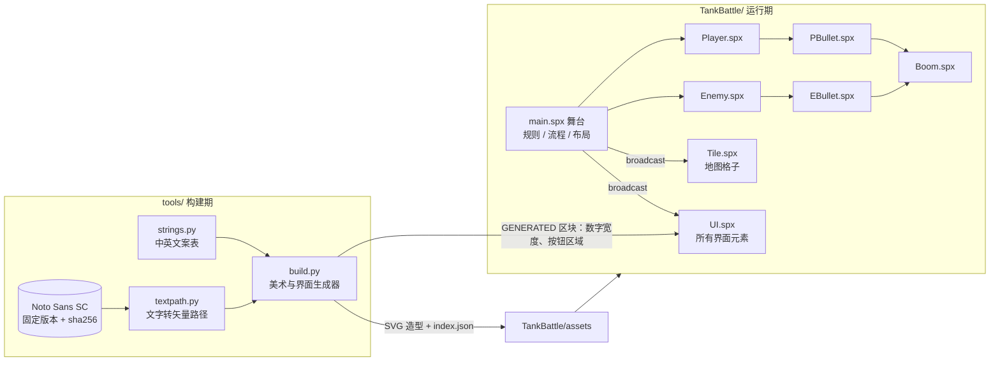
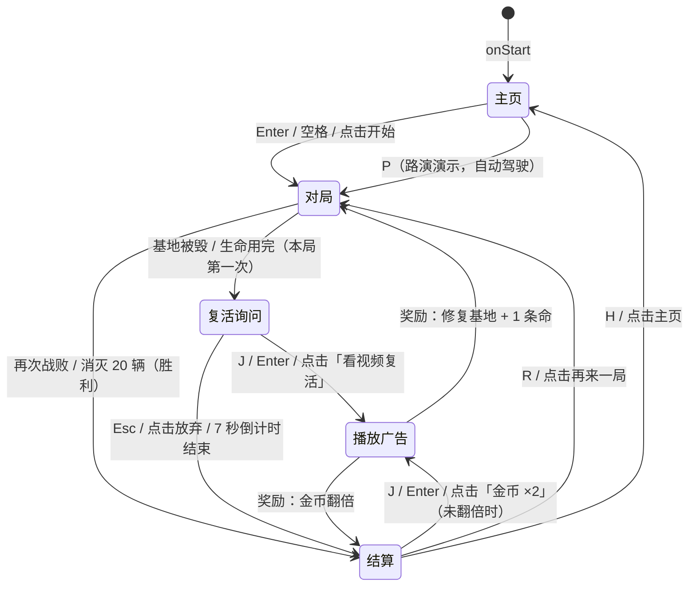

# 坦克大战 2026 · 架构文档

本文说明 v2.0 的整体结构、每个模块的职责和接口、关键的技术约束，以及开发流程与分工。玩法和商业化的设计思路见 [v2 设计方案](v2/DESIGN.md)。

## 目录

1. [技术栈与运行环境](#1-技术栈与运行环境)
2. [总体结构](#2-总体结构)
3. [模块规格](#3-模块规格)
4. [消息表](#4-消息表)
5. [游戏流程状态机](#5-游戏流程状态机)
6. [坐标与布局](#6-坐标与布局)
7. [文字、多语言与防乱码](#7-文字多语言与防乱码)
8. [广告](#8-广告)
9. [spx 解释器的限制与对策（重要）](#9-spx-解释器的限制与对策重要)
10. [测试与演示视频](#10-测试与演示视频)
11. [开发流程与分工](#11-开发流程与分工)

## 1. 技术栈与运行环境

| 项目 | 说明 |
|---|---|
| 语言 | [XGo](https://xgo.dev)（`.spx` 类文件：`main.spx` 是舞台，其他每个文件是一个精灵） |
| 引擎 | [spx 4.0](https://github.com/goplus/spx)，底层是 Godot 4.4，SVG 由 LunaSVG 光栅化 |
| 运行方式 | ① [XBuilder](https://x.qiniu.com) 网页版：导入 `TankBattle.xbp` 运行；② 本地：`spx run .`（解释执行，和网页版用同一个解释器） |
| 画布 | 480×360（XBuilder 固定的运行尺寸，见[设计方案](v2/DESIGN.md#一技术确认画布尺寸)） |
| 资源生成 | Python 3 + fontTools：`tools/assets/build.py` 用代码生成 SVG 造型，`strings.py` 是中英文案表 |

## 2. 总体结构

设计原则：

- **舞台持有全部状态**（`grid`、分数、生命、`state`、语言、画风），精灵只负责表现和自己的运动；精灵之间不直接互相改状态，而是调用舞台的函数或者广播消息。
- **逻辑与表现分离**：画风、语言都只是一个变量。造型名按约定加后缀（`brick` / `brick_m`，`score_zh` / `score_en`），切换时只换造型，不改逻辑。
- **能生成的就不手画**：造型、界面文字、数字宽度、按钮点击区域都由 `build.py` 生成，改布局或文案时不会出现“画面和代码对不上”。

## 3. 模块规格

### 3.1 舞台 `main.spx`

| 分组 | 主要内容 |
|---|---|
| 状态 | `grid []int`（0 空地 1 砖 2 钢 3 裂砖 4 水 5 草 9 基地）、`score` `best` `lives` `killed` `spawned`、`theme`（0 经典 1 现代）、`lang`（0 中 1 英）、`state`、`screen`、`revived` `coins` `doubled`、广告关闭状态、自动驾驶状态 |
| 地图 | `levelMap()`、`buildMap()`、`cellX/cellY/cellIndex/cellAt`、`tankBlocked()`、`blocksTank()` |
| 子弹判定 | `bulletHit()`（弹头左右两个检测点）→ `hitPoint()` → `breakBrick()` / `baseDestroyed()` |
| 规则 | `spawnEnemy()`（左中右轮流出生，最多同时 4 辆）、`enemyKilled()`、`defeat()`、`endGame()` |
| 流程 | `goHome()`、`startGame()`、`watchAd()`、`revive()`、`showResult()`、`setScreen()`、`confirm()`，见[第 5 节](#5-游戏流程状态机) |
| 表现 | `look()`（画风后缀）、`langCode()`、`switchTheme()`、`switchLang()`、`toast()`、`shake()`、基地特写镜头 |
| 界面布局 | `buildHud()`：创建所有 UI 克隆，坐标见[第 6 节](#6-坐标与布局) |
| 路演演示 | `demoFlow` 消息处理、`autopilotDir()`、`seeEnemy()`、`autopilotBlocked()`、`waitState()` |

### 3.2 精灵

| 精灵 | 职责 | 对外接口 | 字段大小 |
|---|---|---|---|
| `Player` | 玩家坦克：键盘 / 自动驾驶移动、开火（同时只能 1 发）、出生保护闪烁、引擎声 | `respawn()`；收 `playerHit` `themeChanged` | 32 B |
| `Enemy` | 敌人坦克：三种类型，随机转向且偏向基地，定时开火；重型坦克 3 发 | `spawn(x, y, kind)`；收 `themeChanged` `clear` | 56 B |
| `PBullet` / `EBullet` | 子弹：飞行、撞墙（交给 `bulletHit`）、互相抵消、命中坦克 | `fire(x, y, dir)` | 16 B |
| `Boom` | 爆炸动画（3 帧），大爆炸触发震屏 | `explodeAt(x, y, size)` | 1 B |
| `Tile` | 地图格子的显示：砖、钢、水、草、基地。碰撞全部由舞台的 `grid` 判断 | `build(x, y, kind, idx)`；收 `gridChanged` `themeChanged` `baseChanged` `clear` | 16 B |
| `UI` | **所有界面元素**，用 `kind` 区分（见下表） | `label` `number` `icon` `langButton` `toastBar` `adSlot` `screenLayer` | 56 B |

“字段大小”是精灵自己声明的变量的总字节数，它会影响解释器能否启动，见[第 9 节](#9-spx-解释器的限制与对策重要)。

### 3.3 `UI` 的 kind

| kind | 用途 | 造型名 | 刷新时机 |
|---|---|---|---|
| `kLabel` | 文字标签 | `<key>_<zh\|en>` | `langChanged` |
| `kScore` / `kBest` / `kCoin` | 数字的一个字符位（每个数字由多个克隆组成） | `S0`…`S9` `Scomma`，`B…`，`C…` | `hud` |
| `kPip` / `kLife` | 敌军剩余格子 / 生命图标 | `pip_on/off`、`life_on/off` | `hud` |
| `kLang` | 中 \| EN 按钮（可点击） | `toggle_<lang>` | `langChanged`、`screen` |
| `kToast` | 提示条（自动隐藏） | `msg.*_<lang>` | `toast` |
| `kAd` | 广告位：原生广告卡 `card` / 主页横幅 `banner`（可点击、可关闭） | `card_<lang>`、`banner_<lang>` | `screen`、`langChanged` |
| `kScreen` | 全屏 / 弹窗画面（可点击） | `home`、`revive_<n>`、`adplay_<n>`、`result_<win\|lose>_<plain\|done>`，再加 `_<lang>` | `screen` |

### 3.4 构建工具 `tools/`

| 文件 | 职责 |
|---|---|
| `assets/strings.py` | 中英文案表（唯一来源），游戏和效果图共用 |
| `assets/textpath.py` | 把文字转成 SVG 路径；字体固定到 google/fonts 的某个提交并校验 sha256；缺字直接报错 |
| `assets/build.py` | 生成：两套背景、现代画风的所有造型、经典画风的水面和草丛、`UI` 精灵的全部造型和 `index.json`、`UI.spx` 里的 `GENERATED widths` / `GENERATED hit` 区块 |
| `package_xbp.sh` | 打包 `TankBattle.xbp` |
| `dev/shot.sh` | 本地运行游戏，只截取游戏窗口（不截整个屏幕），自动裁出 4:3 画面 |
| `dev/record_demo.sh` | 录制路演演示视频（见[第 10 节](#10-测试与演示视频)） |
| `docs/v2/mockups/gen.py` | 生成设计效果图 |

## 4. 消息表

| 消息 | 发送方 | 接收方 | 含义 |
|---|---|---|---|
| `clear` | 舞台（`broadcastAndWait`） | Tile、Enemy、子弹、Boom | 清空战场上的克隆 |
| `gridChanged` | 舞台 `breakBrick` | Tile（砖墙） | `grid` 变了，砖墙对照 `grid` 更新：裂开或消失 |
| `baseChanged` | 舞台 | Tile（基地） | 基地被毁 / 修复 |
| `themeChanged` | 舞台 `switchTheme` | Tile、Player、Enemy | 换画风 |
| `langChanged` | 舞台 `switchLang` | UI | 换语言 |
| `hud` | 舞台、Player | UI | 分数、生命、敌军剩余、金币变了 |
| `toast` | 舞台 `toast()` | UI（提示条） | 内容在舞台的 `toastKey` / `toastSecs` |
| `screen` | 舞台 `setScreen`（`broadcastAndWait`） | UI | 画面切换：画面层置顶，广告位按状态显示 / 隐藏 |
| `raise` | 舞台 `setScreen` | UI | 把广告位、语言按钮、提示条、金币数放到画面层之上 |
| `playerHit` | EBullet | Player | 玩家被击中 |
| `pbHit` / `clash` | Enemy / PBullet | PBullet / EBullet | 子弹命中坦克后消失 / 子弹相撞互相抵消 |
| `shake` / `baseCam` | 舞台 | 舞台 | 震屏 / 基地特写镜头 |
| `reviveFlow` / `adFlow` / `gameEnd` | 舞台 | 舞台 | 复活倒计时 / 模拟激励视频 / 结算音乐（需要 `wait` 的流程放在消息处理里异步执行） |
| `demoFlow` / `demoDone` | 舞台 | 舞台 | 路演演示脚本开始 / 结束 |

## 5. 游戏流程状态机

- `state` 取值：`stHome` `stPlay` `stRevive` `stAd` `stResult`。按键处理都先看 `state`，同一个键在不同画面有不同含义。
- `gameOver` 表示“战场冻结”，坦克和子弹在冻结时不动。除了 `stPlay` 以外的状态，战场都是冻结的。
- 每局只能复活一次（`revived`），金币只能翻倍一次（`doubled`）。

## 6. 坐标与布局

舞台坐标以中心为原点，y 向上；生成器和效果图用 SVG 坐标（左上角为原点，y 向下）。换算：`舞台 x = svgX - 240`，`舞台 y = 180 - svgY`。

| 区域 | SVG 坐标 | 舞台坐标 |
|---|---|---|
| 战场（13×13 格，每格 24px） | (12, 30) 起，312×312 | 左上角 (-228, 150) |
| 顶栏：关卡名 / 敌军剩余 / 语言按钮 | y = 9…21 | y ≈ 160…164 |
| 右侧面板 | (336, 26) 起，132×320 | x = 96…228 |
| 原生广告卡 | (342, 250)，120×86 | 中心 (162, -113) |
| 主页横幅 | (16, 316)，448×32 | 中心 (0, -152) |
| 弹窗（复活 / 结算） | (58, 76)，220×220 | 盖在战场中央 |

按钮的点击区域由 `build.py` 的 `button()` 记录，生成到 `UI.spx` 的 `hit()`，不要手改。

## 7. 文字、多语言与防乱码

- **运行时不用字体**。v1 的乱码来自字体子集缺字（没有拉丁字母、`× · ¥ 「」` 等）。v2 把所有文字在构建时转成矢量路径，造型用 `bitmapResolution: 4`，放大后依然清晰。
- **缺字检查**：`textpath.py` 发现字体里没有某个字就直接报错，构建失败，不会悄悄产生乱码。
- **加一段文案的步骤**：在 `strings.py` 加 `key: (中文, English)` → 在 `build.py` 里决定它的样式和位置（标签放进 `LABELS`；`msg.*` 开头的会自动变成提示条）→ 运行 `build.py` → 在 `.spx` 里用 key 引用。
- 动态数字用“字符位”克隆拼出来：每个数字字体等宽，逗号单独一个窄格，宽度表由生成器写进 `UI.spx`。

## 8. 广告

| 广告位 | 形式 | 出现时机 | 实现 |
|---|---|---|---|
| 主页底部 | 横幅（Anchor Banner），可关闭 | 只在主页 | `UI` kAd `banner` |
| 右侧面板底部 | 原生广告卡（Native），可关闭 | 对局、复活询问、结算 | `UI` kAd `card` |
| 复活询问 | 激励视频，奖励：修复基地 + 1 条命 | 每局第一次战败 | `watchAd(rewardRevive)` |
| 结算 | 激励视频，奖励：金币 ×2 | 结算时，可选 | `watchAd(rewardDouble)` |

- **战场里没有任何广告**；激励视频完全由玩家自愿选择；播放广告时其他广告位和语言按钮都会隐藏。
- 广告按钮统一用 Google 蓝并带「广告 / Ad」标识，游戏自己的按钮用橙色。
- **目前是模拟广告位**：`adFlow` 播放 5 秒的示例素材，画面上标明了「模拟广告位」。spx 画布里接不进广告 SDK，正式上线有两条路：
  - **网页版**：把游戏嵌入网页，激励视频和插屏接入 Google **H5 Games Ads（Ad Placement API）**，横幅和原生广告放在网页里（或者在画布上保留位置，由网页叠加）。游戏里只需要把 `watchAd` 改成通知网页、等待网页回调后再发奖励。
  - **手机版**：接入 **AdMob**，流程相同。

## 9. spx 解释器的限制与对策（重要）

这些是开发 v2 时通过源码阅读和对照实验确认的，**改代码前请先读**。

### 9.1 方法表上限（启动报错 `cannot alloc method ... cap:2560`）

- 本地 `spx run` 和 XBuilder 网页版都用 `pkg/ispx` 解释器，它的方法表（reflectx icall）全局只有 **2560** 个位置，v1 已经接近上限。
- 实测规律：精灵类型的数量影响很小；**每出现一种“新的字段总大小”的精灵类型，就要多占约 110 个位置**（同样大小的类型会共用）。例如 `UI` 用 56 字节（和 Enemy 相同）可以运行，多加一个 `int` 变成 64 字节就启动失败。
- 对策：
  - 新界面元素一律做成 `UI` 的新 kind，**不要给 `UI` 加字段**；需要的数据放在舞台变量里。
  - 改任何精灵的字段时，让字段总大小保持在现有的几种之一：1、16、32、56 字节（按 Go 的结构体对齐计算）。
  - 舞台的变量和函数不受影响，可以放心加。
  - 调试方法：在临时副本里改，`spx run` 看是否报错。

### 9.2 通用消息处理只在原型上运行

- spx 4.0 里 `onMsg (msg, data) => { ... }` **只会在原型上运行，克隆体收不到**。具体的 `onMsg "名字", => { ... }` 克隆体能收到。
- 对策：克隆体只用具体的 `onMsg "名字"`；需要传数据时，把数据放在舞台变量里，或者像 `gridChanged` 那样让接收方自己去读舞台状态。

### 9.3 其他

- 类文件里**所有 `func` 必须写在第一个事件处理（`onStart` / `onKey` / `onMsg`…）之前**，否则编译报错。
- 精灵造型按**朝右**画（heading 90 时不旋转），和 Scratch 一样。
- LunaSVG **不支持 filter**（阴影、模糊），阴影要画成半透明图形。
- 原型精灵如果把自己 `destroy` 了，之后再 `clone` 会直接崩溃。克隆体判断“我是不是原型”要可靠：`Tile` 在克隆之后把原型的 `kind` 重置为 0。
- XBuilder 的运行尺寸固定为 480×360；地图可以更大，但只能靠镜头滚动。

## 10. 测试与演示视频

- **本地运行**：`cd TankBattle && spx run .`
- **自动截图**：`tools/dev/shot.sh <工程副本> <输出前缀> <秒数…>`。在**工程副本**的 `main.spx` 末尾追加一段 `onStart` 测试脚本（例如 `startGame`、`baseDestroyed`、`watchAd rewardRevive`），就能不靠键盘把各个画面跑一遍。只截游戏窗口，不会截到桌面上的其他内容。PR 里的截图都是这样得到的。
- **注意**：测试脚本只放在副本里，不要提交；脚本开头至少 `wait 3`，让游戏先完成初始化。
- **演示视频**：`tools/dev/record_demo.sh` 复制一份工程，追加“自动开始路演演示、结束后退出”，用 `spx run --movie` 录制。spx 的录像器按实际渲染出的帧写视频、每帧记 1/30 秒，而游戏逻辑按真实时间以 60 Hz 运行，机器渲染跟不上时视频会被“快进”。所以脚本统计游戏逻辑的真实时长，再用 ffmpeg 把视频等比例拉伸回真实速度。录像器的音频同样被压缩，所以成品不带声音。

## 11. 开发流程与分工

### 开发流程

- `main` 是发布分支，`v2.0` 是 v2 的集成分支。
- 每个功能一个分支、一个 Pull Request，合入 `v2.0`；最后由 `v2.0` 合入 `main`。不直接往 `main` / `v2.0` 推送。
- PR 描述写清楚：改了什么、为什么、怎么验证的（附实机截图）。
- 改了文案或美术代码，要重新运行 `build.py` 并把生成的文件一起提交；发布前运行 `package_xbp.sh` 更新 `.xbp`。

### v2.0 的 PR 记录

| PR | 内容 |
|---|---|
| #1 | 设计方案与中英文效果图（画布技术确认、防乱码方案、广告原则） |
| #2 | 美术资源生成管线 + 480×360 新布局 |
| #3 | 新 HUD + 中英文切换（文字烘焙为矢量路径；解释器方法表上限的排查与对策） |
| #4 | 广告位 + 游戏流程（主页、复活、激励视频、结算） |
| #5 | 草丛和水面地形；修复格子收不到消息 |
| #6 | 路演演示模式、默认现代画风、演示视频、架构文档、README、`.xbp` |

### 分工

| 模块 | 负责人 | 内容 |
|---|---|---|
| 产品与玩法设计 | dn-mbp14-qn | 2026 版玩法、商业化方案、路演叙事 |
| 游戏逻辑（`main.spx` 及各精灵） | dn-mbp14-qn | 规则、流程状态机、复活与结算、地形、路演演示模式 |
| 美术与界面管线（`tools/assets`） | dn-mbp14-qn | 生成器、现代画风、HUD 与弹窗、文字转路径 |
| 商业化（广告位） | dn-mbp14-qn | 广告位设计与实现、正式接入方案 |
| 测试、演示视频与文档 | dn-mbp14-qn | 实机截图验证、演示视频、架构文档 |

开发全程使用 AI 编程助手（Claude Code）结对完成：人负责方向、取舍和验收，AI 负责实现和验证，每一步都通过 PR 留下记录。团队成员加入后，请在这张表里补充各自负责的模块。
