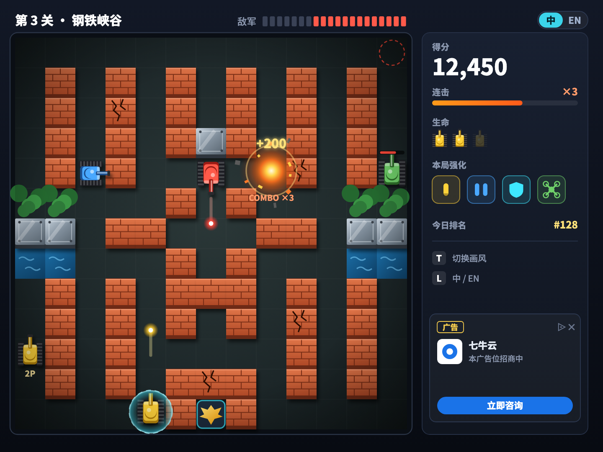
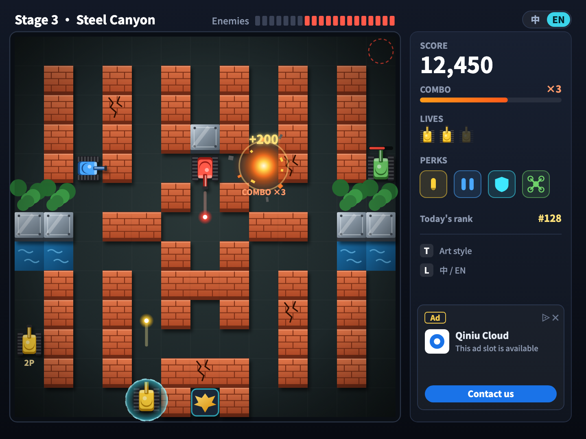
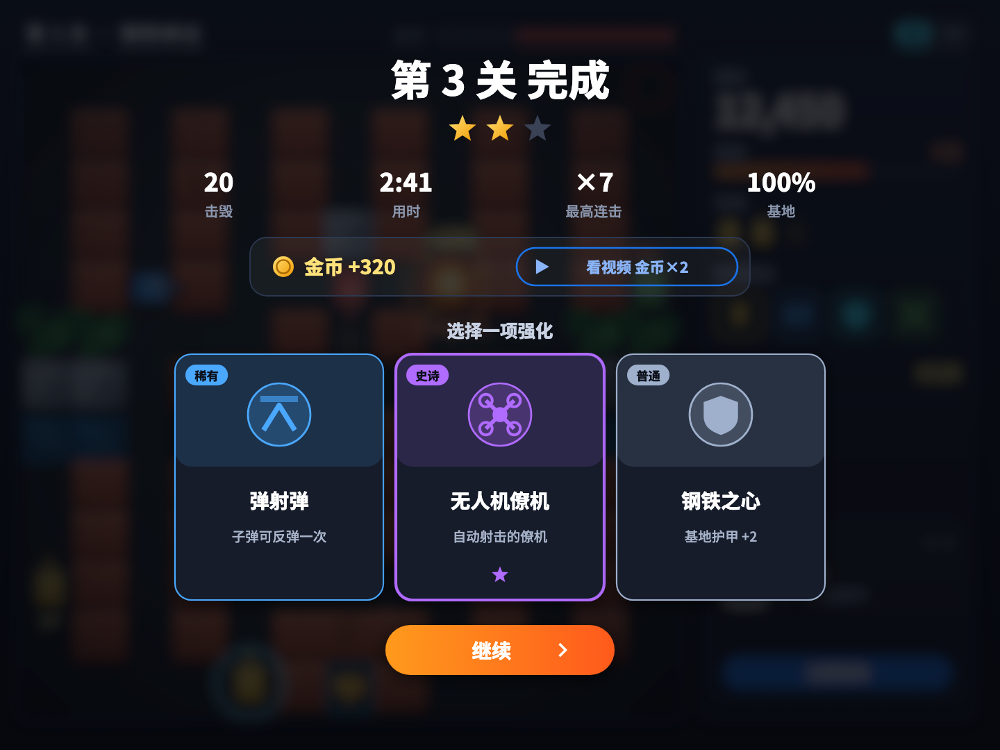
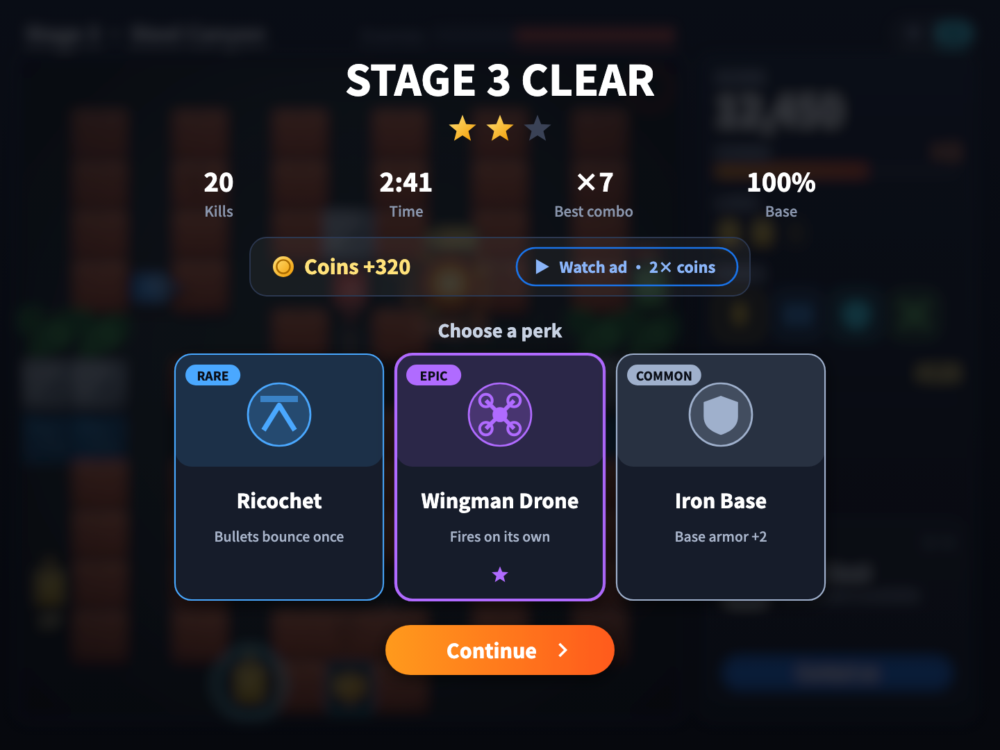
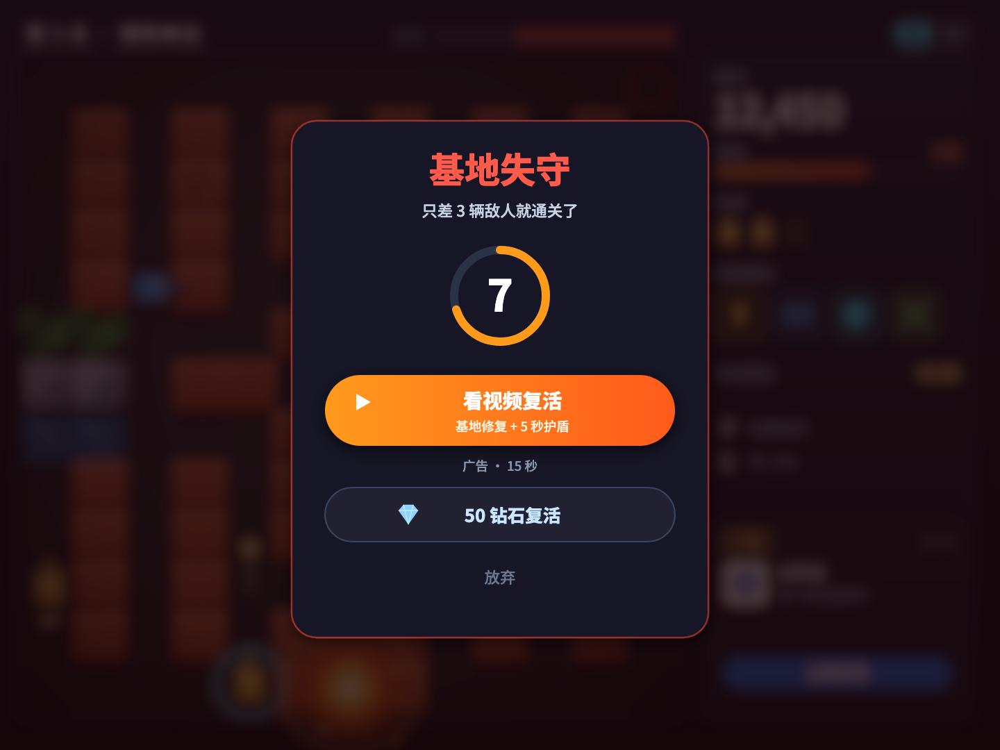
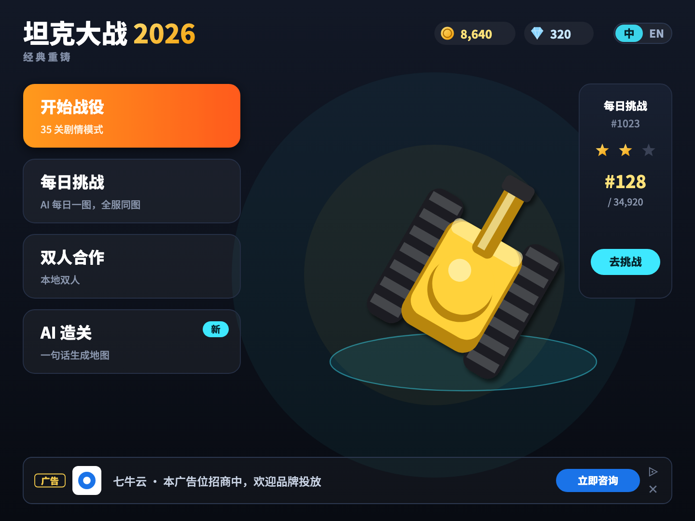
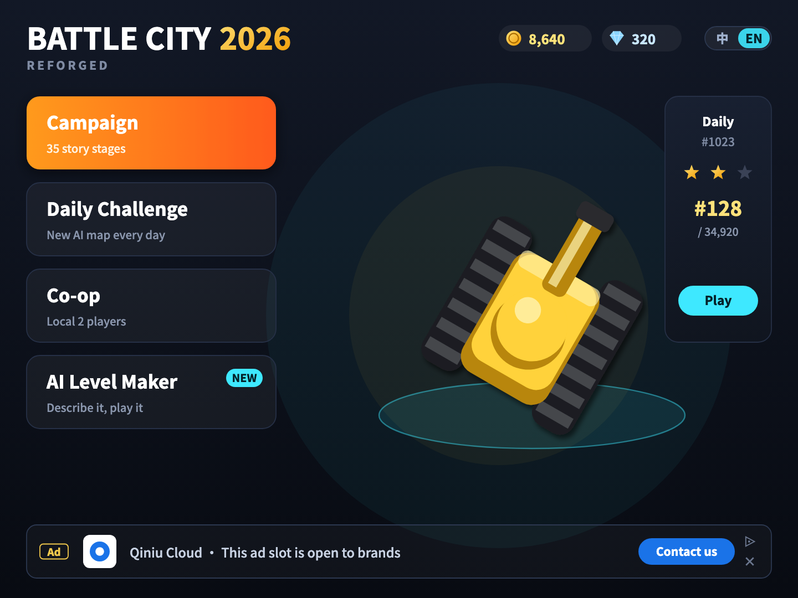

# 坦克大战 2026 · v2.0 设计方案

> 1985 年的玩法内核保留：保护老鹰、打砖墙、20 辆敌人一关。
> 在此基础上，按 2026 年的玩家习惯重做“为什么还想再玩一局”和“怎么赚钱”。

## 效果图（中 / 英）

| | 中文 | English |
|---|---|---|
| 对局 |  |  |
| 通关 · 强化三选一 |  |  |
| 基地失守 · 复活 |  |  |
| 主页 |  |  |

效果图按游戏真实的 **480×360** 画布绘制，导出时放大 3 倍。重新生成的方法：

```sh
pip install fonttools brotli
python3 docs/v2/mockups/gen.py --font NotoSansSC[wght].ttf   # 字体见下文「字体与防乱码」
sh docs/v2/mockups/render.sh
```

---

## 一、技术确认：画布尺寸

结论：**XBuilder 上只能用 480×360（4:3），不能做 16:9。** v2.0 的布局全部按 480×360 设计。

| 来源 | 结论 |
|---|---|
| spx 引擎 `internal/core/project/config.go` | 舞台配置里有 `map.width / height / mode`，窗口大小来自 `run.width / height`。不配置时取背景图尺寸 |
| spx `game.go` | 基准屏幕是 `480 × 360`，UI 坐标也按这个尺寸计算 |
| XBuilder `spx-gui/src/models/spx/project.ts` | 运行尺寸**固定为 480×360**，源码注释是 “For now runConfig will be ignored, as the fixed viewport / run size is used in builder”（自定义尺寸还是 TODO） |
| XBuilder `stage.ts` | 地图可以比 480×360 大，但多出来的部分要靠镜头滚动，不会扩大可视范围 |
| spx `ResolvePlatformLayout` | 网页端会按容器等比放大，所以 480×360 在大屏上也是清晰的（矢量造型） |

布局方案：13×13 的战场（每格 24px，共 312px）放在左边，右侧留 132px 做 HUD 面板，顶部 30px 是标题栏，正好填满 480×360，和 v1 的坐标体系兼容。

## 二、字体与防乱码

**原因**：v1 用的 `basic-chinese.ttf` 是删掉了拉丁字母的子集，只有 GB2312 一级汉字。数字、字母、`× · ¥ 「」`、emoji 都没有，只能靠引擎自带的一个小号拉丁字体兜底；字体里没有的字就会显示成方块或乱码。

**v2.0 的做法**：

1. 改用 **Noto Sans SC**（SIL OFL 1.1 开源协议，可以商用和打包）。一套字体同时覆盖中文和英文，分 Medium / Bold 两个字重。
2. 所有文案集中在 `mockups/i18n.py`，中英文各一份。效果图和游戏共用这张表。
3. **生成时检查字形**：`gen.py` 会逐字检查字体里有没有这个字形，缺字就直接报错，不会悄悄出乱码。
4. **不用 emoji**：金币、钻石、播放这类图标都画成矢量图形。
5. 效果图 SVG 里直接内嵌了字体子集，用任何浏览器、在任何电脑上打开，显示都一样。

游戏里用同样的流程：从文案表加上 GB2312 一级汉字，生成项目字体子集，替换 `assets/fonts/basic-chinese`。

## 三、中英文切换

- 主页和对局顶栏右上角都有 **中 | EN** 切换按钮，当前语言高亮；对局中按 **L** 键也可以切换。
- 实现：在舞台上加一个 `lang` 变量，所有文字都通过 `tr(key)` 取，与 v1 的 `look()` 切换画风是同一个思路。
- 英文版要单独检查排版：英文通常更长，效果图已经按英文最长的文案留出空间（例如 “Stage 3 · Steel Canyon”）。

## 四、广告：干净、不打扰

参照 Google AdMob / AdSense 的规范，原则是：

- **战场里没有任何广告**：没有广告牌，没有品牌空投，对局中也不会弹出广告。
- **每个画面最多一个广告位**，并且都有清楚的「广告 / Ad」标识，加上 AdChoices 图标和关闭按钮。
- **广告按钮用 Google 蓝**，游戏自己的主按钮用橙色。玩家一眼就能分清哪个是广告、哪个是游戏操作。
- 看激励视频全凭玩家自愿，任何时候都有不看广告的选择。

| 画面 | 广告形式 | 位置 | 说明 |
|---|---|---|---|
| 对局 | 原生广告卡（Native） | 右侧 HUD 面板底部 | 不遮挡战场，可以关闭 |
| 通关 | 激励视频（Rewarded） | 金币那一行的次要按钮 | 看视频金币 ×2。主按钮仍然是「继续」 |
| 基地失守 | 激励视频（Rewarded） | 复活主按钮 | 转化率最高的位置。旁边有钻石复活和放弃两个选项 |
| 主页 | 横幅（Anchor Banner） | 页面底部 | 只在菜单里出现 |

**收入结构**：广告（原生广告、激励视频、横幅）加上内购（钻石、去广告）。去广告只去掉原生广告和横幅，激励视频保留，因为那是玩家自己选择看的。

**落地方式**：spx 画布里接不进 Google 广告 SDK。路演时，广告位先用游戏内的造型模拟（就是效果图里的样子）。正式上线时有两条路：

- 发布网页版：把游戏嵌入网页，用 Google **H5 Games Ads（Ad Placement API）** 接入激励视频和插屏，原生广告和横幅放在网页上。
- 发布手机版：接入 **AdMob**。

## 五、游戏性

| 原版的问题 | v2.0 的设计 |
|---|---|
| 每关都一样 | **Roguelite 强化**：每关结束 3 选 1（弹射弹、无人机僚机、钢铁之心……） |
| 节奏慢 | **3 分钟一关**，加上连击计分（连续击毁会累计倍率）和飘字反馈 |
| 玩完就走 | **每日挑战**：AI 每天生成一张地图，全服同图排名 |
| 一个人玩 | **双人合作**（本地双人） |
| 关卡数量有限 | **AI 造关**：一句话生成地图，呼应黑客松“AI 放大执行”的主题 |
| 地形单调 | 新增草丛（可以藏身）和水面（过不去），敌人出生前有红圈预警 |

## 六、画面风格：「微缩战场」

- 正俯视角。墙体加 3px 厚度和投影，形成伪 3D 的桌面沙盘感。
- 暖色砖墙、冷色钢墙，子弹和爆炸用发光特效，护盾是青色能量罩，战场四周加暗角。
- 界面统一用深蓝色面板。数字信息用颜色区分：金色表示分数和排名，橙色表示连击。
- 保留 T 键切回 1985 像素风（v1 已实现）。

## 七、实现路线

| 阶段 | 内容 | 状态 |
|---|---|---|
| P0（路演必备） | 480×360 新布局和 HUD、新美术资源、防乱码（文字转矢量路径）、中英文切换、4 个广告位（模拟） | ✅ 已完成（#2 #3 #4） |
| P0+ | 复活机制、结算与金币、主页、草丛和水面、路演演示模式、默认现代画风 | ✅ 已完成（#4 #5 #6） |
| P1 | 强化三选一、连击计分 | 待做 |
| P2 | 每日挑战（固定种子）、本地双人 | 待做（主页上标为「即将推出」） |
| P3（路演后） | AI 造关；发布网页版并接入 H5 Games Ads，或发布手机版接入 AdMob | 待做 |

实现细节和技术约束见[架构文档](../ARCHITECTURE.md)。
