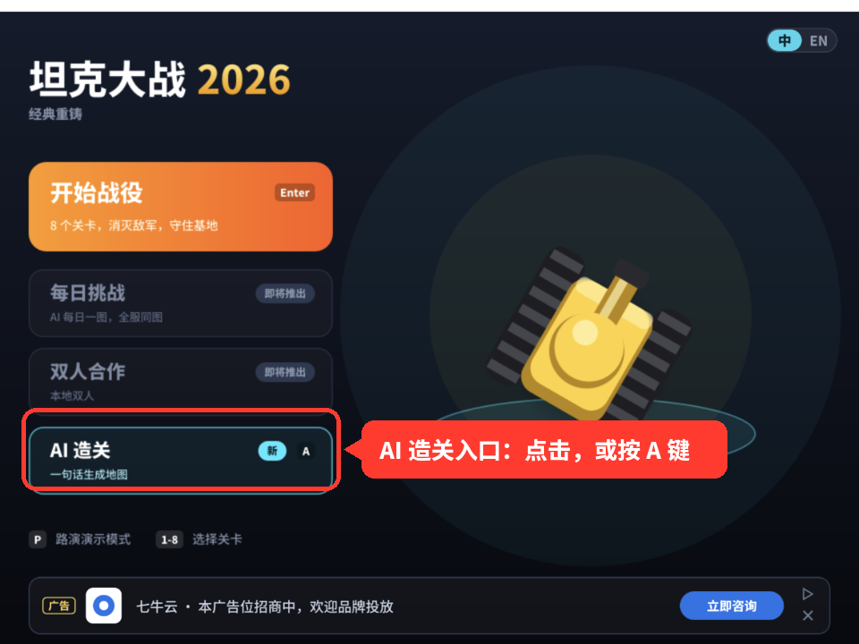
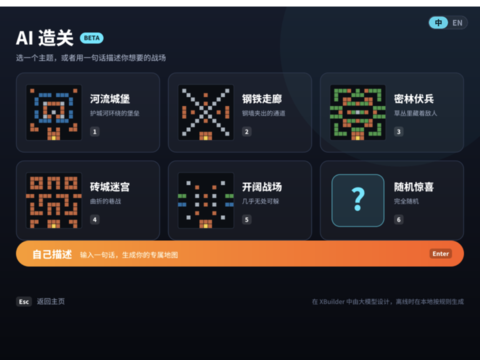
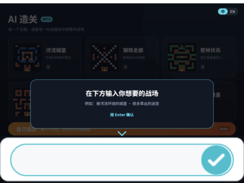
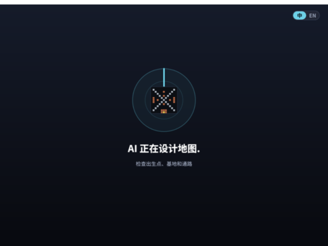
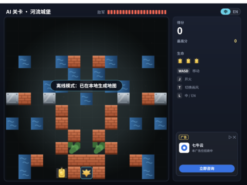
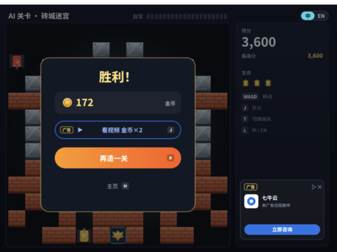
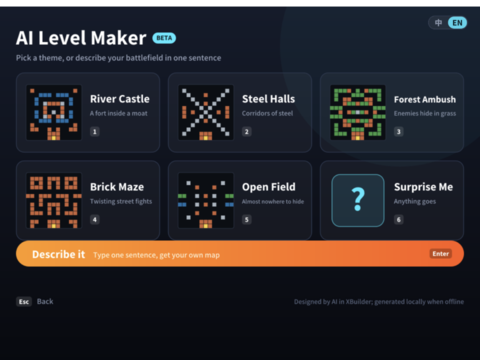
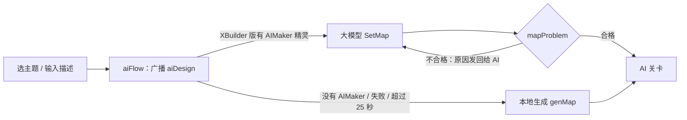
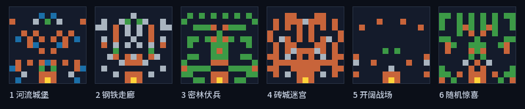
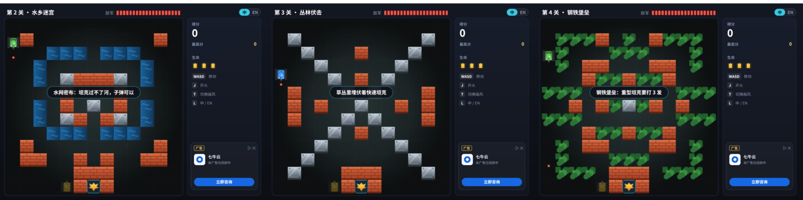

# 坦克大战 v3.0 · AI 生成关卡

> 目标：玩家选一个主题，或者输入一句话（比如“被河流环绕的城堡”），几秒后就在新设计的地图上开战。
>
> 本文是 [v3.0 规划](PLAN.md)的一部分。文中截图都是 2026-10-24 在本机用 `spx run`（和 XBuilder 网页版用同一个解释器）实际运行的画面。

## 结论与现状

| 部分 | 状态 |
|---|---|
| 主页入口、AI 造关页面、设计中画面、AI 关卡、结算「再造一关」 | ✅ 已实现（[PR #11](https://github.com/Qiniu-ERE/zero/pull/11)），风格和游戏一致 |
| 地图检查（`mapProblem`，和 `tools/levels/check.py` 规则相同） | ✅ 已实现 |
| 本地程序化生成（按主题的地形风格，保证合格） | ✅ 已实现，所有平台都能用 |
| 输入框显示中文（项目字体） | ✅ 已实现 |
| 接入 XBuilder 大模型（`ai.Player`） | 📝 接入代码已写好（[`ai/AIMaker.spx`](ai/AIMaker.spx)），**只能在 XBuilder 网页版里测试**，还没测 |

**一句话：现在本地就能完整玩 AI 造关（地图由本地规则生成）。在 XBuilder 里加上一个精灵文件，就会改成由大模型设计。**

---

## 一、入口在哪里

主页左侧第四张卡片「AI 造关」（原来标着“即将推出”，现在可以点了）。**点击它，或者在主页按 A 键**。



## 二、页面和流程

| ① AI 造关页面：6 个主题 + 自己描述 | ② 自己描述：在底部输入框输入 | ③ AI 正在设计地图（3 帧动画） |
|---|---|---|
|  |  |  |
| **④ 进入 AI 关卡**（顶栏显示主题） | **⑤ 胜利后「再造一关」**；战败「再来一局」重打同一张图 | **英文版** |
|  |  |  |

| 操作 | 作用 |
|---|---|
| 1 ~ 6 / 点击主题卡片 | 按主题设计：河流城堡、钢铁走廊、密林伏兵、砖城迷宫、开阔战场、随机惊喜 |
| Enter / 点击「自己描述」 | 打开底部输入框，输入一句话，按 Enter 确认（空白则返回） |
| Esc / 点击「返回主页」 | 回到主页 |

### 2.1 页面为什么这样设计

上一版的试验截图里，输入框的提示文字超出了屏幕，白色输入框也和游戏风格不搭。原因查清楚了：

- `ask` 的输入框是 spx 引擎内置的 Godot 界面（`internal/ui/ui_ask.go`），**位置固定在屏幕底部（约 y = 270~360），样式不能改**。
- 提示文字只有一行，太长就会被截断。
- 但是 `ask ""`（提示为空）时，引擎只显示输入框，不显示提示行。

所以现在的做法是：**整个页面由 `build.py` 按游戏风格生成**，页面内容只用到 y = 262 以上，底部留给输入框；提示文字（“在下方输入你想要的战场”、例子、“按 Enter 确认”）画在页面里，并用箭头指向输入框。白色输入框本身仍然是引擎的样式，这是目前唯一和游戏风格不一致的地方，见第五节。

英文版的主题名比中文长，卡片上的文字会自动缩小字号，保证不超出卡片。

### 2.2 输入框显示中文

spx 默认字体没有中文，玩家输入的中文会显示成方块。现在工程里加了项目字体 `assets/fonts/Noto Sans SC/`（GB2312 一级汉字 + ASCII + 常用标点，1.1 MB，由 `build.py` 生成），并在 `assets/index.json` 里设置了 `fontPreferences`。界面上的其他文字仍然烘焙成矢量路径，不依赖这个字体。

---

## 三、地图是怎么来的



### 3.1 地图检查 `mapProblem()`

把 `tools/levels/check.py` 的规则移植到了 `main.spx`：13×13、只用 `. B S W G E`、基地在第 12 行第 6 列、三个敌人出生点和玩家出生点是空地、基地旁边不是钢墙或水面、每个出生点都能到基地、玩家能到每个出生点（砖墙算能打通）。返回的是中文说明，接入大模型后会原样发回给 AI，让它改正。

### 3.2 本地程序化生成 `genMap()`

1. 随机生成左半边（0~6 列），右半边镜像，保证左右对称；
2. 按主题的权重放砖墙、钢墙、水面、草丛，奇数列更密（和原版的竖墙布局相似）；
3. 固定基地和基地周围的砖墙；
4. 用 `mapProblem()` 检查，不合格就重来，最多 80 次，还不行就用第 1 关的地图。

“自己描述”时，`themeOf()` 从描述里找关键词选主题（河 / 水 → 河流城堡，钢 / 铁 → 钢铁走廊，草 / 林 → 密林伏兵，砖 / 城 / 迷宫 → 砖城迷宫，开阔 / 平原 → 开阔战场，中英文都支持），找不到就随机。这时 AI 关卡开场会提示“离线模式：已在本地生成地图”。

6 个主题实际生成的地图（在 `spx run` 里生成，又用 `check.py` 复查，全部合格）：



**本地生成的局限**：它只能控制地形的比例和疏密，做不出“城堡被护城河围住”这样有整体构思的布局（对比上图第 1 张和页面上“河流城堡”的示意图）。这正是需要大模型的地方。

### 3.3 大模型生成（XBuilder 版）

XBuilder 有面向游戏的 AI 接口 `ai.Player`（来源：[goplus/builder](https://github.com/goplus/builder) 的 `tools/ai/`，产品文档 `docs/product/ai-interaction.zh.md`）：

| API | 在 AI 造关里的用法 |
|---|---|
| `setRole 角色, 上下文` | 关卡设计师：写明地图格式、硬性规则、风格和示例地图 |
| `onCmd SetMap, (cmd) => {...}` | AI 通过 `SetMap{Rows []string}` 交地图；不合格就 `return errorf(原因)`，AI 会根据原因修改，一次 `think` 最多来回 20 轮 |
| `think 消息` | 发送主题或玩家的描述（`aiRequest()`） |
| `onErr` | 失败时打印原因，游戏自动改用本地生成 |

在 XBuilder 网页版里，接口地址和用户的登录令牌由页面自动配置，**不需要我们自己的服务器或 API key**。

接入代码已经写在 [`docs/v3/ai/AIMaker.spx`](ai/AIMaker.spx)：它是一个独立的精灵，收到 `aiDesign` 后请求大模型，通过舞台变量 `aiBusy` / `aiRows` / `aiByModel` 和游戏通信。`main.spx` 不依赖它，所以：

- **XBuilder 网页版**：把 `AIMaker.spx` 放进工程 → 大模型设计地图；
- **本地 `spx run`、导出的 App**：不放这个文件 → 本地生成。

### 3.4 大模型能不能画出合规的地图（会话内验证）

本机没有 XBuilder 的 AI 接口，所以我们按同一套规则，让 Claude（写这份文档的 AI 助手）在会话里根据三句描述直接生成地图。**三张第一次就全部通过检查**，放进游戏也能正常运行，而且有整体构思（护城河加桥、X 形走廊、成片草丛）：



<details>
<summary>三张地图的原文</summary>

```
被河流环绕的城堡    X 形的钢铁走廊      很多草丛的迷宫
.............      .............      .............
.B.........B.      .S.........S.      .GGGB.G.BGGG.
...WWW.WWW...      ..S...B...S..      .G...GGG...G.
..W.......W..      ...S.....S...      .G.BB...BB.G.
..W.SBBBS.W..      ....S.B.S....      ...BGGBGGB...
....B...B....      .B...S.S...B.      GGG.......GGG
..W.B.S.B.W..      .B.B..S..B.B.      ..B.BGSGB.B..
..W.SB.BS.W..      .B...S.S...B.      GGG.......GGG
...WWW.WWW...      ....S.B.S....      ...BGGBGGB...
.B.........B.      ...S.....S...      .G.BB...BB.G.
.BB..B.B..BB.      ..S.......S..      .G...GGG...G.
.....BBB.....      .S...BBB...S.      .GGG.BBB.GGG.
.....BEB.....      .....BEB.....      .....BEB.....
```
</details>

---

## 四、这次探索新发现的限制

| 发现 | 怎么确认的 | 影响和对策 |
|---|---|---|
| **本地解释器里没有 `ai` 包**：只要有文件 `import "ai"`，`spx run` 就报 `not found package ai`，整个游戏启动失败 | 在临时副本里加 `import "ai"` 运行 | AI 代码必须放在独立文件里，只在 XBuilder 版加入（已按这个思路设计，见 3.3） |
| **编译模式也暂时用不了**：spx 检测到 `builder-ai-description.md` 会自动把 AI 模块加进 `go.mod`，但 AI 模块依赖的 spx `v4.0.0` Go 模块 tag 还没发布，编译失败 | `spx runnative` 实测 | 导出的 App 先用本地生成；等 spx 发布 v4 模块 tag 后再试 |
| **`ask` 输入框的位置和样式是引擎固定的** | 读 `internal/ui/ui_ask.go`，实测截图 | 页面给输入框留出底部区域，提示画在页面里（第二节） |
| **引擎默认字体没有中文** | 实测（显示成方块） | 加项目字体（已完成） |

## 五、风险和待验证

| 风险 | 应对 |
|---|---|
| XBuilder AI 后端闭源，用的模型、延迟、额度、限流都不知道 | 在 XBuilder 网页版实测 `AIMaker.spx`，记录延迟和成功率；任何失败都会自动改用本地生成，玩家不会卡住 |
| `AIMaker.spx` 引入 `ai` 包后，解释器方法表是否够用（[架构文档 9.1](../ARCHITECTURE.md)） | 精灵字段只有 1 字节（和 Boom 相同），`ai.Player` 用局部变量；仍需在 XBuilder 里确认能启动 |
| XBuilder 是否使用工程里的 `fontPreferences`（spx 文档说这个字段的含义由上层的 builder 决定） | 在 XBuilder 里确认输入框中文是否正常；不正常就给 XBuilder 提 issue |
| 白色输入框和游戏风格不一致 | 引擎限制。长期办法是给 spx 提 PR，让 `ask` 支持主题色；或者不用 `ask`，改成游戏内的关键词按钮输入 |
| 玩家输入不当内容 | AI 只能通过 `SetMap` 影响游戏，输出只有地图符号；关卡名只显示主题，不显示 AI 写的文字 |

## 六、里程碑

| 阶段 | 内容 | 状态 |
|---|---|---|
| **P0** | 入口、页面、设计中画面、AI 关卡、`mapProblem`、本地生成、项目字体 | ✅ PR #11 |
| **P0** | 在 XBuilder 网页版测试 `AIMaker.spx`：能否启动、延迟、成功率、中文输入 | 待做（需要在 XBuilder 里手动操作） |
| **P1** | 根据实测调整提示词；AI 起的关卡名用气泡显示（有了项目字体以后可以做） | 待做 |
| **P2** | 离线批量生成 + 人工挑选，做「每日挑战」关卡池 | 待做 |
