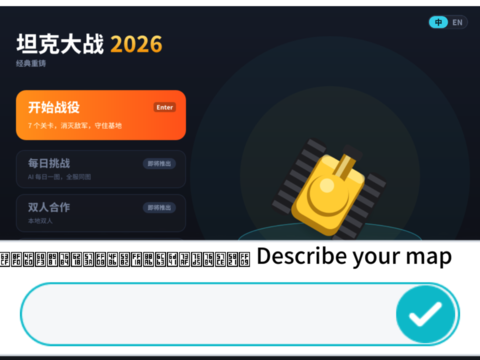
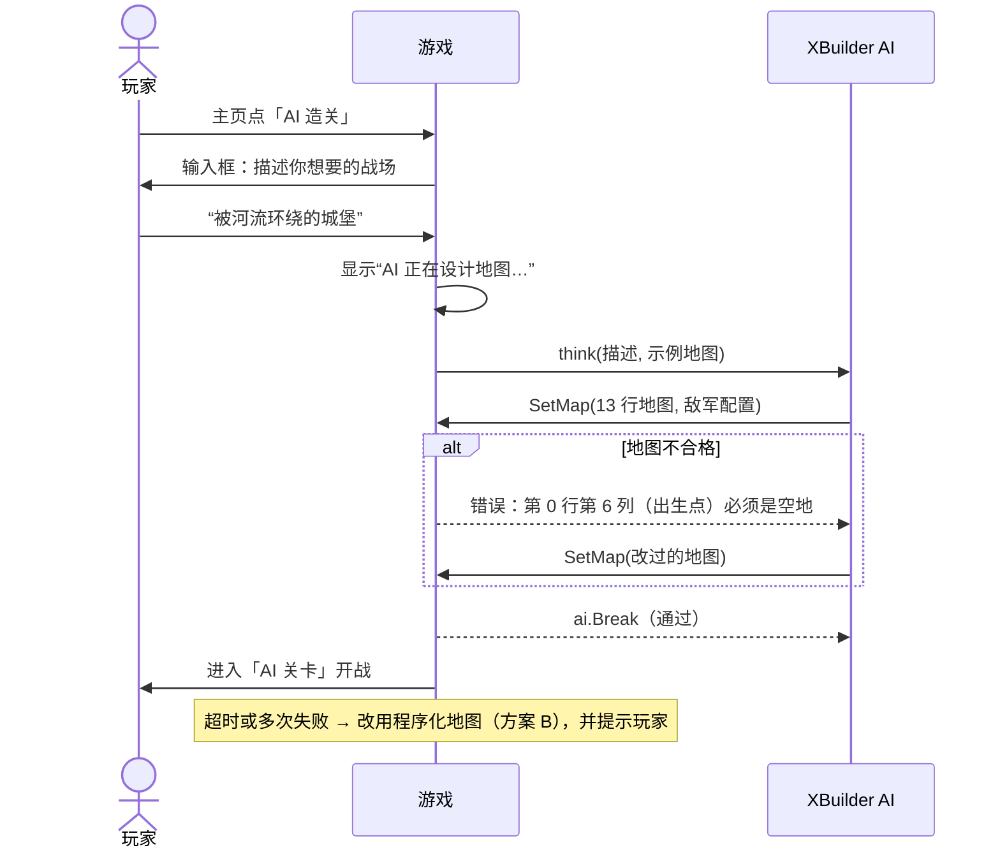

# 坦克大战 v3.0 · AI 生成关卡（可行性方案）

> 目标：主页上的「AI 造关 · 一句话生成地图」（v2 已经放了入口，标着“即将推出”）变成真的。
> 玩家输入一句话，比如“被河流环绕的城堡”，几秒后就能在 AI 设计的地图上开战。
>
> 本文是 [v3.0 规划](PLAN.md)的一部分，只做评估和方案。文中截图都是 2026-10-24 在本机用 `spx run` 实际运行的画面。

## 结论

**可行，而且 XBuilder 已经提供了关键能力。** XBuilder 有一个面向游戏的 AI 接口 `ai.Player`，游戏运行时可以直接调用大模型，不需要我们自己准备服务器或 API key。它支持“命令”：AI 调用游戏注册的命令时，游戏可以检查参数，不合格就把原因返回给 AI，让它改了再交。地图生成正好可以这样做：**AI 出图 → 游戏检查 → 不合格让 AI 改 → 合格就开打**。

| 路线 | 什么时候生成 | 用什么 | 适合 | 推荐 |
|---|---|---|---|---|
| **A. 游戏内实时生成** | 玩家输入一句话的时候 | XBuilder 的 `ai.Player` | 主页「AI 造关」 | ✅ v3.0 主方案 |
| **B. 程序化生成（不用大模型）** | 同上 | 随机 + 对称 + 规则检查，纯 spx 代码 | A 失败、断网、本地 `spx run` 时兜底 | ✅ 和 A 一起做 |
| **C. 离线批量生成** | 开发时 | 脚本调用 Claude API，生成后用 `check.py` 筛选，人工挑选 | 扩充关卡包、「每日挑战」 | 之后再做 |

---

## 一、已经确认的事实

### 1.1 XBuilder 的游戏内 AI 接口

来源：[goplus/builder](https://github.com/goplus/builder) 的 `tools/ai/`（`e2a4c45`，2026-10-23）和产品文档 `docs/product/ai-interaction.zh.md`。

| API | 作用 | 在 AI 造关里的用法 |
|---|---|---|
| `var designer ai.Player` | 声明一个 AI 角色，零值就能用 | 关卡设计师 |
| `designer.setRole 角色, 上下文` | 设定身份、规则、风格 | 写明地图格式、符号和硬性规则 |
| `designer.onCmd 命令类型, (cmd) => {...}` | 注册 AI 可以调用的命令。命令是一个结构体，字段支持 `string` `int` `float64` `bool` 和它们的切片，可以用 `desc` 标签写说明 | `SetMap{Rows []string, Heavy int, Fast int}` |
| 命令处理函数返回 `error` | 返回错误时，错误信息会作为反馈发回给 AI，AI 接着改；返回 `ai.Break` 就结束本轮 | 地图不合格时返回具体原因 |
| `designer.think 消息, 上下文` | 发消息给 AI 并执行它调用的命令（阻塞，自动重试） | 把玩家的描述发过去 |
| `designer.onErr (err) => {...}` | 多次重试仍然失败时调用 | 改用程序化地图兜底 |

- 一次 `think` 最多可以有 **20 轮**“AI 调命令 → 游戏反馈”的往返（`transport.go` 的 `ContinuationTurn` 最大是 19）。地图不合格时，AI 有足够的机会改正。
- 在 XBuilder 网页版里，接口地址和用户的登录令牌由页面自动配置（`tools/ispx/ai.go` 的 `xbuilder_set_ai_interaction_api_*`），默认请求 XBuilder 后端的 `/api/ai-interaction`。**游戏开发者不需要自己的 API key。**
- spx 会在工程里有 `builder-ai-description.md` 时自动接入这个模块（spx `cmd/spx/internal/command/builderai/`）。

### 1.2 地图检查工具已经有了

[PR #10](https://github.com/Qiniu-ERE/zero/pull/10) 加了 `tools/levels/check.py`，7 个关卡都用它检查过。规则如下，AI 生成的地图也要满足：

1. 13 行 × 13 列，只能用 `. B S W G E` 六种符号；
2. 基地 `E` 只有一个，固定在第 12 行第 6 列；
3. 三个敌人出生点（第 0 行第 0、6、12 列）和玩家出生点（第 12 行第 4 列）必须是空地；
4. 每个敌人出生点都能到达基地旁边（砖墙能打掉，算作能通过；钢墙和水面不能）；
5. 玩家能到达每个敌人出生点；
6. 基地旁边不能是钢墙或水面（否则敌人永远打不到基地）。

### 1.3 大模型能稳定画出合规的地图（会话内验证）

本机没有 API key，没法真实调用 XBuilder 的 AI 接口。所以我们换了一种方式验证：把上面的规则和三句玩家描述交给 Claude（就是写这份文档的 AI 助手），在会话里直接生成地图。**三张地图第一次就全部通过 `check.py`**，放进游戏后都能正常运行：

| “被河流环绕的城堡” | “X 形的钢铁走廊” | “很多草丛的迷宫，适合埋伏” |
|---|---|---|
| 护城河中间留了桥，城堡在中央 | 两条钢墙对角线交叉成 X，把战场分成四个区域，靠边缘相连 | 草丛成片分布，中间留出通道 |


<details>
<summary>三张地图的原文</summary>

```
被河流环绕的城堡    X 形的钢铁走廊      很多草丛的迷宫
.............      .............      .............
.B.........B.      .S.........S.      .GGGB.G.BGGG.
...WWW.WWW...      ..S...B...S..      .G...GGG...G.
..W.......W..      ...S.....S...      .G.BB...BB.G.
..W.SBBBS.W..      ....S.B.S....      ...BGGBGGB...
....B...B....      .B...S.S...B.      GGG.......GGG
..W.B.S.B.W..      .B.B..S..B.B.      ..B.BGSGB.B..
..W.SB.BS.W..      .B...S.S...B.      GGG.......GGG
...WWW.WWW...      ....S.B.S....      ...BGGBGGB...
.B.........B.      ...S.....S...      .G.BB...BB.G.
.BB..B.B..BB.      ..S.......S..      .G...GGG...G.
.....BBB.....      .S...BBB...S.      .GGG.BBB.GGG.
.....BEB.....      .....BEB.....      .....BEB.....
```
</details>

这说明“让大模型按规则画 13×13 的字符地图”这件事本身没有难度。没验证的是 XBuilder 后端用的模型和延迟（见第四节）。

### 1.4 发现的问题：引擎输入框显示中文是乱码，加项目字体能解决

玩家要用 `ask` 输入一句话。实测发现，spx 默认字体没有中文，输入框里的中文会显示成方块（v2 把所有界面文字烘焙成矢量路径，就是为了躲开这个问题）。

按 spx 的[项目字体](https://github.com/goplus/spx/blob/dev/docs/zh/dev/project_fonts.md)机制，在 `assets/fonts/` 放一个 Noto Sans SC 子集（GB2312 一级汉字 + ASCII，**1.2 MB**），再在 `assets/index.json` 里加 `"fontPreferences": ["default", "Noto Sans SC"]`，中文就能正常显示了：

| 默认（中文是方块） | 加了项目字体 |
|---|---|
|  |  |

还要注意：提示文字太长会超出屏幕（右图被截断了），正式做的时候提示要短，或者干脆把提示画在背景图上，`ask` 只负责输入框。

---

## 二、方案 A：游戏内实时生成（主方案）

### 2.1 玩家流程



### 2.2 代码草图（`main.spx`）

```go
import "ai"

// AI 可以调用的命令：交一张地图
type SetMap struct {
	Rows  []string `desc:"13 行地图，每行 13 个字符：. 空地 B 砖墙 S 钢墙 W 水面 G 草丛 E 基地"`
	Heavy int      `desc:"重型坦克占比 0~60（%）"`
	Fast  int      `desc:"快速坦克占比 0~70（%）"`
}

var (
	designer ai.Player
	aiRows   []string // AI 关卡的地图，levelMap() 在 stage == aiStage 时返回它
	aiHeavy  int      // AI 给的敌军配置，stageTune() 在 AI 关卡时返回它们
	aiFast   int
)

// 和 tools/levels/check.py 相同的规则，返回第一条问题，"" 表示合格
func mapProblem(rows []string) string {
	// 尺寸、符号、出生点、基地位置、BFS 连通性……
}

designer.setRole "坦克大战关卡设计师", {
	"地图格式": "13 行，每行 13 个字符",
	"硬性规则": "基地 E 在第 12 行第 6 列；第 0 行第 0、6、12 列和第 12 行第 4 列必须是 .；……",
	"风格": "好玩、有掩护、通常左右对称，砖墙多于钢墙",
}

designer.onCmd SetMap, (cmd) => {
	if p := mapProblem(cmd.Rows); p != "" {
		return errorf("地图不合格：%s。请修改后重新调用 SetMap", p)
	}
	aiRows = cmd.Rows
	aiHeavy, aiFast = cmd.Heavy, cmd.Fast
	return ai.Break
}

designer.onErr => {
	aiRows = proceduralMap() // 方案 B 兜底
}

// 主页点击「AI 造关」
func aiLevel() {
	ask "Describe your battlefield"      // 提示用英文或画在背景上，输入框支持中文（需要项目字体）
	setScreen "aithinking"                 // “AI 正在设计地图…”
	aiRows = nil
	designer.think answer, {"示例地图": levelMap()}
	if aiRows == nil {
		aiRows = proceduralMap()
	}
	playStage aiStage
}
```

和现有代码的衔接：

- `levelMap()` 加一个分支：`stage == aiStage` 时返回 `aiRows`；`stageTune()` 返回 AI 给的 `Heavy` / `Fast`。
- 关卡名：界面文字都是构建时烘焙的，AI 起的名字没法直接画出来。顶栏固定显示「AI 关卡」；有了项目字体以后，也可以用 `say` 气泡把 AI 起的名字显示几秒。
- 新增的造型（“AI 正在设计地图…”画面、「AI 关卡」标签）照旧由 `build.py` 生成；主页的「AI 造关」去掉“即将推出”，加上点击区域。

### 2.3 提示词要点

- **给例子**：把现有 7 关的地图作为上下文发给 AI，它会模仿符号用法和疏密程度。
- **规则写成清单**，和 `check.py` 的错误信息用同样的说法，AI 收到反馈时更容易对上。
- **限制风格**：左右对称更像原版；钢墙不要太多；基地周围用砖墙。
- **防跑题**：玩家输入和坦克地图无关时（比如“给我讲个笑话”），角色设定里要求 AI 仍然只画地图，按字面意思理解成地形（“笑脸形状的砖墙”）。

---

## 三、方案 B：程序化生成（兜底）

不调用大模型，纯 spx 代码，所以断网、本地 `spx run`、导出的 App 里都能用。

1. 只随机生成左半边（0~6 列），右半边镜像，保证左右对称；
2. 按权重随机放砖墙、钢墙、水面、草丛（可以按玩家选的风格调权重）；
3. 强制写入出生点、基地和基地周围的砖墙；
4. 用 `mapProblem()` 检查，不合格就重来（通常几次之内就能成功），最多试 50 次，还不行就用固定的备用地图。

它也能单独做成「随机关卡」模式。

---

## 四、风险和待验证事项

| 风险 | 影响 | 应对 |
|---|---|---|
| XBuilder AI 后端是闭源服务，**用的模型、调用额度、限流规则都不知道** | 可能出图慢、质量不稳，或者被限流 | 先做一个最小实验（只 `think` 一次，打印 `SetMap` 的结果），在 XBuilder 网页版实测；失败就走方案 B |
| AI 接口**只在 XBuilder 网页版里有**，本地 `spx run` 和导出的 App 没有配置接口地址 | 跨平台版本用不了 AI 造关 | 这些平台自动改用方案 B；以后如果需要，可以接自己的后端（`httptrans` 支持自定义地址和令牌） |
| 解释器方法表上限（[架构文档 9.1](../ARCHITECTURE.md)）：引入 `ai` 包和命令结构体可能占用方法表 | 游戏启动失败 | 最小实验时先确认能否启动；命令结构体字段保持最少 |
| 等待时间（预计几秒到十几秒） | 玩家等得不耐烦 | “AI 正在设计地图…”画面加动画；超过 20 秒自动改用方案 B |
| 引擎输入框中文乱码（1.4） | 看不清自己输入的内容 | 加项目字体（1.2 MB，已验证） |
| 玩家输入不当内容 | 内容安全 | AI 只能通过 `SetMap` 影响游戏，输出只有地图符号，不会显示 AI 生成的文字（关卡名只显示固定文案） |

---

## 五、里程碑

| 阶段 | 内容 | 估算 |
|---|---|---|
| **P0** | 在 spx 里实现 `mapProblem()`（移植 `check.py`）+ 程序化生成（方案 B）+「AI 关卡」槽位 | 1 天 |
| **P0** | 最小实验：在 XBuilder 网页版里用 `ai.Player` 生成一张地图，记录延迟、成功率和方法表占用 | 0.5 天 |
| **P1** | 完整的 AI 造关：主页入口、输入框、项目字体、等待画面、失败兜底 | 1~1.5 天 |
| **P2** | 方案 C：离线批量生成 + 人工挑选，做「每日挑战」关卡池 | 1 天 |
