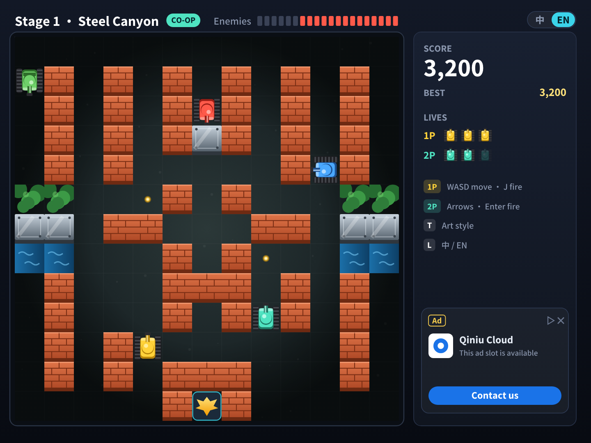
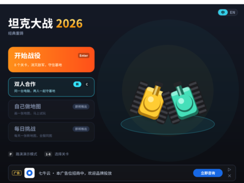
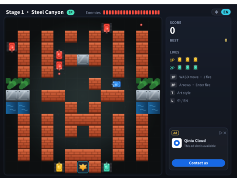

# 坦克大战 v3.0 · 双人合作模式

> 两个人在同一台电脑上，一人一辆坦克，一起守住基地（原版 FC《坦克大战》的经典玩法）。
> 本文是 [v3.0 规划](PLAN.md)的一部分。**状态：✅ 同一键盘双人已实现**（[PR #13](https://github.com/Qiniu-ERE/zero/pull/13)），下面第六节是实际运行截图和验证记录；前面几节是当初的评估和方案。

## 结论

| 形式 | 可行性 | 说明 |
|---|---|---|
| **同一键盘双人**（PC / Mac / XBuilder 网页） | ✅ **可行，约 2.5 天** | v3.0 要做的就是这个 |
| 平板 / 手机同屏双人 | ⚠️ 只有 Web 外壳能做 | 需要多点触控：Web 外壳的 HTML 虚拟按键支持；原生 App 里引擎只把一根手指当作鼠标 |
| 两个手柄 | ⚠️ 需要系统层映射 | spx 没有手柄 API，可以用手柄的键盘模式或 antimicrox 之类的工具，把两个手柄映射成两组按键 |
| 联网双人 | ❌ v3.0 做不了 | spx 的多人命令 `runm` 只保留了名字，执行会返回“未实现” |

---

## 一、效果图

| 双人对局（中文） | English |
|---|---|
|  |  |

主页的「双人合作」卡片从“即将推出”变成可以玩（按 **C**），展示台上是 1P 和 2P 两辆坦克：

## 二、规则设计

| 项目 | 设计 | 理由 |
|---|---|---|
| 按键 | **1P**：WASD 移动，J（或空格）开火；**2P**：方向键移动，Enter 开火 | 两人分坐键盘左右两边。现在方向键和 WASD 都控制同一辆坦克，双人模式下拆开。Enter 在主页、结算时仍然是“确认”（按画面状态区分） |
| 坦克颜色 | 1P 黄色，2P **青绿色** | 现代画风里绿色已经是重型敌人，青绿色和三种敌人（红、蓝、绿）都区分得开 |
| 出生点 | 1P 在基地左边（第 12 行第 4 列），2P 在基地右边（第 12 行第 8 列） | 和原版一致。已检查 8 张地图：第 12 行第 8 列都是空地，从那里都能开到三个敌人出生点 |
| 生命 | 每人 3 条命，分开计算；一个人命用完了，另一个人继续 | 和原版一致 |
| 失败 | 基地被毁，或者两个人的命都用完 | |
| 复活（激励视频） | 每局仍然只有一次：修复基地，两个人各加 1 条命 | 不增加广告次数 |
| 子弹 | 每人场上同时只能有 1 发 | 保留原版手感 |
| 友军火力 | 子弹穿过队友，不造成伤害 | 原版会让队友定住一会儿，容易引起争吵，v3.0 先不做 |
| 得分 | 两人合计一个分数；各自的击毁数放到 P1 阶段再做 | HUD 空间有限，先合计 |
| 难度 | 敌人总数仍为 20；场上上限 +1，出兵间隔 ×0.85 | 两个人火力翻倍，敌人要多一点才有压力 |
| 暂停 | 任何一人按 Esc（或点顶栏 Ⅱ）都会暂停，菜单里可以继续、重新开始本关、返回主页（v3.0.1） | 对局中原来没有办法退出 |
| 关卡 | 从第 1 关开始，下一关继续双人；自制地图也能双人玩（编辑器里 2P 出生点是锁定格） | 和 [自己做地图](MAP_EDITOR.md) 配合 |

## 三、技术方案

| 部分 | 做法 | 依据 / 原因 |
|---|---|---|
| 第二辆坦克 | **`Player` 原型当 1P，克隆一个当 2P**，用 `isCloned` 区分按键和颜色 | 不新增精灵类型、不加字段，不占解释器方法表（[架构文档 9.1](../ARCHITECTURE.md)：每出现一种新的“字段总大小”就要多占约 110 个位置）。现在的主循环在 `onStart` 里，2P 的循环放在 `onCloned` 里 |
| 中弹判定 | **改成每辆坦克自己检查** `touching("EBullet")` | 现在敌人子弹打中玩家时是广播 `playerHit`，两辆坦克都会收到，会一起“中弹”（已读 `EBullet.spx` 确认） |
| 每人 1 发子弹 | 舞台上分开计数 `pb1` / `pb2`；`PBullet` 记录是谁打的 | `PBullet` 的字段是 16 字节，加一个字段会变成新的大小。办法：把发射者编进现有的 `face` 字段（2P 的朝向加 1000，读取时还原），用一个小函数封装 |
| 2P 的颜色 | `build.py` 增加 `player2_m` 造型（现代）和经典画风的 2P 造型 | 美术都由生成器产出 |
| HUD | 右侧面板“生命”下分两行：1P、2P 各 3 个图标；按键提示改成 1P / 2P 两行；顶栏关卡名后加「双人」标签 | 见效果图 |
| 路演演示、单人模式 | 不受影响：不按 C 就和现在一样 | |

## 四、风险

| 风险 | 应对 |
|---|---|
| 键盘“串键”：很多普通键盘同时按住 4 个以上的键时会丢键（比如 1P 斜着走加开火，2P 也在走） | 按键分在键盘两端（WASD+J 和 方向键+Enter），这样的组合在大多数键盘上没问题；在说明里提示 |
| 2P 用 Enter 开火，和“确认”冲突 | 按画面状态区分：只有对局中（`stPlay`）Enter 才是 2P 开火 |
| 两辆坦克挤在一起卡住 | 坦克之间本来就有碰撞（`touching("Player")`），沿用现有的“撞到就退回”逻辑 |
| 手机上两个人挤一块屏幕 | 建议平板；Web 外壳横屏时左边给 1P、右边给 2P（每边一个方向键加一个开火键） |

## 五、里程碑

| 阶段 | 内容 | 估算 |
|---|---|---|
| **P0** | 2P 坦克（克隆）、按键拆分、中弹判定改造、每人 1 发子弹、出生点、生命和失败规则 | 1.5 天 |
| **P0** | 2P 造型、HUD（生命两行、提示、双人标签）、主页入口、难度调整 | 1 天 |
| **P1** | 结算时显示各自击毁数；Web 外壳双人虚拟按键（平板）；手柄映射说明 | 1 天 |

## 六、实现结果（`spx run` 实际运行）

| 主页：按 C 进入双人合作 | 双人对局 | English |
|---|---|---|
|  |  |  |

**验证**（在工程副本里追加测试脚本，`spx run` 运行，测试时关掉了敌人出兵，让结果确定）：

| 场景 | 结果 |
|---|---|
| 主页按 C | 生成 2P（青绿色，基地右边），顶栏显示「双人」，右侧显示 1P / 2P 两行生命和按键说明 |
| 打中 2P / 打中 1P | 只扣被打中的那辆的命（3,3 → 3,2 → 2,2） |
| 2P 开火 | 2P 的子弹单独计数，打到墙消失后归零，不影响 1P |
| 1P 没命了 | 2P 继续玩，游戏不结束 |
| 两人都没命 | 进入复活询问；看完激励视频后两人各加 1 条命 |
| 单人开始 / 回主页 | 2P 被去掉，单人 HUD 和原来一样 |

**和方案不同的地方**：

- **重生倒计时挪到了每帧的 `step` 里**。原来是在 `playerHit` 的处理里 `wait 1.5` 再重生；双人时另一个人中弹会再次广播 `playerHit`，正在等待的处理会被打断，先死的那辆就再也不会重生了（测试中发现）。现在死亡时把倒计时存在 `shield` 字段里，每帧减少，到 0 就重生。
- **2P 开火在每帧里检测 Enter**，并用 `fireHeld` 记住“还按着”，要松开再按才能再开火。`fireHeld` 放在 `dead` 后面，正好占用内存对齐的空隙，`Player` 的字段总大小仍是 32 字节。
- **英文的双人标签是 “2P”**：最长的英文关卡名加上 “CO-OP” 会挤到顶栏的“敌军”，生成器会检查宽度。
- 坦克之间不互相阻挡（两辆可以重叠），避免在狭窄的地方卡住。
