# 坦克大战 v3.0 · 跨平台运行规划（可行性评估）

> 目标：XBuilder 做出来的游戏，不只在 x.qiniu.com 的网页里运行，还能
> **在 iPhone / 安卓上直接玩**、**在 Windows / Mac 上双击就玩**。
>
> 本文是 [v3.0 规划](PLAN.md)中“跨平台”部分的可行性评估，**只做评估和文档，不改游戏代码**。文中的截图分两类，都已标明：
> **实测**是 2026-10-24 在 macOS（M1 Pro）上真实导出并运行后截的图；**概念示意**是方案效果图，里面的游戏画面也是实测截图。

## 实现状态

**✅ 打包工具和发布流程已实现**（[PR #15](https://github.com/Qiniu-ERE/zero/pull/15)），已发布 [v3.0.0](https://github.com/Qiniu-ERE/zero/releases/tag/v3.0.0)。详见下面的[第七节](#七实现结果)。本地已经验证 macOS 单文件程序和网页版；Windows、Linux、Android、iOS 由 GitHub Actions 打包，在 CI 上验证。下面第一到六节是当初的评估记录。

## 结论速览

**不需要“解码”或逆向。** XBuilder 导出的 `.xbp` 就是一个 zip 包，里面是 spx 源码和素材。XBuilder 的运行引擎是 spx 4.0，内核是 **Godot 4.4.1**。spx 命令行自带导出命令，可以把同一份源码打成各个平台的原生包，也可以导出 Web 包。所以“自制 App”是正常的**编译打包**，不需要破解。只有 iPhone 装原生 App 时绕不开苹果签名（见 3.2）。

| 平台 | 推荐路线 | 引擎官方支持 | 本次实测 | 游戏改动 | 可行性 |
|---|---|---|---|---|---|
| **macOS** | `spx buildlauncher` 单文件程序 | ✅ | ✅ 已跑通 | 无 | **高** |
| **Windows** | 同上，在 Windows 机器或 CI 上构建 | ✅（x64） | 未测（不能交叉编译） | 无 | **高** |
| **Linux x64** | 同上 | ✅ | 未测 | 无 | **高** |
| **iPhone** | ① 自己托管 Web 包 + 添加到主屏幕（PWA）<br>② `spx exportios` 生成 Xcode 工程并签名 | ✅ | Web 包 ✅（桌面 Chrome）<br>iOS 未测（本机没装 Xcode） | 虚拟按键 | ① **高** ② 中（需要苹果账号） |
| **Android** | ① 同 iPhone 的 Web 方案<br>② `spx exportapk` 生成 APK 直接安装 | ✅（arm64） | 未测（本机没装 SDK/NDK） | 虚拟按键 | **高** |

一句话：**PC 三平台基本是现成的；手机走 Web 最快，只需要补一层虚拟按键。**

---

## 一、技术底座

```
XBuilder (x.qiniu.com)
   │ 文件 → 导出
   ▼
TankBattle.xbp  ──解压──▶  *.spx 源码 + assets/
                               │
                               ▼  spx 命令行 4.0（内核 Godot 4.4.1 + ixgo 解释器）
     ┌──────────────┬──────────┼───────────────┬───────────────┐
     ▼              ▼          ▼               ▼               ▼
 buildlauncher   exportweb   exportapk       exportios     exportminigame
 PC 单文件程序   Web 包       Android APK     Xcode/IPA      微信小游戏
 (mac/win/linux)  (任何浏览器)
```

### 1.1 spx 4.0 自带的导出命令

来源：本机安装的 `spx help`，以及 [goplus/spx](https://github.com/goplus/spx) 的 `cmd/spx/internal/command/`（2026-10-24 的 `c3c0da5`）。

| 命令 | 产物 | 说明 |
|---|---|---|
| `spx buildlauncher` | 单个可执行文件（引擎、PCK 和项目都打进去） | **只能构建当前机器的平台**（源码里写死了 host-only） |
| `spx export` | `.app` / `.exe` / Linux 可执行文件 | 同样只导出本机平台；实测有素材路径问题（见 2.1） |
| `spx exportweb` | 静态网页目录 | 单线程版本，不依赖 SharedArrayBuffer，手机浏览器也能跑 |
| `spx exportapk` | `game.apk` | 需要 `ANDROID_NDK_ROOT`、JDK 17、Android SDK；只打 `arm64-v8a`；加 `--install` 参数会用 adb 直接装到手机 |
| `spx exportios` | `Game.xcodeproj` 或 `Game.ipa` | 需要完整的 Xcode 和苹果开发者签名；可以用 `ios-deploy` 装到手机 |
| `spx exportminigame` | 微信小游戏包 | 官方已支持，v3.0 先不做 |
| `spx buildtinygo` | ESP32 静态库 | 面向嵌入式，和本项目无关 |

### 1.2 官方发布的运行时（runtime-v4.0.0）

在 `goplus/spx` 的 Release `runtime-v4.0.0`（2026-10-23）里，平台资产如下：

| 有 | 没有 |
|---|---|
| `macos-arm64` `macos-x86_64` `windows-x86_64` `linux-x86_64` `android` `ios` `web` `web-threads` `web-worker` `web-minigame` | `linux-arm64`、`windows-arm64` |

本规划覆盖的平台（macOS、Windows x64、Linux x64、Android、iOS、Web）都有官方运行时。

### 1.3 XBuilder 网站在手机上不能用

XBuilder 前端（[goplus/builder](https://github.com/goplus/builder) `spx-gui/src/apps/xbuilder/App.vue`）只要识别到手机或平板，**整个网站**都只显示“请在电脑上访问”，项目页和分享链接也一样。所以手机玩家**不能靠 XBuilder 的分享链接玩**，只能用我们自己导出的 Web 包或 App。

---

## 二、实测记录（2026-10-24，macOS 26 / M1 Pro）

所有构建都在临时目录里进行，仓库里的游戏没有改动。复现命令见[附录](#附录复现命令)。

### 2.1 macOS 原生：`spx export` ✅ 能跑，但有坑

导出一次不到 1 分钟，产物 `gdexport.app` 117 MB。启动日志显示 `Metal 4.0 - Forward+`，用的是原生 GPU 渲染。

| 主页（实测） | 对局 · English（实测） | 对局 · 经典像素风（实测） |
|---|---|---|
| 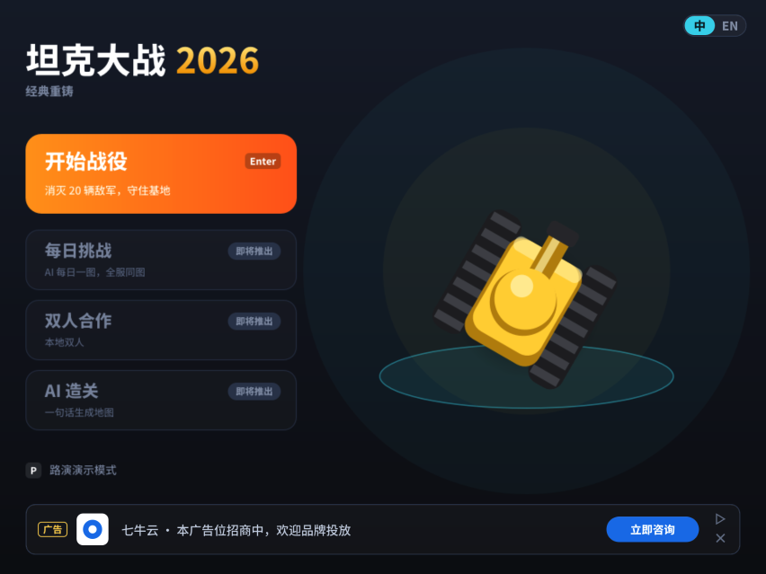 | 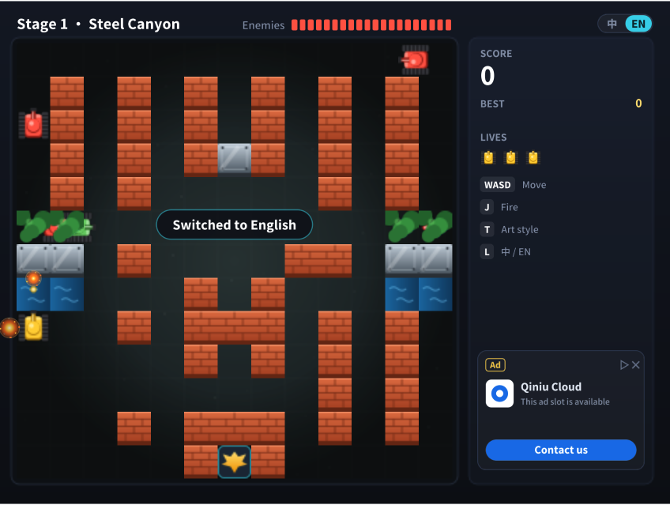 | 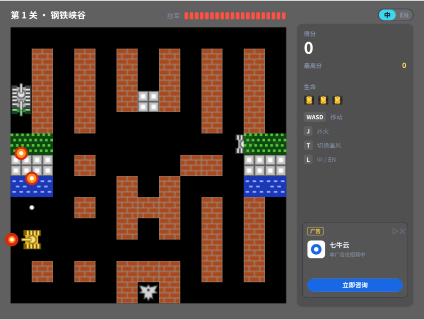 |

**坑**：这个 `.app` 会从“**当前目录**的 `../assets`”读素材。在 Finder 里双击，或者换个目录启动，就会报 `open ../assets/index.json: no such file or directory`，然后黑屏。原因是桌面导出没有调用 `prepareExport()` 把素材复制进项目（APK 和 iOS 导出调用了）。所以 **`spx export` 不适合拿来分发**。

### 2.2 macOS 单文件：`spx buildlauncher` ✅ 推荐

`buildlauncher` 会把引擎、PCK、解释器桥和项目归档打进**一个 82 MB 的可执行文件**。实测把它复制到别的目录，再从根目录 `/` 启动，游戏也正常运行，说明它是真正自包含的。

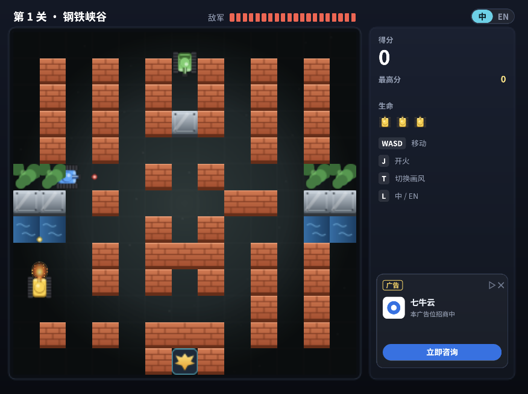

小问题：窗口标题显示的是一串内容哈希，正式发布前需要改成“坦克大战 2026”，可以给 spx 提 issue 或 PR。

前提是工程目录里要有 `gox.mod`（声明 `project main.spx` 和 `pack assets`），v3.0 需要把它加进仓库。

### 2.3 Web：`spx exportweb` ✅（桌面 Chrome）

| 对局 · 中文（实测） | 对局 · English（实测） | 激励视频广告（实测） |
|---|---|---|
| 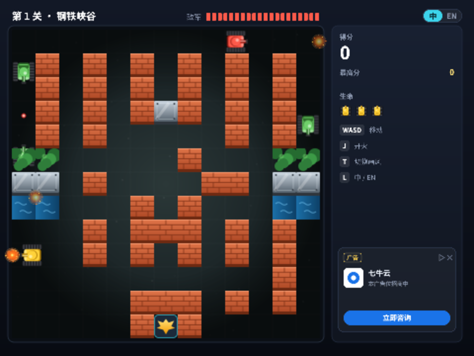 | 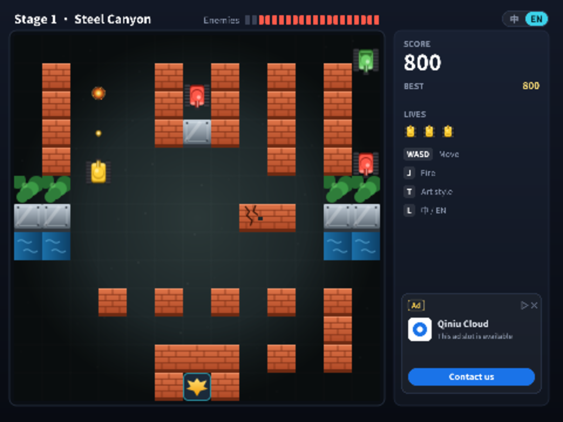 | 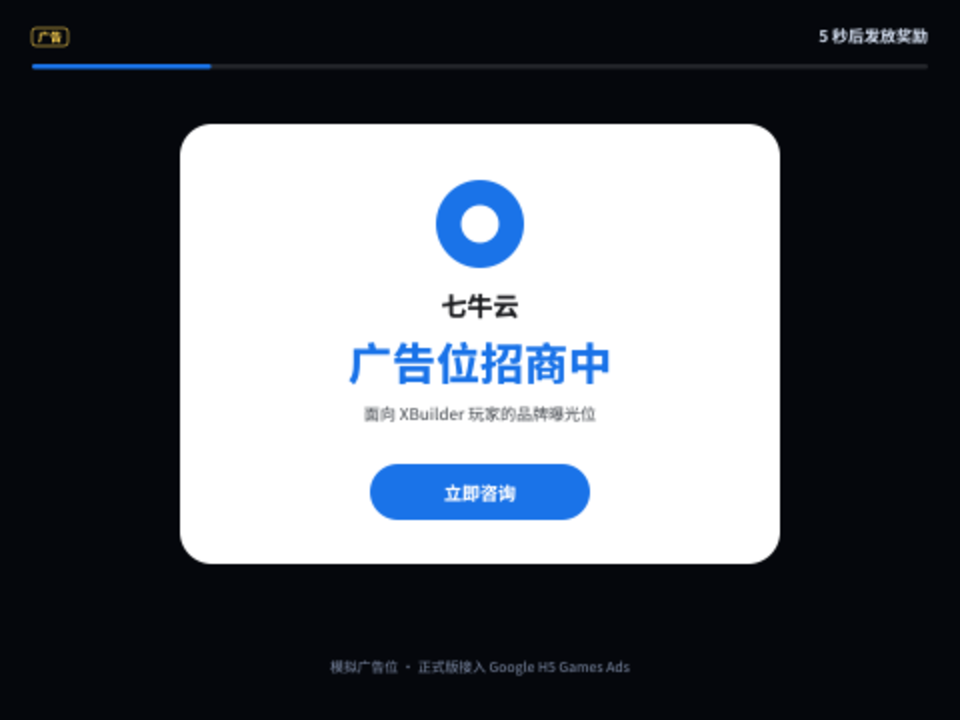 |

体积：未压缩约 83 MB，主要是 `engine.wasm`（31 MB，Godot 引擎）和 `ispx.wasm`（48 MB，XGo 解释器）。服务器开 brotli 后首次只需下载约 15 MB，具体见 5.2。

**注意**：`exportweb` 的 `index.html` 是 spx 自带的**调试台**页面（有 Start、Stop、Pause 等按钮），游戏本体在 `runner.html` 的 iframe 里。给玩家用之前，要自己写一个成品外壳页面（见 4.1）。

### 2.4 关键验证：虚拟按键不用改游戏代码 ✅

游戏现在全靠键盘操作（`keyPressed` / `onKey`）。为了确认手机上能用“HTML 按钮模拟按键”的办法，我们用脚本向游戏的 `<canvas id="game-canvas">` 发送合成的键盘事件：

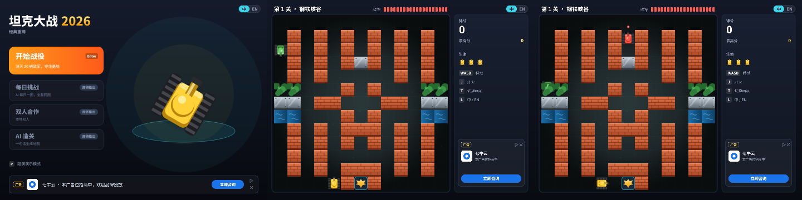

结果是 Godot 能收到 JS 合成的 `keydown` / `keyup` 事件。所以 Web 版的虚拟按键可以做成**纯 HTML 覆盖层**，`.spx` 代码一行都不用改。

### 2.5 这次没有实测的部分

- Android、iOS：本机没有装 Android SDK/NDK 和完整的 Xcode（都要好几个 GB），只做了源码层面的评估。
- Windows、Linux：`buildlauncher` 和 `export` 都只能构建本机平台，需要在对应系统或 CI 上构建。
- 手机浏览器真机：只在桌面 Chrome 上验证过，iOS Safari 的内存上限是主要风险（见第六节）。

### 2.6 工具链的坑（spx 4.0.0 刚发布，生态还没跟上）

| 现象 | 原因 | 临时办法 |
|---|---|---|
| `go: ... github.com/goplus/spx/v4 ... unknown revision v4.0.0` | 只发布了 runtime 的 tag，Go 模块的 `v4.0.0` tag 还没有 | 在 `go.mod` 里 `replace` 到本地的 spx 源码 |
| `xgo: executable file not found` / xgo 启动 panic | 导出要用 xgo 命令行，而且要设置 `XGOROOT` | `go install github.com/goplus/xgo/cmd/xgo@v1.7.5`，并设置 `XGOROOT` 指向它的模块目录 |
| `web dir file not found` / `ispx web runtime not found` | Web 运行时没有安装 | 在 spx 源码目录执行 `make setup-web MODE=normal` |

v3.0 应该把这些步骤写进一个脚本（`tools/export/`），一条命令就能导出。

---

## 三、各平台方案

### 3.1 PC：Windows / macOS / Linux

**做法**：`spx buildlauncher` → 一个可执行文件，双击就能玩。

- 因为不能交叉编译，用 GitHub Actions 的矩阵一次构建三个平台：`macos-14`（arm64）、`macos-13`（x64）、`windows-latest`、`ubuntu-latest`，然后把产物上传到 Release。
- macOS：没签名的程序第一次要“右键 → 打开”；想双击直接打开，需要 Apple Developer ID 签名和公证（99 美元/年）。
- Windows：没签名会弹 SmartScreen 提示，点“仍要运行”就行，比赛演示可以接受。
- 窗口：游戏画面固定 480×360（4:3），引擎会等比缩放并留黑边。加 `--fullscreen` 参数可以全屏。

### 3.2 iPhone

| | 路线 A：Web / PWA（推荐先做） | 路线 B：原生 App（`spx exportios`） |
|---|---|---|
| 玩家怎么装 | Safari 打开链接 → 分享 → “添加到主屏幕”，之后全屏运行，看起来和 App 一样 | 装 IPA |
| 我们要做的 | 托管 Web 包（可以放七牛云 Kodo + CDN），写外壳页面、manifest 和虚拟按键 | 准备 Xcode、苹果账号签名，在游戏里画虚拟按键 |
| 签名 | 不需要 | 免费 Apple ID：自己的手机能装，**7 天后过期**；付费账号（99 美元/年）：TestFlight 分发给 1 万人，或上架 App Store |
| 风险 | Safari 单个页面的内存上限（两个 wasm 解压后约 80 MB）、音频要用户先点一下才能播放 | 签名流程繁琐，`exportios` 没有实测过 |

“解码运行”的说法其实不准确：iOS 不需要越狱或破解，只要**签名**。比赛演示用免费账号 + 数据线就能装到自己手机上。

### 3.3 Android

- **路线 A：Web**，和 iPhone 一样。Chrome 支持“安装应用”（PWA）。
- **路线 B：APK**，`spx exportapk`（需要 NDK r23c 23.2.8568313、JDK 17、Android SDK）→ `game.apk`。安卓可以直接侧载（打开“允许安装未知来源应用”），也可以 `spx exportapk --install` 通过 USB 直接装到手机。只打包 arm64-v8a，覆盖 2017 年以后几乎所有手机。
- 上架应用商店需要正式签名、隐私政策和广告 SDK 合规，不在 v3.0 范围内。

### 3.4 微信小游戏（v3.0 之后）

spx 已经有 `exportminigame`，七牛和微信生态结合也合适，但需要小游戏账号和审核，放到后续版本做。

---

## 四、游戏侧要做的适配

### 4.1 Web 外壳页面（手机 / PWA）

新建 `web-shell/`，只包外壳，不改 `.spx`：

- `play.html`：加载 `runner.html` 的运行逻辑，自动开始游戏，全屏，4:3 居中加黑边，显示加载进度。
- `manifest.webmanifest` 和图标：让手机可以“添加到主屏幕”，横屏、全屏显示。
- 虚拟按键覆盖层：按下时向 `#game-canvas` 发送 `keydown`，松开时发送 `keyup`（2.4 已经验证可行）。用 Pointer Events 支持多点触控，可以**一边移动一边开火**。
- 只在触屏设备上显示（`matchMedia('(pointer: coarse)')`），电脑上自动隐藏。

| 横屏：按钮放在两侧黑边上（概念示意） | 竖屏：掌机布局（概念示意） |
|---|---|
| 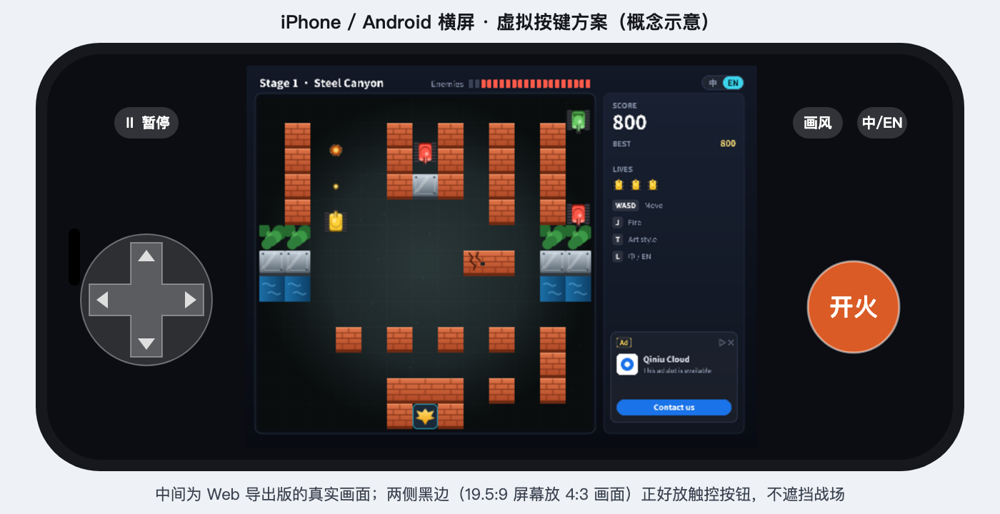 | 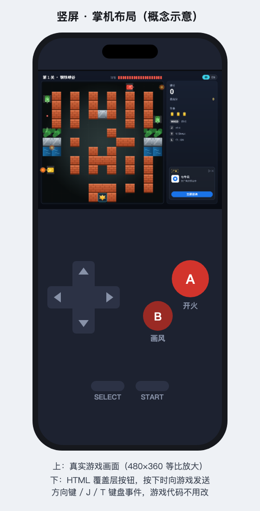 |

### 4.2 原生 App 里的虚拟按键（Android / iOS 路线 B）

原生 App 里没有 HTML，按钮要画在游戏里：在 `UI` 精灵里加 `kind = vpad`，用 `mousePressed` + `mouseX/mouseY` 判断按在哪个按钮上。

限制：Godot 把触屏模拟成**单点鼠标**，同一时间只能识别一个手指。对策是手机上默认**自动开火**，只需要按方向键。这一部分要改 `.spx`，所以排在 Web 方案后面。

### 4.3 其他

- **画面**：继续用 480×360。手机横屏锁定，PC 等比缩放。
- **广告位**：现在的模拟广告在各平台保持原样（展示商业化设计）。接入真实广告 SDK（AdMob、穿山甲）要按平台分别做，不在 v3.0 范围内。
- **最高分存档**：现在只保存在内存里，跨平台版本可以考虑持久化，v3.0 先不做。

---

## 五、里程碑和工作量

### 5.1 计划

| 阶段 | 内容 | 产出 | 估算 |
|---|---|---|---|
| **P0** | 导出脚本 `tools/export/`（固化 2.6 的坑），`gox.mod` 进仓库；Mac 单文件程序 | `TankBattle-macos` | 0.5 天 |
| **P0** | GitHub Actions 矩阵：macOS、Windows、Linux 单文件程序 + Web 包，上传到 Release | 4 个下载包 | 1 天 |
| **P0** | Web 外壳页面 + 虚拟按键 + PWA，托管到七牛云 Kodo | 手机扫码就能玩 | 1~1.5 天 |
| **P1** | Android APK（CI 安装 NDK） | `TankBattle.apk` | 0.5~1 天 |
| **P2** | iOS（Xcode + 签名）、游戏内虚拟按键、微信小游戏 | — | 视资源而定 |

### 5.2 Web 包体积

| 文件 | 原始 | gzip -9 | brotli -q 11 |
|---|---|---|---|
| `engine.wasm`（Godot 引擎） | 31.3 MB | 6.9 MB | 4.7 MB |
| `ispx.wasm`（XGo 解释器） | 48.4 MB | 9.5 MB | 6.4 MB |
| `game.zip`（游戏源码 + 素材） | 3.3 MB | 本身已压缩 | 本身已压缩 |
| **首次下载合计** | **约 83 MB** | **约 20 MB** | **约 14.5 MB** |

开启 brotli 后，首次加载大约下载 15 MB，4G 网络几秒内能下完。之后可以用 Service Worker 缓存，再打开就是秒开。

注意：`exportweb` 会把**整个工程目录**打进 `game.zip`。如果目录里留着 `buildlauncher` 的产物（`.builds/`，82 MB），`game.zip` 会从 3.3 MB 涨到 85 MB。所以导出脚本要先清理，或者在干净的副本里导出。

---

## 六、风险

| 风险 | 影响 | 应对 |
|---|---|---|
| iOS Safari 内存上限，加载两个 wasm（解压后约 80 MB）可能被系统杀掉 | iPhone Web 路线不可用 | 先在真机测；不行就走 exportios 原生路线；或者向 spx 争取给 Web 版用编译模式代替解释器，去掉 48 MB 的 ispx.wasm |
| spx 4.0 刚发布，工具链经常变（2.6） | 导出脚本失效 | 锁定 spx commit 和 runtime 版本，写进导出脚本 |
| 解释器方法表上限（见 [架构文档 9.1](../ARCHITECTURE.md)） | `buildlauncher` 走解释器，限制和 XBuilder 一样 | 现有代码已经在限制内，v3.0 不新增大量方法 |
| 苹果签名和应用商店审核 | iOS 原生分发受限 | 比赛演示用免费账号或 TestFlight，正式上架不在 v3.0 范围 |

---

## 七、实现结果

### 7.1 发布了哪些包

推送 `v*` 标签（例如 `v3.0.0`）后，GitHub Actions（`.github/workflows/release.yml`）打出下面这些包，并创建 GitHub Release：

| 文件 | 平台 | 怎么打出来的 | 怎么安装 |
|---|---|---|---|
| `TankBattle-<版本>-windows-x64.zip` | Windows 10 / 11 | `windows-latest` 上 `spx buildlauncher`（MSYS2 提供 gcc） | 解压后双击 `TankBattle.exe` |
| `TankBattle-<版本>-macos-arm64.zip` | macOS（Apple 芯片） | `macos-15` 上 `spx buildlauncher`，再包成 `坦克大战 2026.app`（图标、Info.plist、ad-hoc 签名） | 第一次右键 → 打开 |
| `TankBattle-<版本>-linux-x64.tar.gz` | Linux x86_64 | `ubuntu-latest` 上 `spx buildlauncher` | `./TankBattle` |
| `TankBattle-<版本>-web.zip` | iPhone / 安卓 / 浏览器 | `spx exportweb` + 我们的外壳页面（PWA） | 上传到 HTTPS 静态网站，手机“添加到主屏幕” |
| `TankBattle-<版本>-android.apk` | Android（arm64） | `spx exportapk`（NDK r23c、JDK 17），调试证书签名，**触屏模式** | 直接安装 |
| `TankBattle-<版本>-ios-unsigned.ipa` | iPhone / iPad | `spx exportios` 只导出 Xcode 工程，`xcodebuild` 不签名编译，**触屏模式** | Sideloadly / AltStore 用自己的 Apple ID 签名安装 |

每个包里都附带对应平台的README.txt（安装说明）（来自 [`tools/export/INSTALL.md`](../../tools/export/INSTALL.md)），Release 里还有 `SHA256SUMS.txt`。

本地也能用同样的脚本打包：

```sh
tools/export/setup_spx.sh web        # 第一次：spx 源码、模板补丁、xgo、运行时（可加 android / ios）
tools/export/build.sh desktop        # 当前系统的单文件程序
tools/export/build.sh web            # 网页版
tools/export/build.sh android        # APK：需要 JDK 17、Android SDK、NDK r23c（ANDROID_NDK_ROOT）
tools/export/release_local.sh        # 把 dist/ 里的包发布成 GitHub Release（标签要先推送）
```

**本机发布（v3.0.2）**：组织的 Actions 额度用完后，v3.0.2 改成在一台 Apple 芯片 Mac 上打包：macOS、网页版、Android 直接打；Linux 在 OrbStack 的 x86_64 Ubuntu 虚拟机里打（Rosetta 转译），并用 Xvfb + 软件 Vulkan 启动截图验证。Windows 和 iOS 本机打不了（`buildlauncher` 只能打本机平台；iOS 需要 Xcode），`release_local.sh` 会把说明里这两行改成指向上一个版本（v3.0.1）的下载链接。Android 导出时如果本机以前运行过 Godot，编辑器设置里的 Java SDK 路径可能是空的，`build.sh android` 会用 `JAVA_HOME` / `ANDROID_HOME` 补上。

**本地打包（v4.0 起的标准做法，不用 GitHub Actions）**：推送标签不再触发 Actions（`release.yml`、`check.yml` 都改成只能手动运行），打包、检查、发布都在本机做：

```sh
tools/export/setup_spx.sh android            # 第一次：spx、xgo、运行时、安卓模板（只打桌面和网页可以不加 android）
tools/export/linux_vm.sh setup               # 第一次：OrbStack 的 x86_64 Ubuntu 虚拟机（约 3.7 GB），以后可以 linux_vm.sh delete 释放
tools/export/build_local.sh                  # 打本机能打的全部平台，每个包都检查，结果写在 dist/BUILD_LOCAL.md
git tag v4.1.0 && git push origin v4.1.0     # 在 main 上打标签
DRY_RUN=1 tools/export/release_local.sh      # 先看发布说明（不发布）
tools/export/release_local.sh                # 发布 GitHub Release；空着的平台指向最近一个有这个平台安装包的版本
```

`build_local.sh` 在一台 Apple 芯片 Mac 上（2026-10-25 实测，v4.0.0）：

| 平台 | 结果 | 怎么打、怎么检查 |
|---|---|---|
| macOS | ✅ 29 MB | 本机 `buildlauncher`；`tools/test/package_boot.sh` 运行安装包里的程序做启动测试（9 个断言） |
| 网页版 | ✅ 22 MB | 本机 `exportweb` + 外壳；检查包里有游戏、外壳和 PWA 文件 |
| Android | ✅ 29 MB | 本机 `exportapk`；JDK 17 没装时用 `nix shell nixpkgs#jdk17` 临时提供（不装进系统）；`apksigner` 验证签名。本机没有模拟器，启动要在真机上手工检查 |
| Linux x64 | ✅ 39 MB | OrbStack 的 x86_64 Ubuntu 虚拟机（Rosetta 转译）里 `buildlauncher`，再在虚拟机里用 Xvfb + 软件 Vulkan 跑启动测试 |
| Windows | ⏸ 空着 | `buildlauncher` 只能打本机平台，需要 Windows 环境。VMware Fusion 已装，但 Windows 虚拟机至少要 30 GB 磁盘，本机剩余不够。以后有空间时装 Windows 11（ARM 版能转译运行 x64 的 Go 工具链）或者用一台 Windows 电脑运行同样的 `build.sh desktop` |
| iOS | ⏸ 空着 | 需要 Xcode（十几 GB），本机只有命令行工具 |

踩过的坑：后台运行或者特殊语言环境下，macOS 的 `sed` 读到 `CHANGELOG.md` 里的中文会报 `illegal byte sequence`（`env.sh` 读版本号改成 `LC_ALL=C`）；bash 里变量后面紧跟中文（如 `$VM（`）会被当成变量名的一部分，要写成 `${VM}（`；开着 `pipefail` 时 `unzip -l | grep -q` 会因为 grep 提前退出而误判失败。

### 7.2 关键做法

| 问题 | 做法 |
|---|---|
| spx 的 Go 模块 `v4.0.0` 还没发布 | 从固定提交（`c3c0da5`）编译安装 spx，游戏的 `go.mod` 用 `replace` 指向这份源码 |
| spx 每次导出都会用内置模板覆盖 `export_presets.cfg`，包名是 `com.gamestan.spx`，iOS 的 Team ID 是 spx 自己的 | `patch_spx.py` 在编译 spx 之前改模板：包名 `com.qiniu.tankbattle`、应用名、版本号、图标；iOS 改为只导出 Xcode 工程，再用 `xcodebuild CODE_SIGNING_ALLOWED=NO` 编出不签名的 IPA |
| 原生 App 里没有网页外壳的虚拟按键 | 游戏加了**触屏模式**（`touchUI`，只在 Android / iOS 包里打开）：右侧面板换成方向键，按住移动并自动开火，点战场也能开火。引擎只把一根手指当作鼠标，所以按方向时自动开火 |
| 桌面窗口标题显示一串哈希 | `assets/index.json` 里设置 `run.title` |
| 网页版只有 spx 的调试台页面 | `tools/export/web/`：自动启动、4:3 铺满、多点触控虚拟按键（单人 WASD + J；“双人按键”打开后右边是 2P 的方向键 + Enter）、PWA 清单、离线缓存；电脑上把键盘事件转发进游戏 |
| 单文件程序是否真的自包含 | 实测：启动器第一次运行时把内嵌的引擎解压到 `~/Library/Caches/spx/runtimebundle/`，换目录、换电脑都能运行 |

### 7.3 实测截图

| macOS：解压出的 `坦克大战 2026.app` | 网页版：iPhone 横屏（模拟） | 按住方向键“上”之后 |
|---|---|---|
| 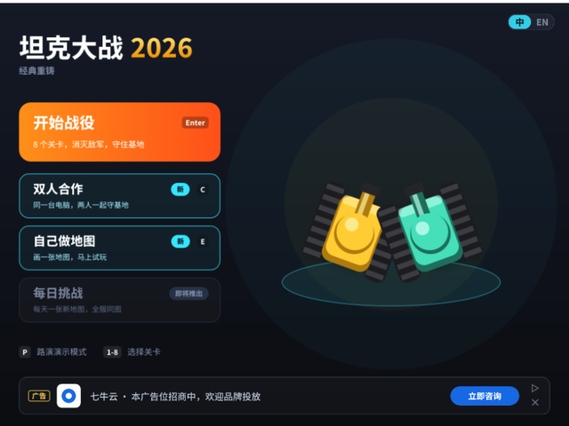 | 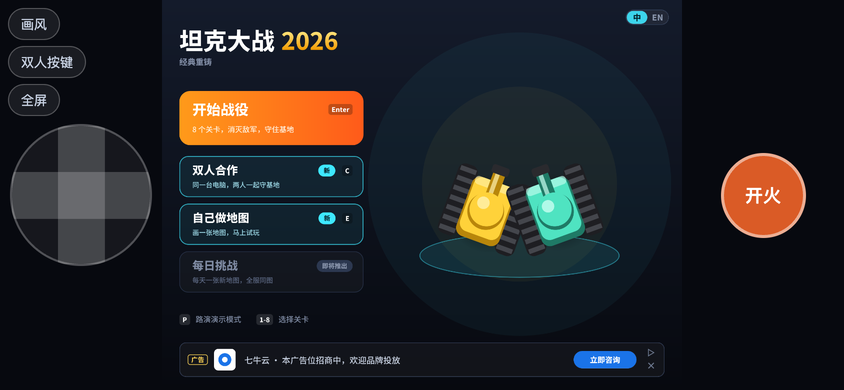 | 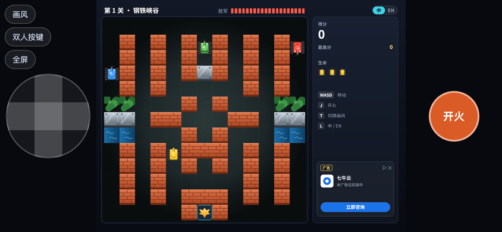 |

| 网页版：竖屏 | 网页版：电脑浏览器 | 手机 App 的触屏模式 |
|---|---|---|
| 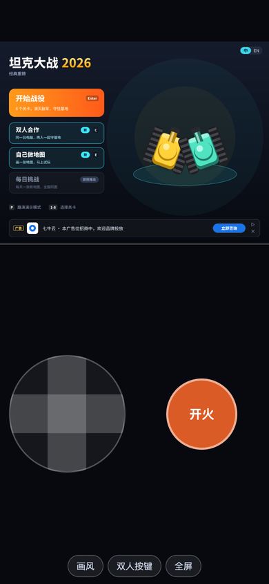 | 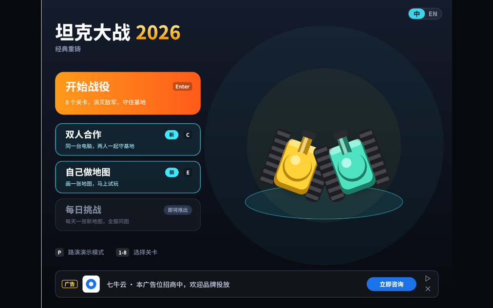 | 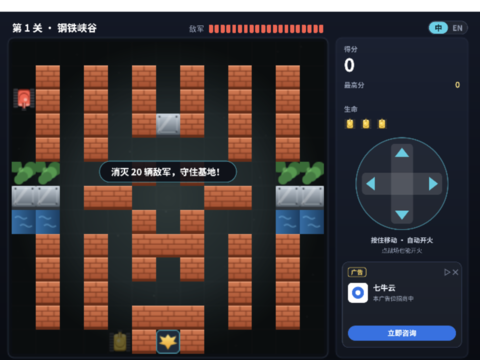 |

- macOS：从别的目录启动解压出的 `.app`，正常进入主页；Bundle ID、显示名、ad-hoc 签名都对。
- 网页版：用无头 Chrome 模拟 iPhone（横屏、竖屏、触屏），点“开始”后进入主页，点“开火”进入第 1 关，按住方向键“上”坦克向上开，按住“右”转向右边并移动。
- 触屏模式：在 `spx run` 里打开 `touchUI` 预览布局（截图右下）。

### 7.4 CI 上的冒烟测试

在提交说明里带 `[ci smoke]` 时，CI 会把打好的桌面包解压、启动，45 秒后截屏（`smoke-windows` / `smoke-macos` / `smoke-linux` 三个任务）：

| Windows（windows-latest，没有显卡，自动用 ANGLE 软件渲染） | macOS（macos-15） | Linux（Xvfb 虚拟显示器 + lavapipe 软件 Vulkan） |
|---|---|---|
| 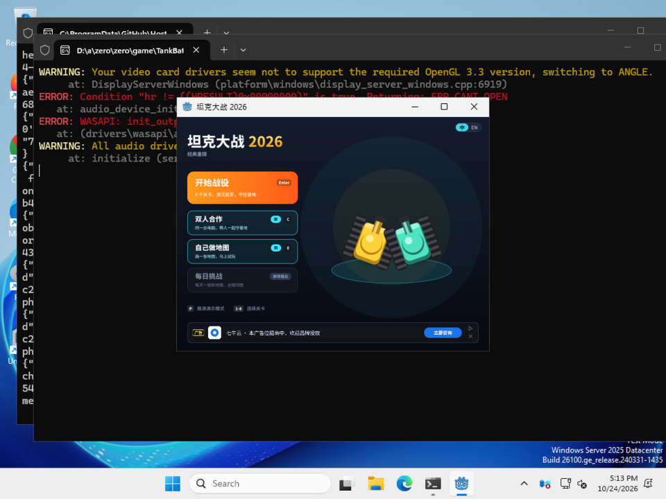 | 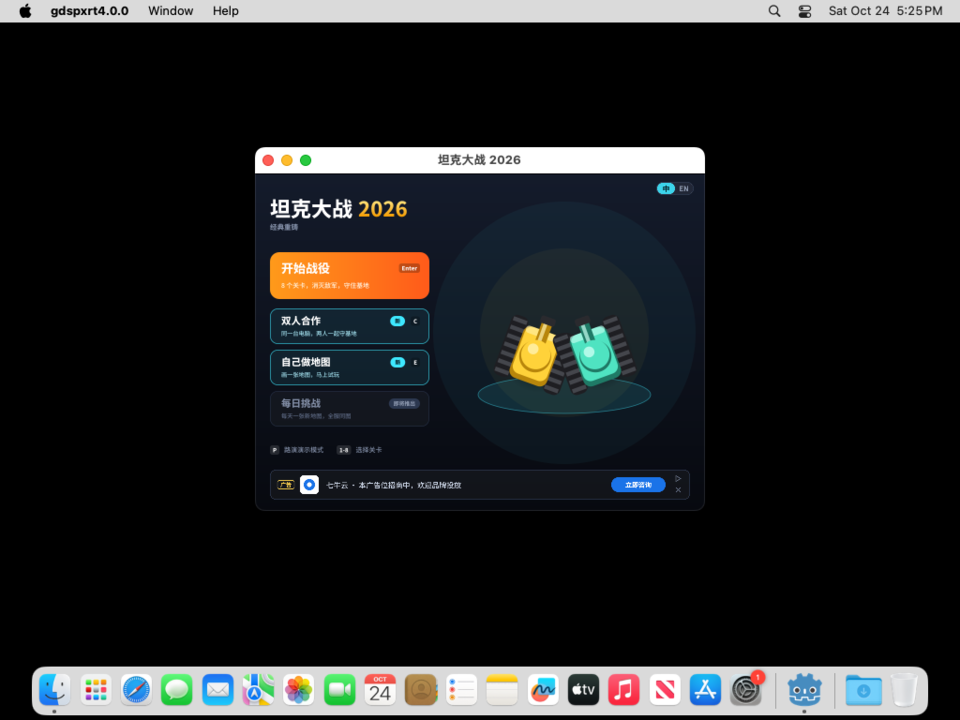 | 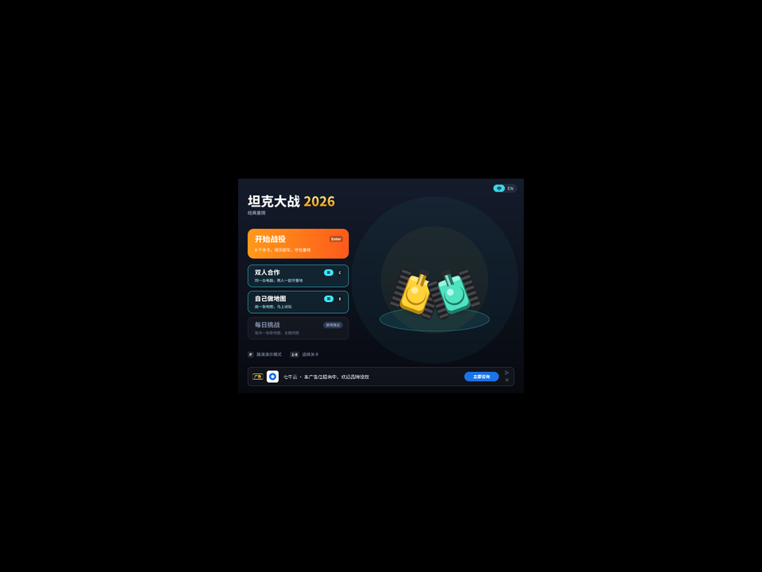 |

三个平台都正常进入了主页。冒烟测试发现并修复了两个问题：

- **macOS 偶发崩溃**：`signal 16 received but handler not on signal stack` / `non-Go code set up signal handler without SA_ONSTACK flag`。游戏的 Go 库运行在引擎进程里，Go 用来做异步抢占的 SIGURG 信号可能落到引擎自己的线程上。修法：`.app` 和 Linux 包都通过一个小启动脚本运行，设置 `GODEBUG=asyncpreemptoff=1`（引擎子进程会继承）。本机跑了十几次都没遇到，CI 上第一次就遇到了，说明是和时机有关的偶发问题，用户机器上也可能出现。
- **Windows 压缩包里的中文文件名乱码**：各平台的说明文件统一改名为 `README.txt`（Windows 版带 UTF-8 BOM）。

另外几点：

- Windows 版运行时还会开一个黑色的日志控制台窗口（spx 的启动器是控制台程序），不影响游戏。
- **APK 没法在 CI 的安卓模拟器里测**：Godot 的安卓模板只有 ARM 引擎库（arm64、armv7），只能用 x86_64 模拟器的 ARM 转译来跑，而转译层不支持 Go 运行时读取 CPU 型号的指令（`mrs MIDR_EL1`），启动 3 秒后 SIGILL 崩溃。真机的 Linux 内核会处理这条指令，所以这只是模拟器的限制，但 APK 仍然要在真机上验证。
- iOS 包检查过内容：Bundle ID `com.qiniu.tankbattle`、版本 3.0.0、arm64 可执行文件、坦克图标；主屏幕名称是 “TankBattle”。

### 7.5 限制和没验证的部分

- **GitHub Pages 用不了**：仓库是私有的，组织是免费套餐，不支持 Pages。所以网页版以 zip 发布，需要自己上传到静态网站（例如七牛云 Kodo）。仓库公开后可以加一个 Pages 部署任务。
- **Actions 分钟数**：私有仓库每月 2000 分钟，macOS 机器按 10 倍计算。实际一次完整发布（含冒烟测试）各任务只要 1~4 分钟，macOS 任务 1~2 分钟；调试时推到 `ci/` 开头的分支，用提交信息里的 `[ci 平台]` 只打需要的平台。
- **签名**：macOS 和 Windows 都没有付费签名证书，第一次打开会有系统提示（说明里写了怎么打开）；APK 用调试证书；IPA 不签名。上架应用商店不在 v3.0 范围内。
- **Intel Mac、Windows ARM、Linux ARM** 没有打包。
- **真机**：Android、iOS 的包在 CI 上打出来，还没有在真机上装过；手机网页版只在模拟器里测过。
- **iOS 的 MoltenVK**：模板的 Xcode 工程要求 `MoltenVK.xcframework`，打包时用 Khronos 发布的 v1.3.0 静态版本补上；真机上的渲染还没验证。

## 附录：复现命令

以下是本次实测用的命令（macOS，spx 4.0.0 已安装在 `~/go/bin`）：

```sh
# 0. 准备：spx 源码、xgo 命令行
git clone --depth 1 https://github.com/goplus/spx.git /tmp/spx
GOBIN=/tmp/tools go install github.com/goplus/xgo/cmd/xgo@v1.7.5
export PATH=/tmp/tools:$PATH XGOROOT=$(go env GOMODCACHE)/github.com/goplus/xgo@v1.7.5

# 1. 在副本里操作，不动仓库
cp -R TankBattle /tmp/build/ && cd /tmp/build/TankBattle
cp /tmp/spx/gox.mod .                       # project main.spx / pack assets
spx export                                  # 第一次会生成 go.mod，然后失败
echo 'replace github.com/goplus/spx/v4 => /tmp/spx' >> go.mod
cat /tmp/spx/go.sum >> go.sum

# 2. macOS
spx export                                  # → project/.builds/pc/gdexport.app（有素材路径问题）
spx buildlauncher --path .                  # → .builds/TankBattle（单文件，推荐）

# 3. Web
(cd /tmp/spx && make setup-web MODE=normal) # 安装 Web 运行时和 ispx.wasm
spx exportweb                               # → project/.builds/web
python3 -m http.server 8765 -d project/.builds/web   # 打开 http://127.0.0.1:8765/ 点 Start

# 4. 概念示意图
sh docs/v3/mockups/render.sh
```
