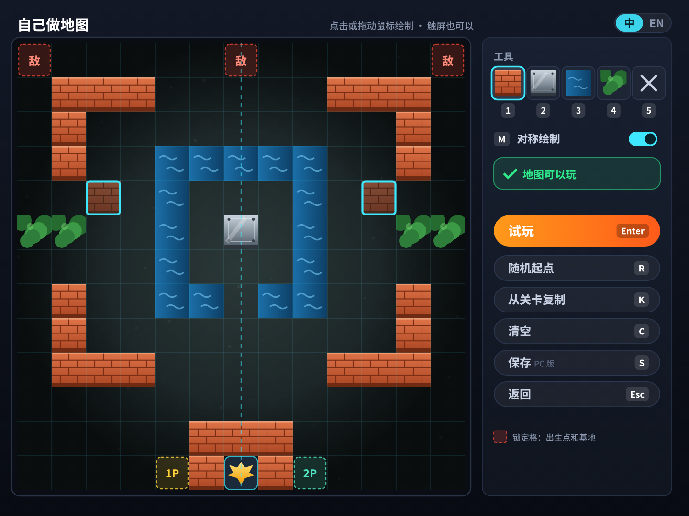
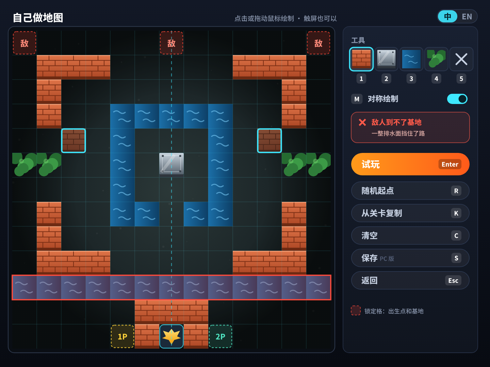
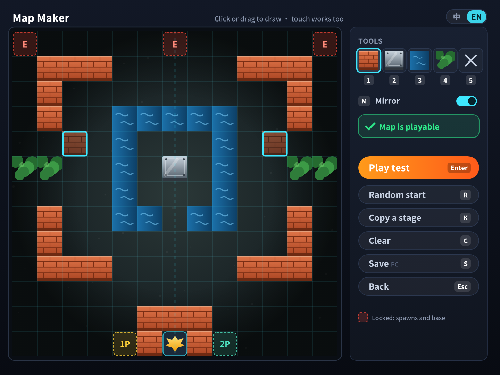
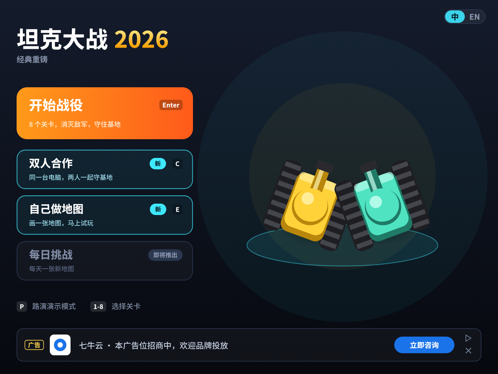
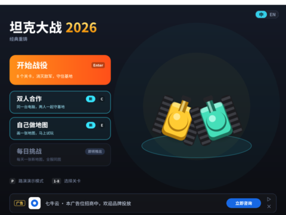
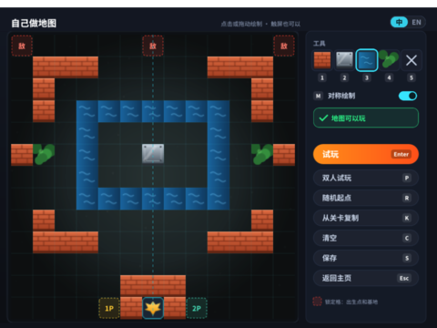
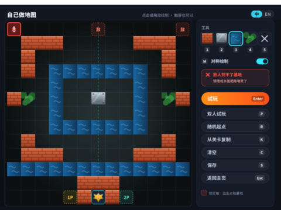
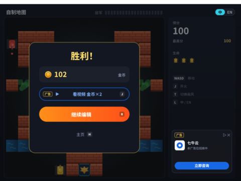

# 坦克大战 v3.0 · 自己做地图（地图编辑器）

> 玩家在游戏里用鼠标（或手指）一格一格画出自己的战场，画完马上试玩。
> 本文是 [v3.0 规划](PLAN.md)的一部分。**状态：✅ 已实现**（[PR #14](https://github.com/Qiniu-ERE/zero/pull/14)），第七节是实际运行截图和验证记录；前面几节是当初的评估和方案。效果图由 [`mockups/gen_v3.py`](mockups/gen_v3.py) 调用游戏自己的美术生成器画出。

## 结论

**可行，约 3 天。**

- **所有平台都能用**：纯游戏逻辑，不需要联网，打包出来的 PC / Mac / 手机版和 XBuilder 网页版一样能玩。
- **不需要文字输入**：只用鼠标 / 触屏和按键，不用引擎自带的输入框（白色、固定在屏幕底部、和游戏风格不搭），也不用额外打包中文字体。
- **契合定位**：玩家自己创作、所见即所得，和 XBuilder 面向青少年创作的定位一致。
- **规则现成**：地图合格的标准就是 `tools/levels/check.py`（PR #10），8 个关卡都用它检查过。

---

## 一、效果图

| 编辑中（地图合格） | 地图有问题（实时提示并标红） |
|---|---|
|  |  |

| English | 新主页：「自己做地图」入口（按 E） |
|---|---|
|  |  |

## 二、玩法

| 操作 | 作用 |
|---|---|
| 主页按 **E** / 点击「自己做地图」 | 进入编辑器 |
| 鼠标**点击或拖动**（手机上用手指） | 用当前工具画格子 |
| **1 ~ 5** / 点击工具 | 砖墙、钢墙、水面、草丛、橡皮擦 |
| **M** | 对称绘制开关：画左边，右边自动镜像（默认打开，新手也能画出好看的地图） |
| **Enter** / 点击「试玩」 | 地图合格时进入试玩；不合格时提示“地图还不能玩”，原因看右侧的检查结果 |
| **R** | 随机起点：随机生成一张合格的地图，在它上面修改 |
| **K** | 从关卡复制：每按一次换一关（1~8），在现有关卡上改 |
| **C** | 清空（保留锁定格） |
| **S** | 保存（PC 版，见第四节） |
| **Esc** | 返回主页 |
| 试玩时按 **Esc** / 点顶栏 Ⅱ | 暂停，选“返回编辑”回到编辑器（v3.0.1） |

- **锁定格**：三个敌人出生点（标“敌”）、1P / 2P 出生点、基地和基地上方左右三块护墙。这些格子不能改，从源头上避免最常见的错误。
- **实时检查**：每画一笔都检查一次，右侧显示“✓ 地图可以玩”，或者显示问题（“敌人到不了基地”“玩家开不到敌人出生点”），并把出问题的位置标红。
- **试玩**：进入「自制关卡」，顶栏显示“自制关卡”。结算时多一个「继续编辑」按钮，回到编辑器接着改。双人模式（见 [COOP.md](COOP.md)）也能玩自制地图。

## 三、技术方案

| 部分 | 做法 | 依据 |
|---|---|---|
| 鼠标 / 触屏绘制 | 每帧检查 `mousePressed`，用 `mouseX` / `mouseY` 换算格子（`cellIndex`，已有）。按住拖动就能连续画 | spx 有 `MousePressed` / `MouseX` / `MouseY`；Godot 默认把单指触屏当作鼠标，所以手机上不需要多点触控 |
| 显示地形 | 复用 `Tile` 克隆：改格子时，旧格子的克隆销毁，按新类型 `Tile.build` 一个。`Tile.sync` 从“只处理砖墙”改成“和 `grid` 不一致就销毁” | 地图最多 169 格，每次只改一两格，开销很小 |
| 检查 | 把 `tools/levels/check.py` 的规则移植成 spx 函数 `mapProblem()`（约 60 行，广度优先搜索判断连通），返回**问题编号 + 位置**，文案提前烘焙成造型 | 界面文字都是构建时转成路径的，运行时不能显示任意字符串 |
| 界面 | 编辑器背景、工具栏、按钮、提示文案都由 `build.py` 生成；工具选中框、光标、问题标记用 `UI` 的新 kind | 和现有界面同一套做法 |
| 随机起点 | `genMap()`：随机生成左半边、右半边镜像，按地形权重放砖墙 / 钢墙 / 水面 / 草丛，用 `mapProblem()` 检查，不合格就重来 | 地图只有 13×13，几次之内就能得到合格的地图 |
| 解释器限制 | 不新增精灵类型、不给精灵加字段，只加舞台变量和函数、`UI` 的 kind | [架构文档 9.1](../ARCHITECTURE.md) |

## 四、保存和分享

| 平台 | 能做到什么 | 依据 |
|---|---|---|
| **本地 `spx run` / PC 单文件版** | ✅ 存到电脑上，下次打开还在（比如 `~/Library/Application Support/TankBattle/maps.txt`） | 实测：游戏脚本里 `os.UserConfigDir()` + `os.WriteFile` / `os.ReadFile` 能正常读写（测试文件已删除） |
| **XBuilder 网页版、Web 包、手机** | ⚠️ 只在本次运行里有效（3 个存档位，关掉页面就没了） | 浏览器里的 wasm 没有真正的文件系统；spx 引擎有“持久化目录”接口，但没有开放给游戏脚本 |
| **分享给别人** | ❌ v3.0 不做 | 地图编码大约 70 个字符，太长不适合手抄；游戏画面里的文字也不能复制。以后可以通过 Web 外壳页面（JS 读写 localStorage、生成分享链接）实现 |

## 五、风险

| 风险 | 应对 |
|---|---|
| XBuilder 网页版里 `os.WriteFile` 的行为没测过（可能报错，也可能静默失败） | 保存失败时提示“网页版只能在本次运行中保存”；在 XBuilder 实测确认 |
| 点按钮时误画到战场上 | 只在战场范围（13×13）内响应绘制，右侧面板区域不画 |
| 手机屏幕上格子太小 | 手机横屏时整个画面高约 65 mm，一格只有 4~5 mm，手指很难点准。对策：手机上改成“先点格子出现放大光标，再点工具确认”，或者建议在平板 / 电脑上编辑；手机上照样可以试玩 |
| 玩家画出很难打的地图（比如全是钢墙） | 检查只保证“能玩”，不保证“好玩”；试玩输了可以继续编辑，这本身就是乐趣 |

## 六、里程碑

| 阶段 | 内容 | 估算 |
|---|---|---|
| **P0** | 编辑器页面、绘制、工具、对称、锁定格、实时检查、试玩 / 继续编辑 | 2 天 |
| **P0** | 随机起点、从关卡复制、清空；PC 版保存到文件、网页版存档位 | 0.5~1 天 |
| **P1** | Web 外壳里用 localStorage 保存、分享链接 | 1 天 |

## 七、实现结果（`spx run` 实际运行）

| 主页：按 E 进入 | 编辑中（地图合格） | 地图有问题：出生点标红 | 试玩胜利：继续编辑 |
|---|---|---|---|
|  |  |  |  |

**验证**（在工程副本里追加测试脚本调用编辑器函数，`spx run` 运行）：

| 场景 | 结果 |
|---|---|
| 进入编辑器 | 空白地图只有锁定格；地形由 `Tile` 克隆显示，玩家坦克隐藏 |
| 对称绘制 | 画左边，右边同时出现；锁定格不会被改 |
| 画一整排水面 | 右侧显示“敌人到不了基地”，左上出生点标红；删掉两格后恢复“地图可以玩” |
| 随机起点 | 生成的地图检查合格 |
| 从关卡复制（按两次 K） | 载入第 2 关的地图 |
| 保存（PC） | 写入 `~/Library/Application Support/TankBattle/maps.txt`（182 字节），下次进入编辑器自动载入（测试文件已删除） |
| 试玩 / 双人试玩 | 进入「自制地图」（双人时带「双人 / 2P」标签）；胜利后「继续编辑」回到编辑器 |
| English | 编辑器、提示、按钮都有英文 |

**和方案不同的地方**：

- **只有一个保存位**：PC 版存到文件，下次自动载入；网页版保存时提示“网页版不能存文件，地图保留到关闭页面”（地图在本次运行里一直保留）。原方案的 3 个存档位没有做。
- **问题标记**：在出问题的出生点（敌人到不了基地）或玩家出生点（坦克开不到敌人出生点）上标红，没有标整排。
- **还没做**：手机上的“放大光标”。鼠标点击和拖动是用每帧检查 `mousePressed` 实现的，触屏在引擎里会当作鼠标，理论上可以直接用，但还没在真机上试过。
- **没测的**：真实的鼠标点击和拖动（测试是脚本直接调用绘制函数；为了不往你的前台窗口发鼠标事件）。
