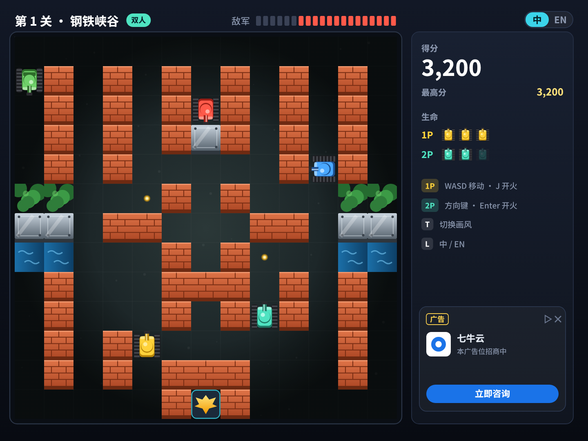

# 坦克大战 v3.0 · 规划总览

v2.0 把 1985 年的《坦克大战》在 XBuilder 上重做成了 2026 年的样子，但只有一关，只能一个人玩，也只能在 XBuilder 网页里玩。v3.0 要解决四个问题：**内容不够玩、地图只能开发者做、只能一个人玩、只能在电脑网页上玩**。

| 方向 | 内容 | 状态 | 详细文档 |
|---|---|---|---|
| **1. 关卡** | 从 1 关扩展到 8 关，每关的地形和敌军配置都不一样；选关、下一关、全部通关 | ✅ 已实现（[PR #10](https://github.com/Qiniu-ERE/zero/pull/10)） | 本文第一节 |
| **2. 自己做地图** | 玩家用鼠标 / 手指画地图，实时检查，马上试玩 | ✅ 已实现（[PR #14](https://github.com/Qiniu-ERE/zero/pull/14)） | [MAP_EDITOR.md](MAP_EDITOR.md) |
| **3. 双人合作** | 同一台电脑两人各开一辆坦克，一起守基地 | ✅ 已实现（[PR #13](https://github.com/Qiniu-ERE/zero/pull/13)） | [COOP.md](COOP.md) |
| **4. 跨平台** | Windows / macOS / Linux 双击运行；iPhone / 安卓用浏览器（PWA）或 App 运行 | 方案已评估，Mac 和 Web 已实测 | [CROSS_PLATFORM.md](CROSS_PLATFORM.md) |

四个方向互相配合：**8 个关卡**提供基本内容；**自己做地图**让内容不再有上限，编辑器里也锁定了 2P 出生点；**双人合作**可以玩所有关卡和自制地图；**跨平台**让更多人玩到，而且前三项都不依赖网络，打包后在所有平台都能用。

---

## 一、8 个关卡（已实现）

| 关卡 | 地形 | 敌军 | 开场提示 |
|---|---|---|---|
| 1 钢铁峡谷 | 经典布局，砖墙夹道（v2 原有） | 标准：重型 20%、快速 30%，每 2 秒出兵，场上最多 4 辆 | 消灭 20 辆敌军，守住基地！ |
| 2 水乡迷宫 | 大片水面分割战场，坦克要绕路，子弹能隔河对射 | 标准 | 水网密布：坦克过不了河，子弹可以 |
| 3 丛林伏击 | 草丛遍地 | 快速 60%，每 1.8 秒 | 草丛里埋伏着快速坦克 |
| 4 钢铁堡垒 | 钢墙林立，射击角度少 | 重型 50%，每 2.2 秒 | 钢铁堡垒：重型坦克要打 3 发 |
| 5 砖城巷战 | 密集砖墙街区 | 重型、快速各 30%，每 1.8 秒 | 巷战：打穿砖墙，开出一条路 |
| 6 闪电突袭 | 开阔地，几乎无处躲 | 快速 70%，每 1.2 秒，场上最多 5 辆 | 闪电突袭：敌军来得更快 |
| 7 双子要塞 | 左右两座砖堡，中间一道水渠 | 快速 50%、重型 30%，每 1.5 秒，场上最多 5 辆 | 双子要塞：小心两侧的交叉火力 |
| 8 最终决战 | 水、草、钢都有，基地两侧有钢墙 | 重型、快速各 45%，每 1.3 秒，场上最多 5 辆 | 最终决战：守住最后的防线！ |

- **流程**：胜利后按「下一关」，得分带到下一关；第 8 关胜利显示「全部通关！」；战败后重打本关，得分回到进关时的分数。主页按 1~8 可以直接选关。
- **关卡检查**：`python3 tools/levels/check.py` 检查每张地图的出生点、基地和连通性。编辑器里的实时检查用同一套规则。
- **代码**：地图在 `main.spx` 的 `levelMap()`，敌军配置在 `stageTune()`。没有给任何精灵加字段，不影响解释器的方法表上限。

## 二、自己做地图（方案）

| 编辑中 | 地图有问题时 |
|---|---|
|  |  |

要点（详见 [MAP_EDITOR.md](MAP_EDITOR.md)）：

- 主页按 E 进入。鼠标点击或拖动绘制（手机上用手指），1~5 选工具，M 对称绘制，R 随机起点，K 从现有关卡复制，Enter 试玩。
- 出生点和基地是锁定格；每画一笔都检查一次，有问题就标红并说明原因，合格才能试玩。
- 保存：PC 版存成文件（已实测游戏脚本能读写文件）；网页版只能在本次运行里保存。分享 v3.0 先不做。
- 不需要文字输入，所以用不到引擎的白色输入框和 1.1 MB 的中文字体。

## 三、双人合作（方案）

| 双人对局 | 新主页 |
|---|---|
|  |  |

要点（详见 [COOP.md](COOP.md)）：

- 主页按 C 进入。1P：WASD + J；2P：方向键 + Enter。2P 是青绿色坦克，在基地右边出生（8 张地图都已确认这个位置可用）。
- 每人 3 条命，基地被毁或两人都没命时失败；复活仍然每局一次，两人各加 1 条命；没有友军伤害。
- 实现上，2P 是 `Player` 的克隆，不新增精灵类型、不加字段；敌人子弹的中弹判定要改成每辆坦克自己检查（现在是广播，两辆会一起中弹）。
- 联网双人做不了（spx 的多人命令还没实现）；手机双人只能在 Web 外壳里用多点触控做。

## 四、跨平台（方案）

要点（详见 [CROSS_PLATFORM.md](CROSS_PLATFORM.md)）：

- 不需要“解码”：spx 4.0 自带 `buildlauncher` / `exportweb` / `exportapk` / `exportios` 等导出命令。
- PC：`spx buildlauncher` 打出单文件程序，Mac 已实测；Windows、Linux 用 CI 构建。
- 手机：XBuilder 网站在手机上整站不能用，所以要自己托管 Web 包（PWA）加虚拟按键，已验证虚拟按键不用改游戏代码；安卓也可以出 APK。

---

## 五、里程碑

| 阶段 | 关卡 | 自己做地图 | 双人合作 | 跨平台 |
|---|---|---|---|---|
| **P0** | ✅ 8 关、选关、下一关、检查工具 | 编辑器、绘制、实时检查、试玩、随机起点、复制关卡、PC 保存（约 3 天） | 2P 坦克、按键、规则、HUD、主页入口（约 2.5 天） | 导出脚本；CI 打包 PC 三平台和 Web；Web 外壳 + 虚拟按键 + PWA（约 3 天） |
| **P1** | 关卡平衡调整（试玩后调敌军配置） | Web 外壳里保存、分享链接 | 各自击毁数；平板双人虚拟按键；手柄映射说明 | Android APK |
| **P2** | 「每日挑战」 | — | — | iOS、游戏内虚拟按键、微信小游戏（[评估](WECHAT_MINIGAME.md)） |

P0 剩余约 8~9 天（关卡已完成）。建议顺序：双人合作 → 自己做地图 → 跨平台，这样打包时所有玩法都已经就绪。
