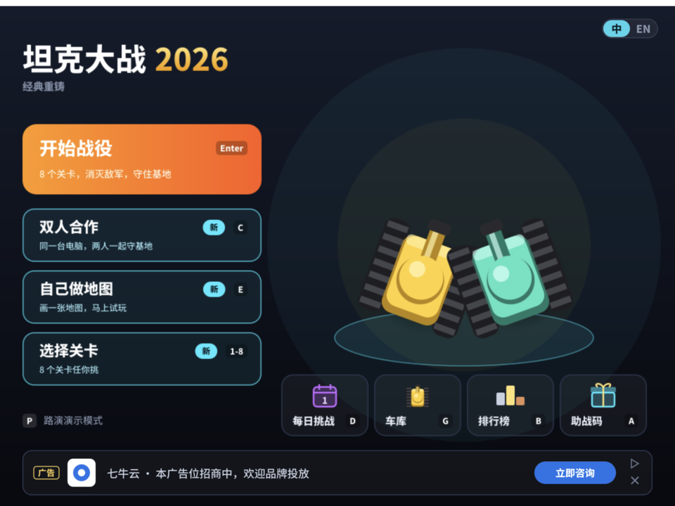
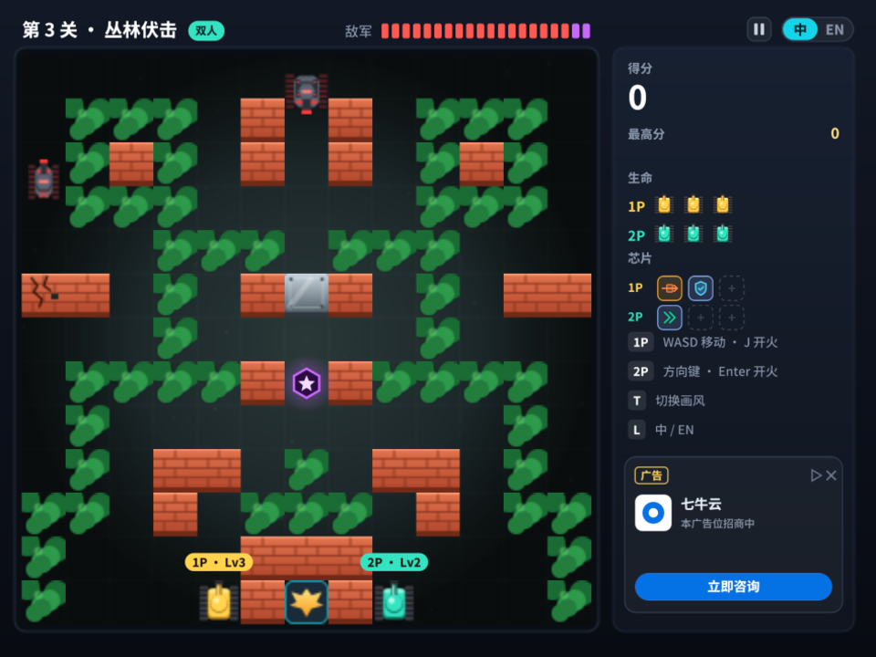
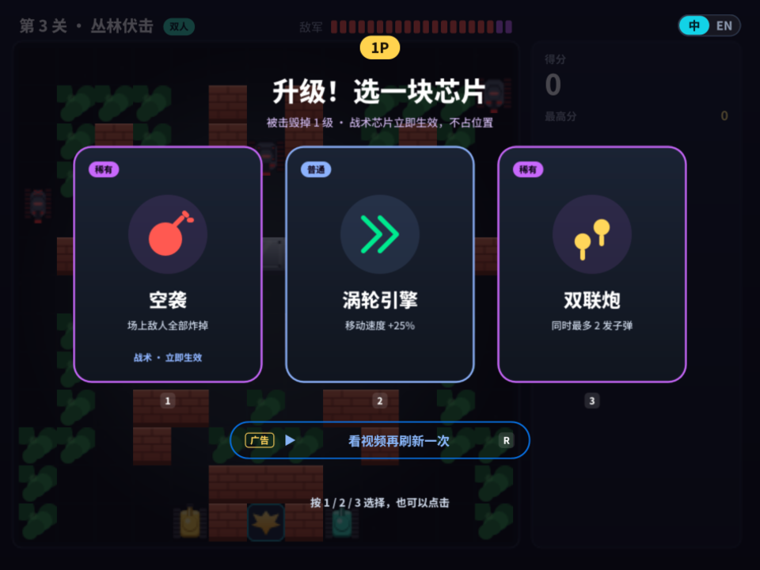
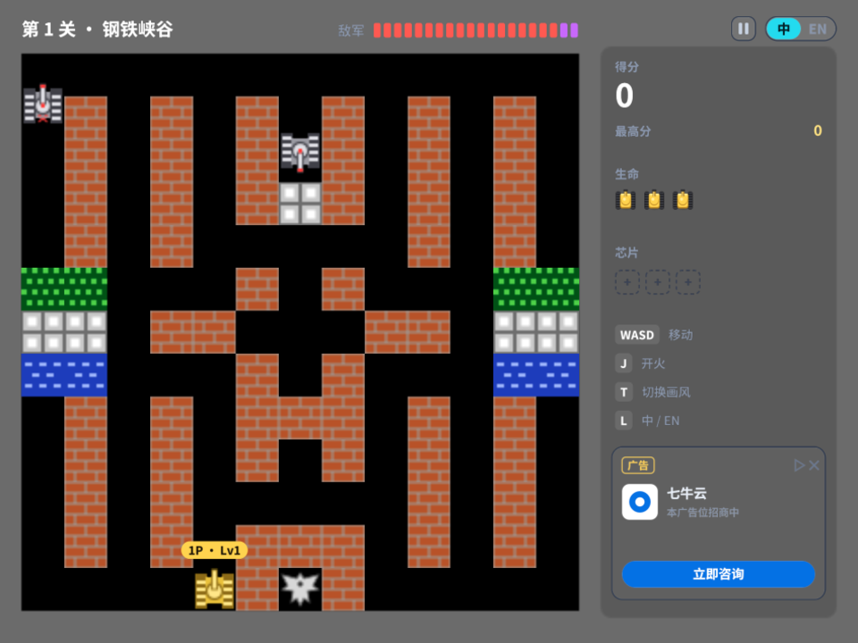
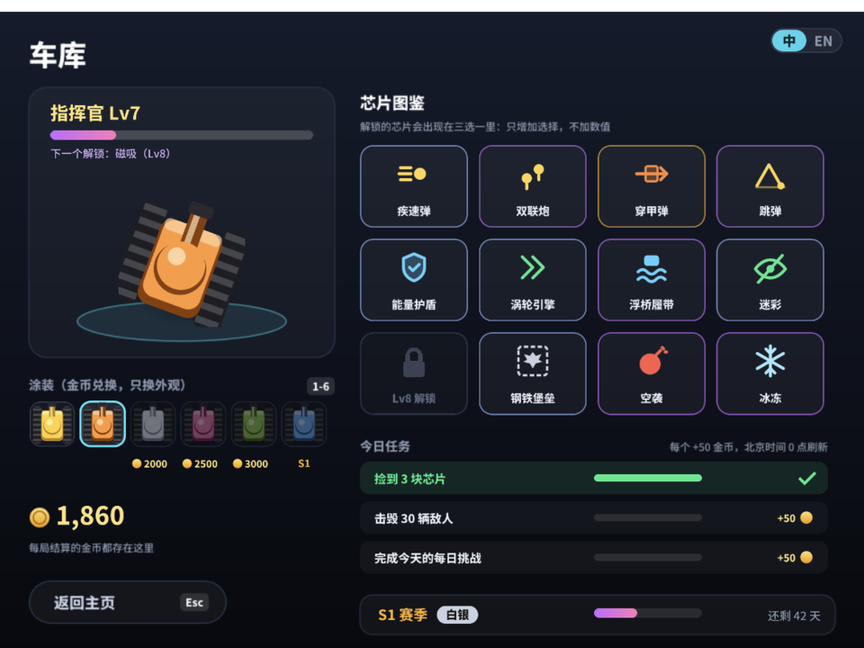
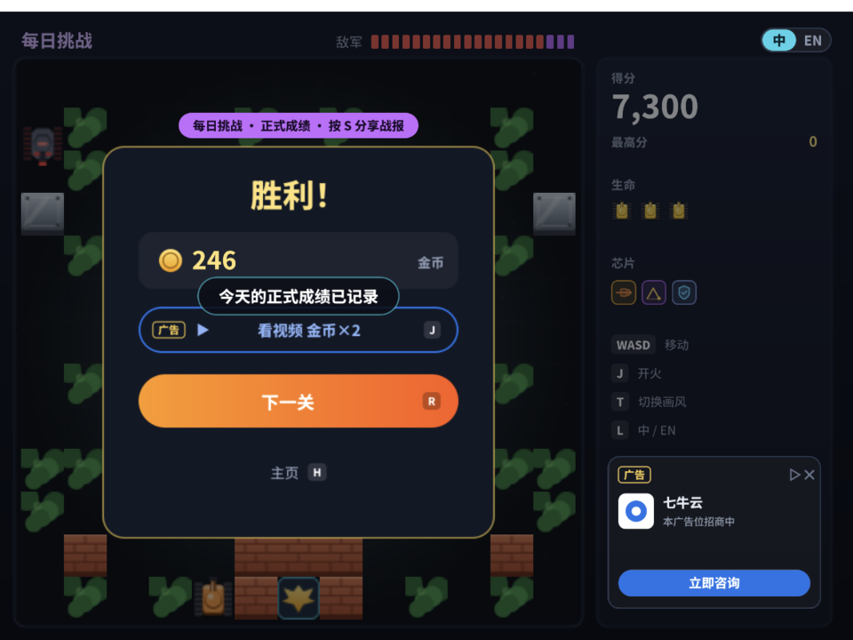
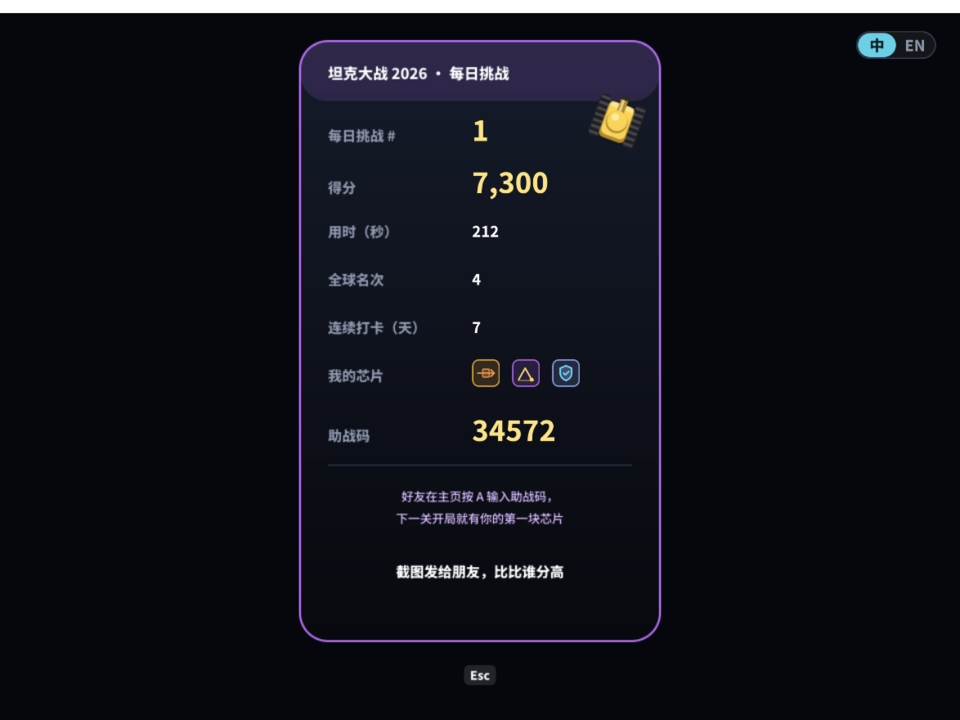
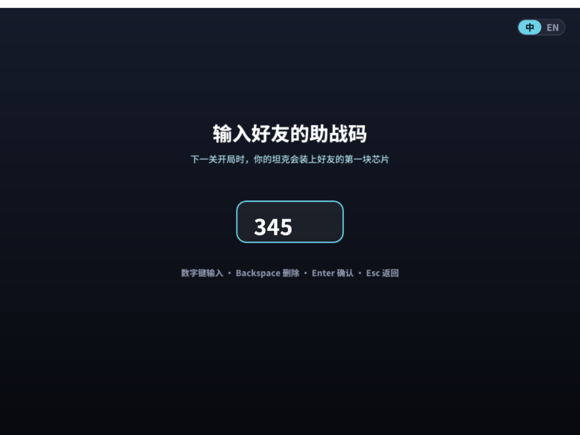
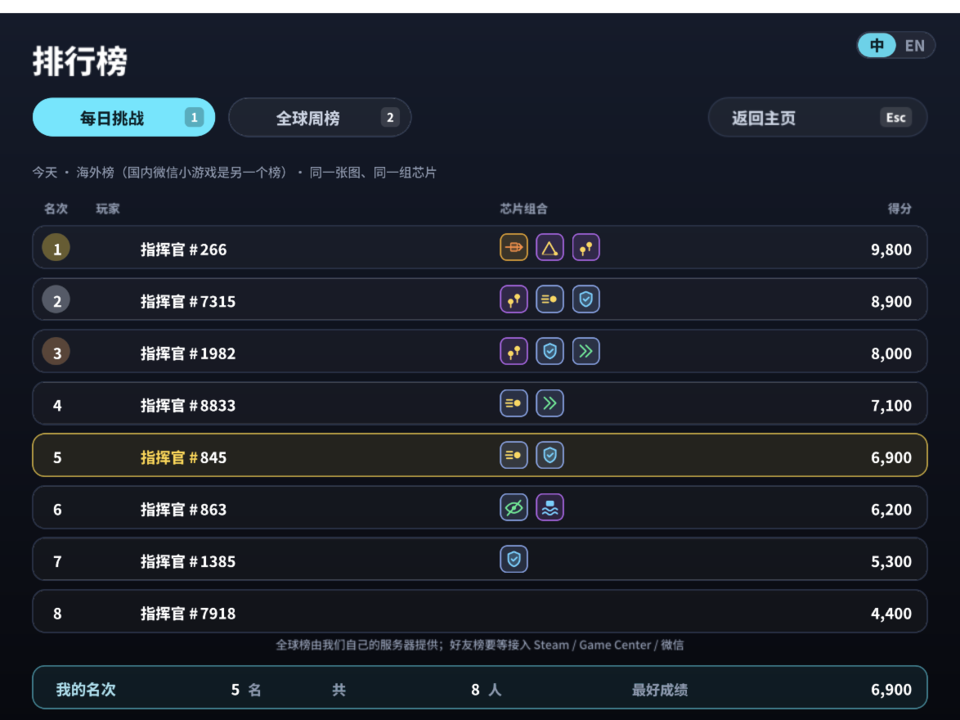

# 坦克大战 v6.0 · 规划和实现：敌我区分、打精英升级、排行榜

> **v6.0 的 P0~P4 已经实现**（PR #85~#89），截图都是游戏实际运行的画面（`screens/`）。还没做的：平台好友榜（P5，要等 SDK 桥）、排行榜服务的正式部署（服务端代码和测试已完成）。依据分三类：**代码**（仓库里的实现）、**公开资料**（2026-10-31 / 11-01 查阅，上线前要重新核对）、**推测**（所有留存和收入数字）。

**目标只有一个：让玩家明天还想回来。** v5 的回本测算假设平均每个玩家只玩 2 天（[盈利方案](../v5/MONETIZATION.md)），多留一天，广告收入就多一半。

| # | 方向 | 一句话 | 状态 |
|---|---|---|---|
| 1 | **敌我区分** | 我方亮色圆炮塔 + 光圈 + “1P · Lv3”标签；敌方统一枪灰色切角车身 + 红色标识 | ✅ #85 |
| 2 | **局内升级** | 打掉紫色精英坦克掉芯片，三选一，最高 Lv4，被击毁掉 1 级 | ✅ #86 |
| 3 | **局外成长** | 车库：指挥官等级解锁芯片（只加选择、不加数值），金币换涂装，每日任务，存档 | ✅ #87 |
| 4 | **回来的理由** | 每日挑战（全球同图同芯片）、免费赛季、分享战报、助战码 | ✅ #88、#89 |
| 5 | **排行榜** | 全球周榜、每日挑战榜自建（服务端 + 客户端，海外和国内分开）；好友榜用各平台自己的 | ✅ 自建榜（未部署）· ⏳ 好友榜 |
| 6 | **测试全覆盖** | 每个用例 ID 都有测试，v6 新函数全部执行到，新工具 100% 行覆盖 | ✅ [测试方案](TEST_PLAN.md) |

| 主页 | 战斗（双人、精英、掉落的芯片） | 三选一 |
|---|---|---|
|  |  |  |

## 一、敌我区分

以前敌我只靠车身颜色区分：玩家黄 / 青绿，敌人红 / 蓝 / 绿，2P 的青绿和重型敌人的绿很像。现在**四重区分**，任何一项单独看都能分清：

| | 我方（1P、2P） | 敌方（普通、快速、重型、精英） |
|---|---|---|
| **颜色** | 亮色：1P 黄、2P 青绿；涂装也只用亮色 | 统一枪灰色车身，标识色红色；精英换紫色 |
| **外形** | 圆角车身、圆形炮塔 | 切角车身、六角炮塔；种类看外形：快速窄、重型带装甲板 |
| **标识** | 脚下光圈 + 头顶“1P · Lv3”（`UI` 的 `kAlly`，每帧跟着坦克） | 车头红色警示条、红色炮口、红色“眼睛” |
| **子弹** | 黄色 | 红色 |

- 经典画风（按 T）也一样：敌人统一银灰色 + 红色眼睛，三种外形不同；精英是紫色像素坦克。
- 光圈和标签不画进坦克造型：造型变大会改变碰撞范围。敌人造型都由 `tools/assets/build.py` 生成；精灵不加字段（方法表上限）。

## 二、局内升级：打精英，升级自己

照着 1985 年原版的“打闪光坦克 → 吃星星升级”，把固定路线换成**三选一**：每局选的不一样，打法就不一样。

| 规则 | 实现 |
|---|---|
| **精英** | 第 4、11 辆（第 4 关起和每日挑战还有第 18 辆）：紫色、多 1 发血、快 15%、多 300 分，出场提示“精英来袭”。`Enemy.kind` 加 10 表示精英；顶栏剩余格子里还没击毁的精英是紫色 |
| **芯片** | 精英被击毁时原地掉落，10 秒内去捡（暂停不倒计时，最后 3 秒闪烁）；双人时谁捡到谁升级 |
| **三选一** | 战场冻结，从已解锁、还没装上的芯片里按稀有度（普通 6 : 稀有 3 : 传奇 1）抽 3 块；按 1 / 2 / 3 或点击；卡片标出能组成连携的芯片 |
| **刷新** | 每关 1 次：免费版看激励视频；买了去广告（$0.99）和 PC 商店版免费 |
| **等级** | Lv1 起步，每装一块**升级芯片**升一级，最高 Lv4；满级再捡到直接 **+500 分** |
| **战术芯片** | 钢铁堡垒、空袭、冰冻**立即生效，不占位置、不升级** |
| **被击毁** | 掉 1 级，最后选的那块失效（能量护盾能先挡一发） |
| **持续** | 过关带到下一关；战败重打、暂停里重新开始回到进关时；从主页 / 选关进关回到 Lv1 |
| **连携** | 弹幕（穿甲弹 + 跳弹）：反弹 2 次；连射（疾速弹 + 双联炮）：同时 3 发 |

和规划稿不同的三处：满级不再“替换一块”，直接换分；战术芯片不占位置（否则会占掉一个升级位）；迷彩从“敌人看不见你”改成“草丛里敌人子弹打不中你”（敌人本来就不瞄准玩家）。

| 类别 | 芯片 | 解锁 |
|---|---|---|
| 火力 | 疾速弹（子弹 +40%）、双联炮（同时 2 发）、穿甲弹（一发打掉钢墙，传奇）、跳弹（反弹一次） | 一开始就有 |
| 防护 / 机动 | 能量护盾（挡 1 发，30 秒恢复）、涡轮引擎（移速 +25%） | 一开始就有 |
| | 浮桥履带（过水）、迷彩（草丛里打不中） | 指挥官 Lv3 / Lv5 |
| 辅助 | 磁吸（芯片自动飞来） | 指挥官 Lv8 |
| 战术 | 钢铁堡垒（基地四周钢墙 15 秒）、空袭（场上敌人全部炸掉）、冰冻（敌人停 5 秒） | 一开始就有 |

## 三、局外成长：车库与存档

| 项目 | 实现 |
|---|---|
| **存档** | `save.txt`，和自制地图同一个目录；纯文本 `key=value`，版本号不对当作新玩家、认不出的行跳过。网页版没有文件系统，进度只在这次运行里有效 |
| **指挥官等级** | 击毁 +2、精英再 +10、过关 +50、每日挑战 +100 经验；每级 100 + 50 ×（等级 - 1），最高 Lv30（Lv20 约 1 万经验） |
| **芯片图鉴** | 解锁的芯片才进三选一：**只加选择、不加数值** |
| **金币和涂装** | 每局结算的金币存进钱包（看视频翻倍的也算）；1P 4 款涂装 1500~3000 金币，只换现代画风的外观；2P 一直青绿色；第 6 款是赛季涂装，不卖 |
| **每日任务** | 按日期抽 3 个（大家一样），完成 +50 金币；8 种：击毁 30 辆、击毁 3 辆精英、通关 2 关、捡 3 块芯片、打一局双人、凑出连携、试玩自制地图、完成每日挑战 |

## 四、让玩家明天还回来

| 每日挑战结算 | 分享战报 | 输入助战码 |
|---|---|---|
|  |  |  |

| 做法 | 实现 |
|---|---|
| **每日挑战** | 主页按 D。地图按日期生成（北京时间 0 点换），全世界同一张图；敌人顺序和三选一也用当天的种子，卡池是全部 12 块（和指挥官等级无关）；只能单人。今天第一局是**正式成绩**，之后是练习。2026-11-01 是第 1 期。Python 版生成器 `tools/levels/daily.py` 和游戏里逐格相同，365 张都通过 `check.py` |
| **免费赛季** | 6 周一季（2026-11-01 开始 S1）。积分：每日挑战正式成绩 50 + 得分 / 200，战役过一关 20；段位青铜 → 白银 300 → 黄金 800 → 铂金 1600 → 钻石 3000 → 王牌 5000；到黄金送赛季涂装；换季积分清零 |
| **分享战报** | 每日挑战结算后按 S：期数、得分、用时、全球名次（联网时）、连续打卡、芯片、助战码。玩家截图分享；一键分享到微信要等 SDK 桥 |
| **助战码** | 5 位数字（3 位芯片 + 2 位校验）。好友在主页按 A 输入，下一局战役开局装上你的第一块芯片（每日挑战不用，保证公平）。规划稿里的“链接点开、AI 坦克来帮守”要平台分享接口，先用助战码代替 |
| **看视频刷新** | 见第二节；去广告和 PC 版免费 |
| **断签不惩罚** | 连续打卡只展示，断了从 1 开始，不扣东西 |

**效果目标（推测）**：次日留存 22% → 30%、7 日留存 4% → 8%，平均游玩约 2 天 → 3 天。按路演的同一公式，欧美手机单玩家收入 ¥0.57 → 约 ¥0.77，微信小游戏 ¥0.4 → 约 ¥0.6；PC 买断不变。v5 的回本测算不改，等真实数据再更新。

### 和路演商业路线对照

商业路线以路演版为准（[PITCH.md](../v5/PITCH.md)）：手机和微信**免费 + 激励视频、$0.99 去广告**，PC **$0.99 买断、没有广告**，不买量，先上 PC、第 4 个月接广告。

| 路演的要求 | v6 怎么做 | 结论 |
|---|---|---|
| 只放激励视频和战场外横幅，不弹插屏 | 新增的“看视频刷新”是激励视频，玩家自愿看；三选一本来就暂停 | 一致 |
| $0.99 去广告 = 永久清静 | 去广告的玩家刷新不用看视频（`adFree`，接上内购后设置） | 一致 |
| Steam 不能放广告 | PC 商店版（`storeBuild`）没有视频入口，免费刷新 | 一致 |
| 不卖数值，金币只换外观 | 芯片靠等级解锁、不卖；赛季涂装送、不卖 | 一致 |
| 推广 ¥0 | 每日挑战、分享战报、助战码都不花钱 | 一致 |
| 先上 PC，第 4 个月接广告 | v6 全部不需要 SDK，随 PC 和网页上线 | 一致 |
| 投入 ¥3350，之后几乎没有成本 | **有差异**：排行榜要部署。海外榜用无服务器平台的免费额度（推测 ¥0）；国内榜用微信云开发基础套餐 ¥19.9/月，约 ¥240/年 | 跟着微信小游戏上线才产生；回本月份不变 |

## 五、排行榜

截图是本机临时起的排行榜服务的真实数据（`server/leaderboard.py`）。

| 榜 | 谁提供 | 内容 | 状态 |
|---|---|---|---|
| 每日挑战榜 | 自建 | 当天的正式成绩 | ✅ 客户端 + 服务端，未部署 |
| 全球周榜 | 自建 | 单人战役的累计得分，周一换周 | ✅ 同上 |
| 好友榜 | 各平台（Steam / Game Center / 微信开放数据域） | — | ⏳ P5，要等 SDK 桥 |

- **服务端** `server/leaderboard.py`：只用 Python 标准库；上传、榜单、查名次；合理性检查（分数上限按关数、用时、芯片和等级）、限频、**海外（global）和国内（cn）完全分开**；不存 IP 等个人信息。接口见 [server/README.md](../../server/README.md)。
- **客户端**：一局结束后在后台 goroutine 里上传（不卡画面）；没联网时排队（存档里也有，最多 20 条），联网后补传；排行榜画面按 B。服务地址是 `main.spx` 的常量 `lbURL`，**部署后填上**；现在是空的，游戏里显示“排行榜服务还没上线”。
- **玩家身份：不用手机号注册**。现在用第一次启动时生成的随机 16 位 ID，榜上显示“指挥官 #编号”；接上 SDK 后换成平台账号（Game Center 的 `teamPlayerID`、Play 游戏服务、微信 `openid`、SteamID）。不做跨平台账号：同一个人在 Steam 和微信是两条记录，正好分别进海外榜和国内榜。
- **网页版拿不到本机时间**（spx 的解释器里没有 `time.Now`，桌面版用临时文件的修改时间）：用排行榜服务健康检查返回的日期。
- 微信小游戏的实名和防沉迷由平台统一做（腾讯健康系统），上线前和版号要求一起核实。

## 六、测试全覆盖

见 [v6 测试方案](TEST_PLAN.md)：16 个新测试文件、112 个用例 ID（V / U / K / D / R / S / Q），每个 ID 都有测试；`pr_check.sh --coverage` 在 v6 的 ID 缺测试、新函数没执行到、新工具行覆盖不到 100% 时直接失败。

测试和截图发现的最大问题：spx 和 Scratch 一样**全部精灵最多 300 个克隆**，排行榜的数字克隆常驻时超过上限，地图格子和敌人出不来（不报错）。现在全屏画面的小部件按需创建、离开时删掉，并加了克隆预算测试。

## 七、实施结果

| 阶段 | PR | 内容 |
|---|---|---|
| P0 | #85 | 敌我区分（V01~V10） |
| P1 | #86 | 精英与升级芯片（U01~U34） |
| P2 | #87 | 车库与存档、克隆预算（K01~K12、Q01~Q03） |
| P3 | #88 | 每日挑战（D01~D11） |
| P3b | #89 | 全球排行榜：服务端 + 客户端（R01~R29） |
| P4 | #90 | 赛季、分享战报、助战码（S01~S09、Q04） |
| 文档 | #91 | 本文、测试方案、架构文档、截图、覆盖率基线、Python 行覆盖（Q05~Q07） |

**还没做**：
- **P5 平台好友榜**：Steam / Game Center / 微信开放数据域，和广告 SDK 共用一座桥（[MONETIZATION.md 第五节](../v5/MONETIZATION.md#五技术前提为什么-sdk-现在接不上代码)）。
- **排行榜部署**：海外一份、国内一份（国内数据存境内）；部署后把地址填进 `lbURL`。
- **一键分享、内购去广告、手机上输入助战码**：都要平台接口；手机版现在没有键盘输入。
- 规划稿里的“每日挑战附操作录像、前 100 名抽查”：先只做服务端的合理性检查，录像以后做。

## 效果图（规划时）

`mockups/` 是规划阶段用美术生成器画的效果图，保留作对比；实际画面以 `screens/` 为准。重新生成：`tools/dev/venv.sh && .venv/bin/python docs/v6/mockups/gen_v6.py && sh docs/v6/mockups/render.sh`。

## 来源

- Steam：[Leaderboards](https://partner.steamgames.com/doc/features/leaderboards)、[ISteamUserStats](https://partner.steamgames.com/doc/api/isteamuserstats)
- Apple：[WWDC20 周期排行榜](https://developer.apple.com/videos/play/wwdc2020/10619/)、[WWDC21 Game Center 好友](https://developer.apple.com/videos/play/wwdc2021/10066/)、[GKPlayer.teamPlayerID](https://developer.apple.com/documentation/gamekit/gkplayer/teamplayerid)
- 微信：[开放数据域](https://developers.weixin.qq.com/minigame/dev/guide/open-ability/open-data.en.md)、[排行榜](https://developers.weixin.qq.com/minigame/dev/guide/open-ability/ranklist.html)、[wx.login](https://developers.weixin.qq.com/minigame/dev/api/open-api/login/wx.login.html)、[云开发计费](https://developers.weixin.qq.com/minigame/dev/wxcloud/billing/price.html)、[实名和防沉迷公告](https://developers.weixin.qq.com/community/minigame/doc/000e629bcacbe0c1eb94e3f4966008)
- 版署：[防沉迷实名认证系统企业手册](https://wlc.nppa.gov.cn/2021/03/02/a4189493e5594f6c8b2e72dc417b0b29.pdf)
- 留存基准：[GameAnalytics 2026](https://www.gameanalytics.com/reports/2026-mobile-pc-gaming-benchmarks)
- spx 克隆上限：spx 源码 `shape_manager.go` 的 `maxClones = 300`（v3.3.0 和本地 4.0 相同）
