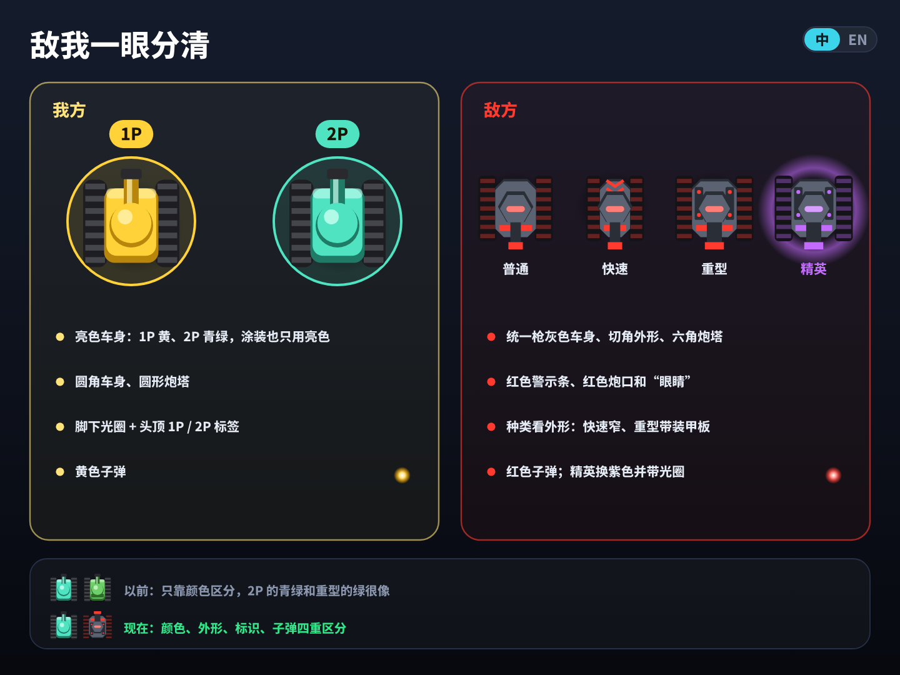
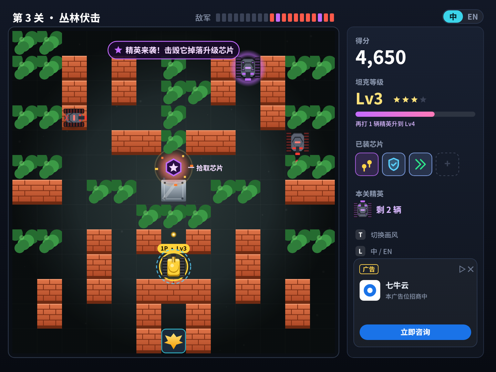
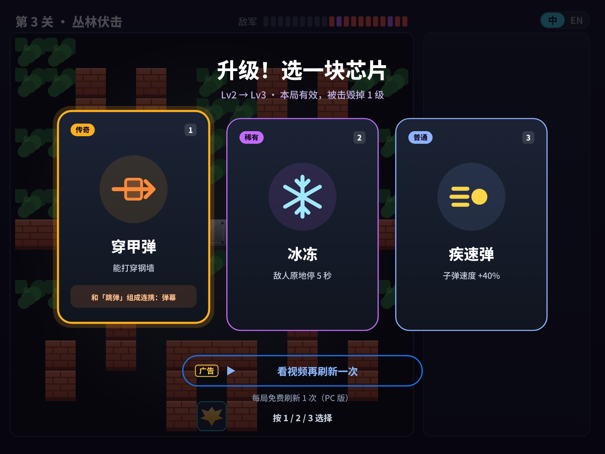
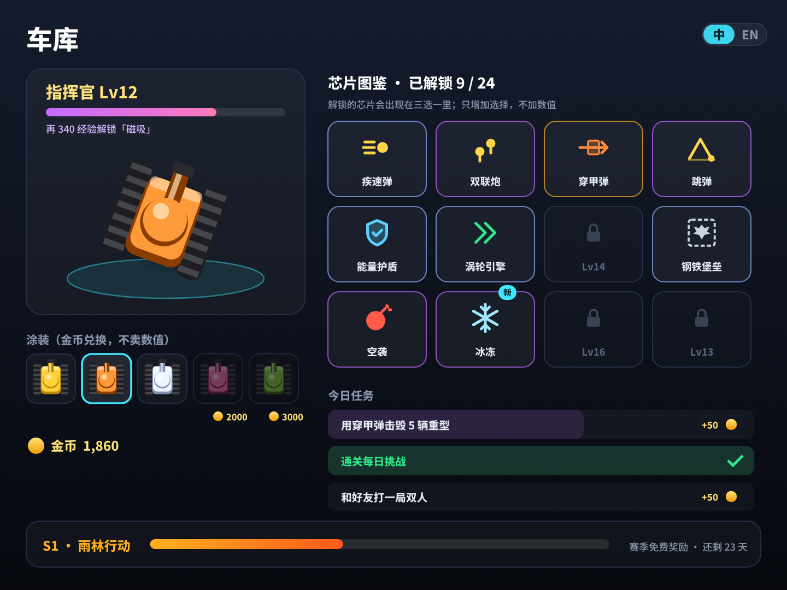
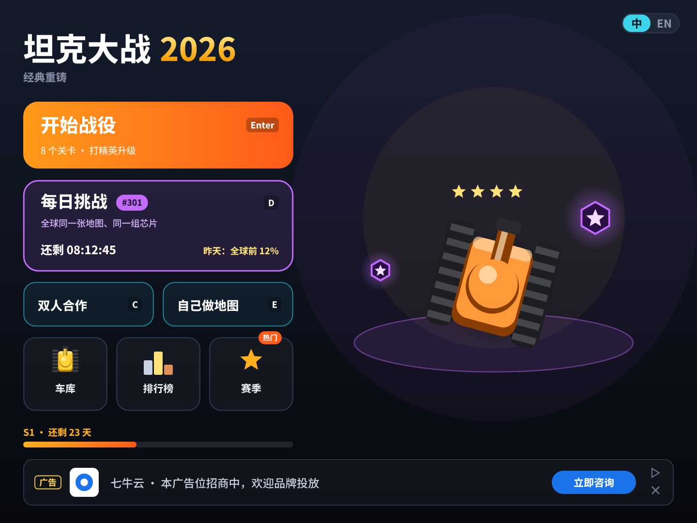
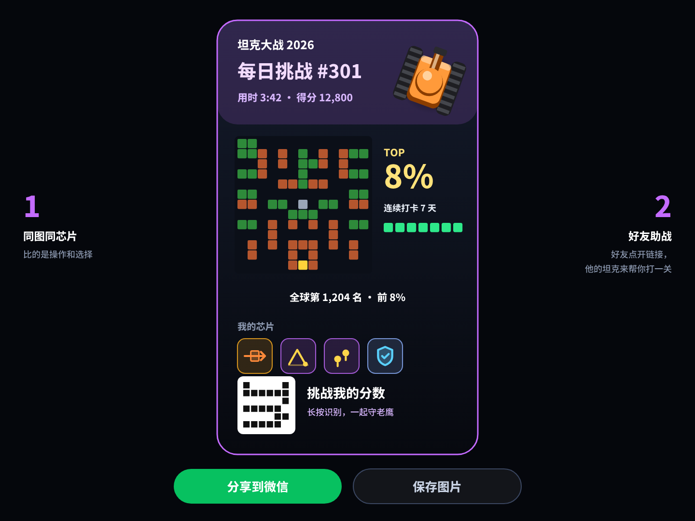
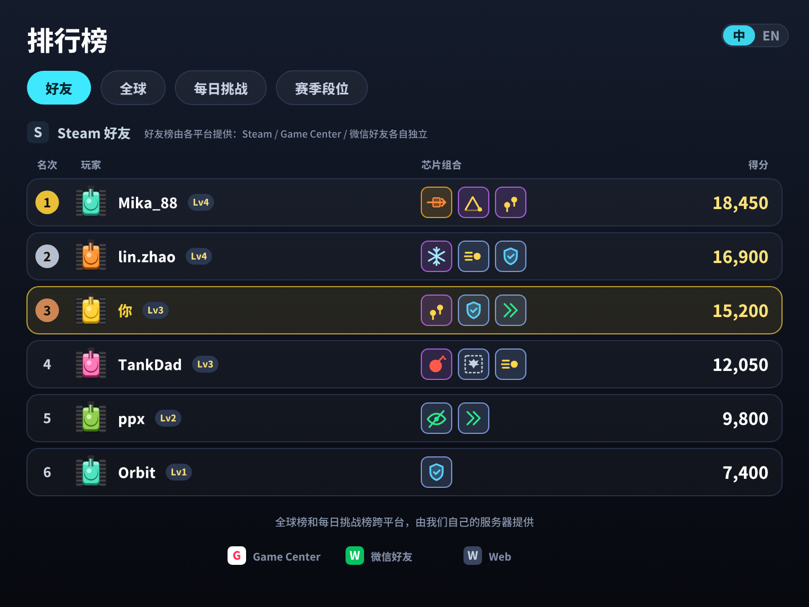
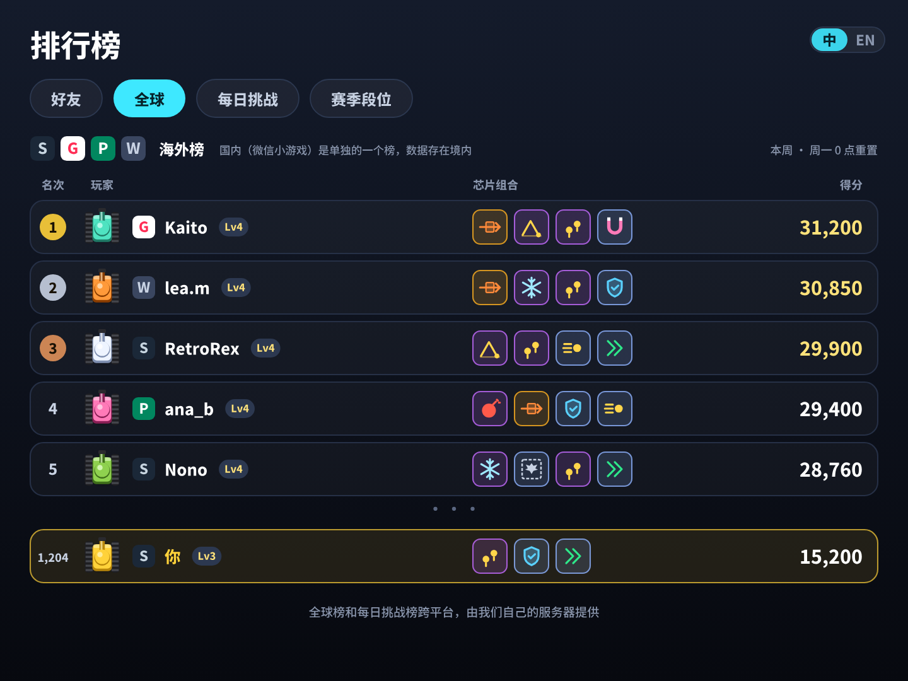

# 坦克大战 v6.0 · 规划：打精英升级，加上排行榜

> **本版只做规划，不改程序。** 文中画面都是效果图（`mockups/gen_v6.py` 用游戏自己的美术生成器画的）。依据分三类：**代码**（读 `main` v5.0.1 确认）、**公开资料**（2026-10-31 查阅，动手前要重新核对）、**推测**（所有留存和收入数字）。

**目标只有一个：让玩家明天还想回来。** v5 的回本测算假设平均每个玩家只玩 2 天（[盈利方案](../v5/MONETIZATION.md)），多留一天，广告收入就多一半。

| # | 方向 | 一句话 |
|---|---|---|
| 1 | **敌我区分** | 我方亮色圆炮塔 + 光圈 + 1P/2P 标签；敌方统一枪灰色切角车身 + 红色标识 |
| 2 | **局内升级** | 打掉紫色精英坦克掉芯片，三选一，最高 Lv4，被击毁掉 1 级 |
| 3 | **局外成长** | 车库：指挥官等级解锁芯片（只加选择、不加数值），金币换涂装，每日任务 |
| 4 | **回来的理由** | 每日挑战（全球同图同种子）、免费赛季、分享战报 |
| 5 | **排行榜** | 好友榜用各平台自己的（各自独立）；全球榜、每日榜自建，海外和国内分开 |
| 6 | **测试全覆盖** | v6 每条规则、每个新函数都有自动化测试，覆盖率不达标不能合入 |

## 一、敌我区分



现在敌我只靠车身颜色区分：玩家黄 / 青绿，敌人红 / 蓝 / 绿。2P 的青绿和重型敌人的绿很像，加了紫色精英后颜色更多更乱。v6 改成**四重区分**，任何一项单独看都能分清：

| | 我方（1P、2P） | 敌方（普通、快速、重型、精英） |
|---|---|---|
| **颜色** | 亮色：1P 黄、2P 青绿；涂装也只用亮色 | 统一枪灰色车身，标识色红色；精英标识换紫色并带光圈 |
| **外形** | 圆角车身、圆形炮塔（现有造型） | 切角车身、六角炮塔；种类看外形：快速窄车身、重型带装甲板 |
| **标识** | 脚下光圈 + 头顶 1P / 2P 标签 | 车头红色警示条、红色炮口、炮塔上的红色“眼睛” |
| **子弹** | 黄色 | 红色 |

- 只改美术：`tools/assets/build.py` 的 `TANKS` 和坦克造型函数，加一个敌方造型函数；精灵代码不加字段（方法表上限，[架构文档 9.1](../ARCHITECTURE.md)）。
- 光圈画在造型里（圆形，坦克转向时不变）；1P / 2P 标签是 `UI` 的新 kind，跟随坦克位置、不跟着转。
- 涂装、顶栏剩余敌人格子、排行榜头像都遵守同一规则：深灰和红色留给敌方。

## 二、局内升级：打精英，升级自己

| 打掉精英，掉落芯片 | 升级：三选一 |
|---|---|
|  |  |

照着 1985 年原版的“打闪光坦克 → 吃星星升级”，把固定路线换成 2026 年玩家熟悉的**三选一**：每局选的不一样，打法就不一样。

| 规则 | 内容 |
|---|---|
| **精英** | 每关 2~3 辆（第 4、11、18 辆出场），敌方造型 + 紫色标识和光圈；多 1 发血、略快；出场提示“精英来袭！” |
| **芯片** | 精英被击毁时掉落，10 秒内去捡；双人时谁捡到谁升级 |
| **三选一** | 捡到后暂停，抽 3 块，按 1 / 2 / 3 或点击选择 |
| **等级** | Lv1 起步，每选一块升一级，最高 Lv4（3 块芯片）；满级后可替换一块或换 500 分 |
| **被击毁** | 掉 1 级，最后选的芯片失效 |
| **持续** | 战役带到下一关，重打本关回到进关等级；每日挑战一局一清 |
| **连携** | 部分芯片两两组合有额外效果，如穿甲弹 + 跳弹 = 弹幕 |

**第一批 12 块芯片**（初始卡池 9 块，其余靠指挥官等级解锁，以后每赛季加 2~4 块）：

| 类别 | 芯片 |
|---|---|
| 火力 | 疾速弹（子弹 +40%）、双联炮（同时 2 发）、穿甲弹（打穿钢墙，传奇）、跳弹（反弹一次） |
| 防护 / 机动 | 能量护盾（挡 1 发，30 秒恢复）、涡轮引擎（移速 +25%）、浮桥履带（过水）、迷彩（草丛隐身） |
| 守家 | 钢铁堡垒（基地钢墙 15 秒）、空袭（清场，一次性）、冰冻（敌人停 5 秒，一次性） |
| 辅助 | 磁吸（芯片自动飞来） |

技术约束（代码）：精英用 `Enemy` 现有的 `kind` 编码（如 `kind + 10`），不加字段；芯片掉落物是 `UI` 的新 kind；等级、芯片、连携放舞台变量。三选一用**可指定种子**的整数随机数生成器（XBuilder 的 spx v3.3.0 里 `rand(int, int)` 返回 `float64`，[架构文档 9.3](../ARCHITECTURE.md)）。

## 三、局外成长：车库



| 项目 | 做法 |
|---|---|
| **指挥官等级** | 击毁、过关、每日挑战给经验；每级解锁一块芯片或一款涂装，Lv20 约 2 周 |
| **芯片图鉴** | 解锁的芯片才进三选一卡池：**只加选择、不加数值**，排行榜公平 |
| **涂装** | 金币兑换（1500~3000），只换外观，都是亮色 |
| **每日任务** | 每天 3 个，每个 +50 金币，引导试新芯片、打每日挑战、拉朋友双人 |
| **存档** | 本地保存，登录排行榜后同步 |

## 四、让玩家明天还回来

| 主页 | 分享战报 |
|---|---|
|  |  |

| 做法 | 内容 |
|---|---|
| **每日挑战** | 每天 0 点（UTC+8）换地图和种子，全球相同；正式成绩一天一次，可无限练习；365 张地图提前生成，用 `tools/levels/check.py` 检查 |
| **免费赛季** | 6 周一季，有主题、新芯片、限定涂装、段位重置；奖励全部免费，不卖通行证 |
| **分享战报** | 竖版卡片：编号、用时、得分、全球排名、芯片组合、打卡天数、二维码；微信好友排名不能放进图里 |
| **好友助战** | 分享链接带上自己的芯片组合，好友点开后下一关有一辆“你的坦克”由 AI 帮守 |
| **看视频刷新** | 免费版三选一时看激励视频刷新一次（每局 1 次）；$0.99 去广告的玩家和 PC 买断版每局直接免费刷新 1 次 |
| **断签不惩罚** | 连续打卡只展示，断了不扣东西 |

**效果目标（推测）**：次日留存 22% → 30%、7 日留存 4% → 8%，平均游玩约 2 天 → 3 天。按路演的同一公式，欧美手机单玩家收入 ¥0.57 → 约 ¥0.77，微信小游戏 ¥0.4 → 约 ¥0.6；PC 买断不变。v5 的回本测算不改，等真实数据再更新。另看每日挑战参与率（目标 40%）、分享率（5%）、刷新视频观看率（20%）。

### 和路演商业路线对照

商业路线以路演版为准（[PITCH.md](../v5/PITCH.md)）：手机和微信**免费 + 激励视频、$0.99 去广告**，PC **$0.99 买断、没有广告**，不买量，先上 PC、第 4 个月接广告。v6 逐项对照：

| 路演的要求 | v6 怎么做 | 结论 |
|---|---|---|
| 只放激励视频和战场外横幅，不弹插屏、不打断对局 | 新增的“看视频刷新”是激励视频，玩家自愿看、看完有奖励；三选一本来就暂停，不打断对局 | 一致 |
| $0.99 去广告 = 永久清静 | 去广告的玩家刷新不用看视频，和 PC 一样每局免费 1 次 | 已补上（之前只写了 PC） |
| Steam 不能放广告，激励视频也不行 | PC 版没有任何视频入口 | 一致 |
| 不卖数值，金币只换外观 | 芯片靠等级解锁、不卖；赛季奖励全免费、不卖通行证 | 一致 |
| 推广 ¥0：微信分享、双人拉朋友、编辑器做内容 | 分享战报、好友助战、每日挑战都是不花钱的拉新和回流 | 一致，而且加强了 |
| 先上 PC，第 4 个月接广告 | P0~P4 不需要 SDK，先随 PC 和网页上线；看视频刷新跟着广告 SDK 上 | 一致 |
| 投入 ¥3350，之后几乎没有成本 | **有差异**：自建排行榜要运营费。海外榜用无服务器平台的免费额度（推测为 ¥0）；国内榜用微信云开发，基础套餐 ¥19.9/月（原价 ¥39，新用户有免费环境），约 ¥240/年 | 跟着微信小游戏上线才产生；基准情景第二年净赚约 ¥1 万 → 约 ¥9800，回本月份不变 |

## 五、排行榜

| 好友榜（各平台自己的） | 全球榜（自建，海外和国内分开） |
|---|---|
|  |  |

**各平台的好友和排行榜各自独立、互相不通**，所以好友榜跟着平台走，全球榜自己建：

| 平台 | 好友榜接口 | 要注意的 | 做不做 |
|---|---|---|---|
| Steam | Steamworks 排行榜，可按全球 / 附近 / 好友读取 | 接 Steamworks SDK | 做 |
| App Store | Game Center，支持周期榜（适合每日榜） | 接 GameKit，读好友要授权 | 做 |
| Google Play | Play 游戏服务排行榜 | 跟 Android 上架一起（[PLATFORMS.md](../v5/PLATFORMS.md#六google-play)） | 以后 |
| 微信小游戏 | 开放数据域 `wx.getFriendCloudStorage` / `getGroupCloudStorage` | 好友数据只能在开放数据域里读和画，拿不出来，也不能进分享图 | 做 |
| Microsoft Store / 网页 | Xbox 服务门槛高；网页没有 | — | 只用全球榜 |

| 榜 | 谁提供 | 重置 |
|---|---|---|
| 好友榜 | 各平台 | 每日榜每天，其余不重置 |
| 全球榜 | 自建；**海外**（Steam、App Store、Google Play、网页）和**国内**（微信）分开，国内数据存境内 | 每周一 |
| 每日挑战榜 | 自建，同上分海外 / 国内 | 每天 |
| 赛季段位 | 自建，按每日挑战和全球榜积分 | 每赛季 |

### 玩家身份：不用手机号注册

**排名挂在“玩家 ID”上，玩家 ID 来自各平台已登录的账号，不让玩家注册。** 手机号注册要买短信服务（和路演的“之后几乎没有成本”冲突）、要收集和保护手机号这一类个人信息、还会在第一局之前就劝退一批人，不划算。

| 平台 | 玩家 ID 从哪来 | 玩家要做什么 | 昵称 |
|---|---|---|---|
| iOS | Game Center 的玩家 ID（`teamPlayerID`） | 系统已登录就自动有；没登录用设备 ID | Game Center 昵称 |
| Android | Play 游戏服务的玩家 ID | 自动登录 | Play 游戏昵称 |
| 微信小游戏 | `wx.login` 拿 code，服务器换成 `openid`（云开发直接带 `openid`） | 无感，不弹窗 | 玩家用微信的头像昵称填写组件自己填，或者用“指挥官 + 编号” |
| Steam | SteamID（会话票据由服务器验证） | Steam 已登录 | Steam 昵称 |
| 网页 / 微软 | 首次打开生成的匿名设备 ID | 无 | 自己起，过敏感词 |

- **一个玩家 ID 对应一份成绩和存档**：服务器按“平台 + 玩家 ID”存，同一平台换手机、重装都能找回（网页 / 微软除外，清缓存就没了）。
- **不做跨平台账号**：同一个人在 Steam 和微信是两条记录，分别进海外榜和国内榜，正好和“海外 / 国内分开”一致。
- **实名和防沉迷**：微信小游戏由平台统一用微信账号实名、未成年人限时限额（腾讯健康系统），开发者一般不用自己接；上线前和版号要求一起核实。
- 好友关系不存我们这边：好友榜直接用平台接口，我们只存自己的成绩。

### 自建怎么做

游戏脚本用 `net/http` 上传（v5 已验证，[TECH.md](../v5/TECH.md#三存档与匿名统计)），微信走 JS 桥；上传得分、用时、芯片组合、版本，每日挑战附操作录像；服务器做合理性检查和限频，前 100 名抽查录像；离线成绩联网后补传。玩家量级下用无服务器平台的免费额度即可（推测）。

## 六、测试全覆盖

v6 沿用 v4 的测试框架（[测试方案](../v4/TEST_PLAN.md)），要求从“基线不降”提高到**全覆盖**：

| 指标 | v5.0.1 现状 | v6 要求 |
|---|---|---|
| 规则覆盖 | README 玩法规则 100% | 本文每条规则（敌我区分、精英、芯片、等级、连携、车库、每日挑战、排行榜）都有用例 ID，**100%** |
| 函数覆盖 | 全部 96%，`main.spx` ≥ 85% | v6 新增和改动的函数、事件处理 **100%**；整体不低于基线 |
| 芯片 | — | 12 块芯片每块至少一条效果测试 + 一条和其他芯片叠加的测试；每个连携一条 |
| Python 行覆盖 | 没有实现 | 补上 `coverage` 统计；v6 新增的工具（每日地图生成、种子）**100%** 行覆盖，旧工具 ≥ 85% |
| 后端 | — | 排行榜服务每个接口：正常、非法分数、限频、海外 / 国内分区、离线补传 |

新用例按方向编号，写进断言说明，覆盖率报告靠它统计：

| 编号 | 测什么 | 层 |
|---|---|---|
| **V01~** 敌我区分 | 敌方造型都是枪灰车身 + 红色标识、我方都是亮色 + 光圈；涂装颜色不落进敌方色域；子弹颜色按阵营 | L1（`test_assets.py`） |
| **U01~** 升级 | 精英出场位置和血量、掉落和 10 秒消失、三选一暂停和选择、Lv1~Lv4、满级替换 / 换分、被击毁掉级、跨关保留、每块芯片效果、连携 | L2 / L3 |
| **K01~** 车库 | 经验和升级、解锁进卡池、涂装兑换、每日任务、存档读写 | L2 / L3 |
| **D01~** 每日挑战 | 同种子同地图同芯片顺序（逐项比对）、365 张地图全部通过 `check.py`、一天一次正式成绩、离线不计 | L1 / L2 |
| **R01~** 排行榜 | 玩家 ID 获取和回退到设备 ID、去广告玩家刷新不弹视频、上传内容、离线排队补传、海外 / 国内分区、合理性检查、战报卡内容 | L1 / L2 / 后端 |

- `pr_check.sh` 加一项：v6 函数有没覆盖到的、规则表有没对应用例的，**直接失败**，不能合入。
- 按键 / 点击处理在无界面测试里触发不了：处理里只调一个舞台函数，测这个函数；三选一的 1 / 2 / 3 按键走同一个函数。
- 每个 PR 跑全部测试，徽章和基线一起更新；XBuilder 兼容检查（L1.5）照旧。

## 七、实施拆分（以后做）

| 阶段 | PR | 内容 | 估计 |
|---|---|---|---|
| **P0** | feat: 敌我区分 | 敌方新造型、我方光圈和标签、子弹颜色、V 组测试 | 1 天 |
| **P1** | feat: 精英与升级芯片 | 精英、掉落、三选一、Lv1~Lv4、初始 9 块芯片、U 组测试 | 3~4 天 |
| **P2** | feat: 车库与存档 | 指挥官等级、图鉴、涂装、每日任务、K 组测试 | 2~3 天 |
| **P3** | feat: 每日挑战与全球榜 | 种子随机数、365 张地图、海外榜后端、战报卡、D / R 组测试 | 3~4 天 |
| **P4** | feat: 赛季与分享 | 赛季、段位、好友助战、看视频刷新（模拟广告位） | 2~3 天 |
| **P5** | feat: 平台好友榜 | Steam / Game Center / 微信开放数据域、国内榜 | 跟着 SDK 桥 |

P0~P4 不需要 SDK，可以先在 PC 和网页版验证留存；P5 和广告 SDK 共用一座桥（[MONETIZATION.md 第五节](../v5/MONETIZATION.md#五技术前提为什么-sdk-现在接不上代码)）。每个 PR 的测试和功能一起提交，不单独补。

## 效果图

都有中英两版（`mockups/*-en.png`）。重新生成：

```sh
tools/dev/venv.sh
.venv/bin/python docs/v6/mockups/gen_v6.py && sh docs/v6/mockups/render.sh
```

平台标识是示意，不是官方商标；广告是 v2 起就有的模拟广告位。

## 来源

- Steam：[Leaderboards](https://partner.steamgames.com/doc/features/leaderboards)、[ISteamUserStats](https://partner.steamgames.com/doc/api/isteamuserstats)
- Apple：[WWDC20 周期排行榜](https://developer.apple.com/videos/play/wwdc2020/10619/)、[WWDC21 Game Center 好友](https://developer.apple.com/videos/play/wwdc2021/10066/)、[管理排行榜](https://developer.apple.com/help/app-store-connect/configure-game-center/manage-leaderboards/)
- 微信：[开放数据域](https://developers.weixin.qq.com/minigame/dev/guide/open-ability/open-data.en.md)、[排行榜](https://developers.weixin.qq.com/minigame/dev/guide/open-ability/ranklist.html)
- 微信云开发价格：[计费说明](https://developers.weixin.qq.com/minigame/dev/wxcloud/billing/price.html)、[价格计算器](https://cloud.weixin.qq.com/cloudbase/price)（2026-11-01 查阅）
- 微信小游戏实名和防沉迷：[微信开放社区公告](https://developers.weixin.qq.com/community/minigame/doc/000e629bcacbe0c1eb94e3f4966008)、[版署防沉迷系统企业手册](https://wlc.nppa.gov.cn/2021/03/02/a4189493e5594f6c8b2e72dc417b0b29.pdf)
- Game Center 玩家 ID：[GKPlayer.teamPlayerID](https://developer.apple.com/documentation/gamekit/gkplayer/teamplayerid)；微信登录：[wx.login](https://developers.weixin.qq.com/minigame/dev/api/open-api/login/wx.login.html)
- 留存基准：[GameAnalytics 2026](https://www.gameanalytics.com/reports/2026-mobile-pc-gaming-benchmarks)
