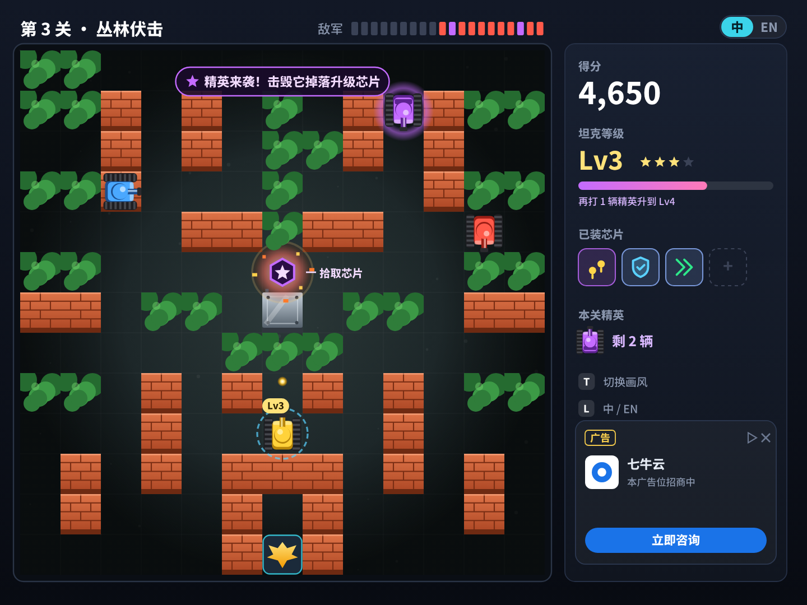
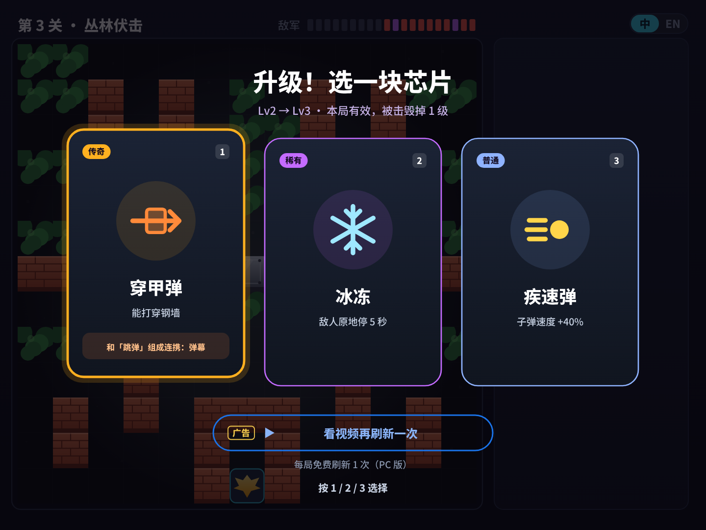
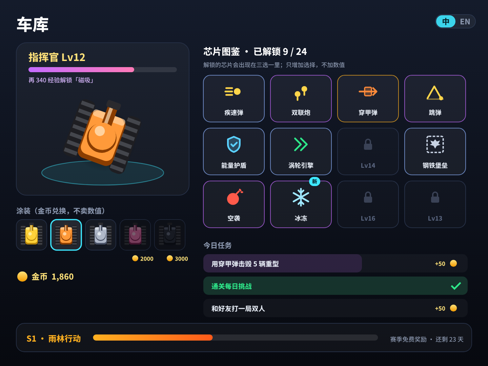
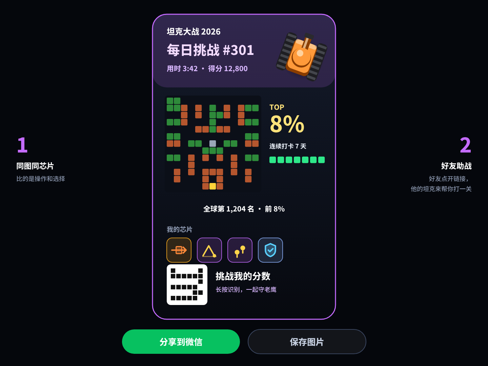
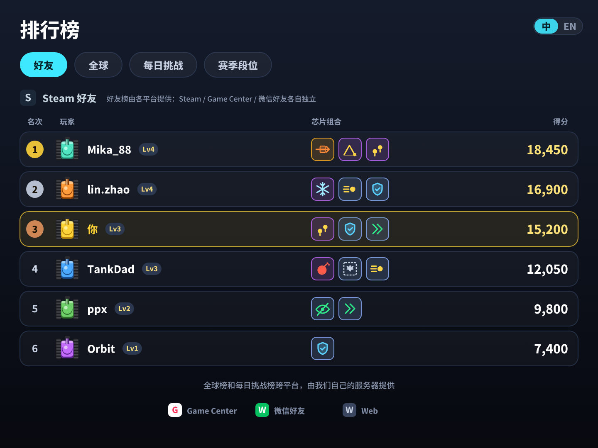
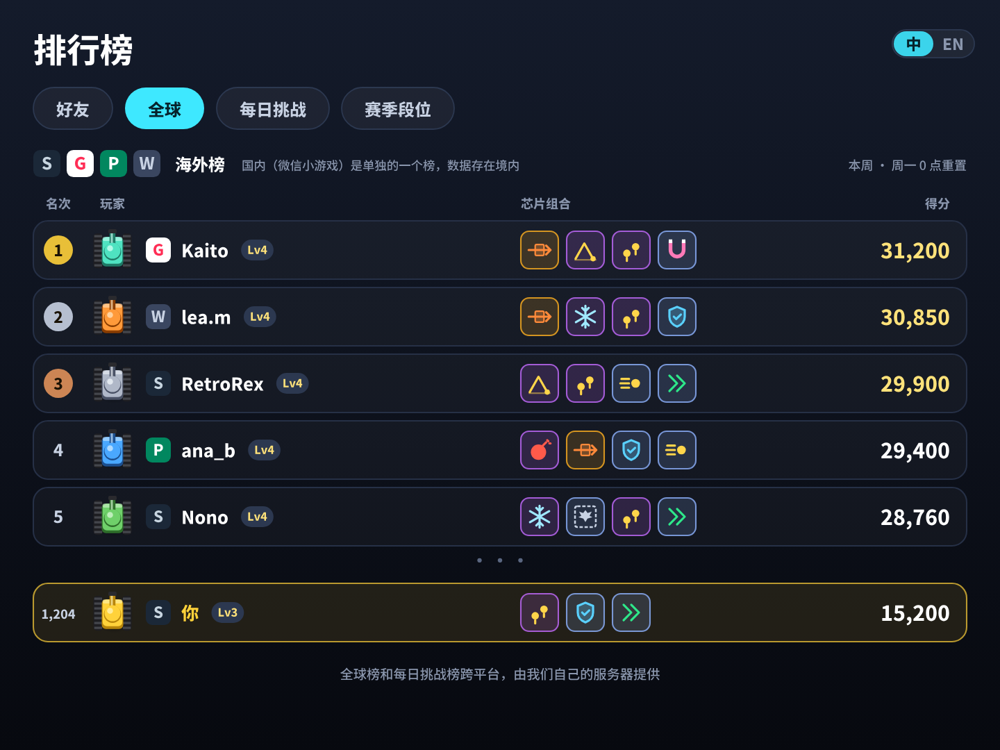
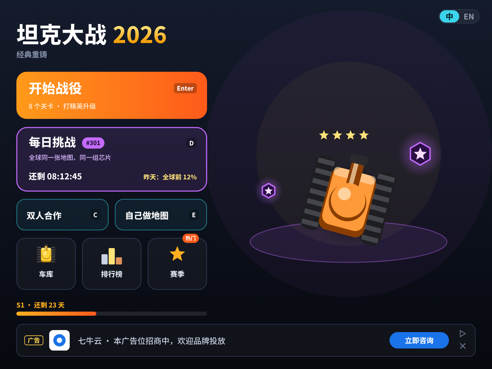
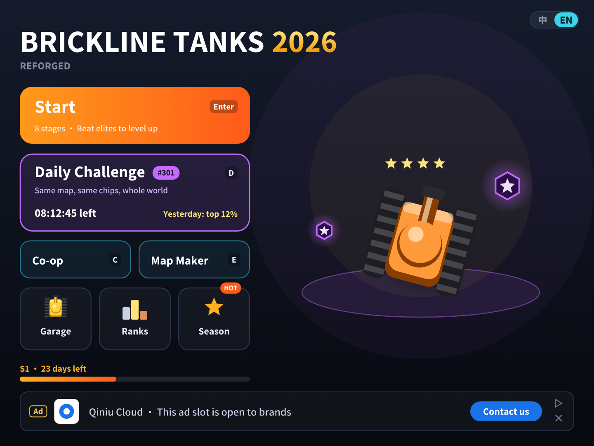

# 坦克大战 v6.0 · 规划总览：打精英升级，加上排行榜

> **本版只做规划，不改程序。** 文中的画面都是效果图（`mockups/gen_v6.py` 用游戏自己的美术生成器画的），游戏里还没有。
>
> 依据分三类，文中都已标明：
> - **代码**：读本仓库 `main`（v5.0.1，`d4564a2`）确认的现状。
> - **公开资料**：2026-10-31 查阅的平台文档，来源列在文末。平台规则经常变，**动手前要以官方文档重新核对**。
> - **推测**：没有条件验证的判断，包括所有留存和收入数字。

v5.0 想清楚了“怎么卖”：免费玩看广告、$0.99 去广告，PC $0.99 买断（[v5.0 盈利方案](../v5/MONETIZATION.md)）。但回本测算里有一个最弱的假设：**平均每个玩家只玩 2 天**（GameAnalytics 2026 留存中位数推算）。广告收入 = 每天的广告 × 玩的天数，玩家多留一天，手机和微信的收入就多一半。v6.0 只解决这一个问题：**让玩家明天还想回来**。

| 方向 | 内容 | 状态 | 本文 |
|---|---|---|---|
| **1. 局内升级** | 每关有几辆紫色的**精英坦克**，击毁后掉落**升级芯片**；捡到后三选一，坦克升到 Lv4；被击毁掉 1 级 | 📝 规划 | 第二节 |
| **2. 局外成长** | **车库**：指挥官等级解锁新芯片（只增加选择，不加数值）、金币换涂装、每日任务 | 📝 规划 | 第三节 |
| **3. 回来的理由** | **每日挑战**（全球同图同芯片）、免费赛季、分享战报、好友助战、看视频刷新芯片 | 📝 规划 | 第四节 |
| **4. 排行榜** | 好友榜用各平台自己的（Steam / Game Center / Google Play / 微信，**各自独立**）；全球榜、每日挑战榜自建，海外和国内分开 | 📝 规划 | 第五节 |
| **5. 实施拆分** | 按 PR 拆成 P1~P5，先做不需要 SDK 的部分 | 📝 规划 | 第六节 |

---

## 一、结论先说

1. **升级系统：照着 1985 年原版的“星星”来，再加上 2026 年玩家熟悉的“三选一”。** 原版打掉闪红光的坦克会掉道具，吃星星升级火力，被击毁就全没了。我们保留“打特定敌人 → 升级自己”这个核心，把固定的升级路线换成**三选一芯片**：每局选的不一样，打法就不一样，可重玩性来自选择而不是关卡数量。
2. **局外成长只给“更多选择”，不给“更强数值”。** 解锁的芯片进入三选一的卡池，不会让老玩家碾压新玩家；金币只换外观。这样排行榜才公平，也和 v5 的“$0.99 只买清静、不卖数值”一致。
3. **每日挑战是留存的发动机。** 全世界每天同一张地图、同一组芯片出现顺序（同一个随机种子），比的是操作和选择；一天一次正式成绩，结算出一张能分享的战报卡。这正好兑现 v2.0 规划里“每日挑战：全服同图排名”的想法（v5 因为没有服务器把入口去掉了）。
4. **排行榜要分两层：好友榜跟着平台走，全球榜自己建。** 各平台的好友关系是封闭的，不能互通；微信更是规定好友数据只能在“开放数据域”里读取和绘制。所以好友榜用各平台自己的接口，**各自独立**；全球榜和每日挑战榜用一个我们自己的服务，跨平台同一套分数规则。**海外和国内（微信）分成两个榜**，国内玩家数据存在境内。
5. **能先做的不需要 SDK。** 升级、车库、每日挑战都是纯游戏代码；全球榜用游戏脚本直接发 HTTP 请求就能做（v5 已验证 spx 脚本能用 `net/http`）。只有各平台的好友榜要等 SDK 桥（和广告 SDK 是同一座桥，见 [MONETIZATION.md 第五节](../v5/MONETIZATION.md#五技术前提为什么-sdk-现在接不上代码)）。

## 二、局内升级：打精英，升级自己

### 2.1 画面

| 打掉精英，掉落芯片 | 升级：三选一 |
|---|---|
|  |  |

### 2.2 规则

| 项目 | 规则 | 为什么 |
|---|---|---|
| **精英坦克** | 每关 20 辆敌人里有 2~3 辆是**紫色带光圈**的精英（第 4、11、18 辆出场，后面的关卡更多）；顶栏剩余格子里精英格也是紫色 | 原版是闪红光的坦克；我们的敌人已经用了红、蓝、绿，玩家是黄和青绿，紫色最好认 |
| 精英的能力 | 在原来的三种坦克上加一层：多 1 发血、移动快一点；出场时提示“精英来袭！” | 让“打精英”需要一点冒险，奖励才有分量 |
| **升级芯片** | 精英被击毁时掉落，**10 秒内**开过去捡；双人合作时谁捡到谁升级 | 让玩家离开安全位置，原版道具也是要去捡的 |
| **三选一** | 捡到后游戏暂停，从卡池里抽 3 块芯片，按 1 / 2 / 3（或点击）选一块 | 2026 年玩家最熟悉的升级方式（肉鸽类游戏通用的做法）；暂停对手机和新手友好 |
| **坦克等级** | Lv1 起步，每选一块升一级，**最高 Lv4**（最多装 3 块芯片）；满级后再捡到芯片，可以替换一块，或者直接换 500 分 | 4 级对应原版的 4 档星星；上限让平衡可控 |
| **被击毁** | 掉 1 级，最后选的那块芯片失效（原版是全部清空） | 全部清空太挫败；掉 1 级保留紧张感 |
| 持续多久 | 战役里一直带到下一关，战败重打本关时回到进关时的等级；每日挑战一局一清 | 和现在“得分带到下一关”的规则一致 |
| **连携** | 某些芯片两两组合有额外效果，例如穿甲弹 + 跳弹 = “弹幕”（反弹后仍能打穿钢墙） | 让玩家有“凑组合”的目标，分享战报时也更有话题 |
| **Boss**（可选） | 第 4、8 关最后出一辆 Boss（重型，8 发血），掉落**传奇**芯片 | 给关卡一个高潮；先做精英，Boss 看数据再定 |

### 2.3 第一批芯片（12 块）

| 类别 | 芯片 | 效果 | 稀有度 | 对应原版 |
|---|---|---|---|---|
| 火力 | 疾速弹 | 子弹速度 +40% | 普通 | 星星第 1 档 |
| 火力 | 双联炮 | 同时最多 2 发子弹 | 稀有 | 星星第 2 档 |
| 火力 | 穿甲弹 | 能打穿钢墙 | 传奇 | 星星第 3 档 |
| 火力 | 跳弹 | 打到墙反弹一次 | 稀有 | 新 |
| 防护 | 能量护盾 | 挡住 1 发子弹，30 秒恢复 | 普通 | 头盔 |
| 机动 | 涡轮引擎 | 移动速度 +25% | 普通 | 新 |
| 机动 | 浮桥履带 | 可以开过水面 | 稀有 | 船（续作） |
| 机动 | 迷彩 | 在草丛里敌人看不见你 | 普通 | 新，配合第 3 关丛林 |
| 守家 | 钢铁堡垒 | 基地外围变钢墙 15 秒 | 普通 | 铲子 |
| 守家 | 空袭 | 立刻炸掉场上所有敌人（一次性） | 稀有 | 炸弹 |
| 守家 | 冰冻 | 敌人原地停 5 秒（一次性） | 稀有 | 定时器 |
| 辅助 | 磁吸 | 芯片自动飞向你 | 普通 | 新 |

一开始卡池只有前 9 块，其余靠指挥官等级解锁（第三节）；以后每个赛季加 2~4 块，共 24 块。这也顺带解决了 v5 审查里的 A5（“没有原版的道具”，[REVIEW.md](../v5/REVIEW.md)）。

### 2.4 技术约束（代码）

- **方法表上限**（[架构文档 9.1](../ARCHITECTURE.md)）：不能给精灵加会改变字段总大小的字段。精英直接用 `Enemy` 现有的 `kind`（0 普通、1 快速、2 重型）再加一个精英标记的编码（例如 `kind` 加 10），不加字段；芯片掉落物做成 `UI` 的新 kind；坦克等级、已装芯片、连携都放在**舞台变量**里（舞台不受限制）。
- 芯片效果大多是改现有的数值（`Player.spx` 的速度、`PBullet.spx` 的子弹速度和数量、`Tile.spx` 的钢墙判定），集中在舞台的一个函数里按芯片查表。
- 每块芯片都要有引擎内测试（[v4 测试方案](../v4/TEST_PLAN.md)），覆盖率基线不能降。
- 三选一的随机数用**可指定种子**的生成器，每日挑战靠它保证全世界同一组芯片。注意 XBuilder 上的 spx v3.3.0 里 `rand(整数, 整数)` 返回 `float64`（[架构文档 9.3](../ARCHITECTURE.md)），自己写一个整数随机数生成器更稳。

## 三、局外成长：车库



| 项目 | 做法 | 为什么 |
|---|---|---|
| **指挥官等级** | 击毁、过关、每日挑战都给经验；每升一级解锁一块芯片或一款涂装，Lv1~Lv20 大约要玩 2 周 | 前两周每天都有“再玩一局就解锁”的小目标 |
| **芯片图鉴** | 已解锁 / 未解锁（显示几级解锁）；解锁的芯片才会出现在三选一里 | **只增加选择，不加数值**：新玩家和老玩家同一局里的强度一样，排行榜公平 |
| **涂装** | 金币兑换（1500~3000），只换外观；赛季限定涂装 | 延续 v5 的“金币只换外观、不能用钱买”（[MONETIZATION.md 4.3](../v5/MONETIZATION.md#43-金币只换外观)） |
| **每日任务** | 每天 3 个小任务（“用穿甲弹击毁 5 辆重型”“通关每日挑战”“和好友打一局双人”），每个 +50 金币 | 把玩家引向新玩法：试新芯片、打每日挑战、拉朋友 |
| **存档** | 等级、金币、图鉴、涂装存在本地；登录排行榜后同步到服务器 | v5 的存档项（[PLAN.md 第二节](../v5/PLAN.md#二现状离能上架还差什么代码)）一起做 |

## 四、让玩家明天还回来：2026 年的做法

| 做法 | 具体怎么做 | 参考 |
|---|---|---|
| **一局 3~5 分钟** | 每关现在大约 2~3 分钟，保持不变；每日挑战是一关加强版 | 微信小游戏、手机碎片时间 |
| **每日挑战** | 每天 0 点（UTC+8）换一张地图和一个随机种子；**正式成绩一天一次**，之后可以无限练习；地图提前生成 365 张，用 `tools/levels/check.py` 同一套规则检查 | 种子挑战、每日谜题类游戏的做法：同一题，大家比 |
| **免费赛季** | 6 周一季，有主题（例如“S1 雨林行动”）、2~4 块新芯片、限定涂装、段位重置；**赛季奖励全部免费，不卖通行证** | 给老玩家“这个月还有新东西” |
| **分享战报** | 结算时生成一张竖版战报卡：每日挑战编号、用时、得分、全球排名、芯片组合、连续打卡天数、二维码；一键分享到微信、保存图片发朋友圈 / 小红书 / 抖音 | 不买量的推广方式（[PITCH.md](../v5/PITCH.md)）就靠分享；**微信好友排名不能放进分享图**（只能在开放数据域里画，第五节） |
| **好友助战（异步）** | 分享链接带上自己的芯片组合；好友点开后，下一关会有一辆“你的坦克”由 AI 开着来帮他守家，打完提示“回赠一辆” | 不需要实时联网，又能拉新、回流；微信分享链接可以带参数 |
| **看视频刷新** | 三选一时可以看激励视频再刷新一次；PC 版（不能放广告）每局免费刷新 1 次 | 给免费版多一个**玩家主动想看**的广告位，比复活更自然 |
| **断签不惩罚** | 连续打卡只是展示，断了不扣东西 | 避免“上班式”打卡的反感 |



### 4.1 对收入的影响（推测）

v5 的回本测算按“平均玩 2 天”。如果 v6 把次日留存从 22% 提到 30%、7 日留存从 4% 提到 8%（**目标值，推测**），平均游玩天数大约变成 3 天：

| 平台 | 一个玩家赚多少（v5） | v6 之后（推测） |
|---|---|---|
| 欧美手机 | ¥0.57 | 约 ¥0.85 |
| 微信小游戏 | ¥0.4 | 约 ¥0.6 |
| Steam / 微软（买断） | ¥3.5 / ¥5.0 | 不变（买断不按天数算，但好评和口碑会更好） |

基准情景（每天 48 个新玩家）第 4 个月起的月收入从约 ¥914 变成约 ¥1230（推测）；还没算“看视频刷新”这个新广告位。**v6 不改变 v5 的回本测算**，等真实留存数据出来再更新。

### 4.2 怎么判断有没有用

| 指标 | 现在（行业中位数） | v6 目标 | 怎么拿到 |
|---|---|---|---|
| 次日留存 | 22% | 30% | 匿名统计（v5 已验证 HTTP 可用）、各商店后台 |
| 7 日留存 | 约 4% | 8% | 同上 |
| 每日挑战参与率（日活中） | — | 40% | 自建服务器 |
| 分享率（结算后点分享） | — | 5% | 自建服务器 / 微信后台 |
| 三选一刷新的视频观看率 | — | 20% | 广告后台 |

## 五、排行榜

### 5.1 画面

| 好友榜（各平台自己的） | 全球榜（自建，海外和国内分开） |
|---|---|
|  |  |

### 5.2 各平台有没有自己的好友和排行榜？

**有，而且各自独立，互相不通。** 每个平台的好友关系都是自己的，接口也只给自己平台的数据：

| 平台 | 好友从哪来 | 排行榜接口 | 要注意的 | 我们怎么用 | 可信度 |
|---|---|---|---|---|---|
| **Steam** | Steam 好友 | Steamworks 排行榜（`ISteamUserStats`）：可以按“全球 / 我附近 / 好友”下载；一个游戏可以建很多个榜（每关、每日都能单独建） | 要接 Steamworks SDK；也可以设置成“只能读好友的分数” | Steam 好友榜 | 高（Steamworks 文档） |
| **App Store** | Game Center 好友（要玩家授权才能读好友列表） | Game Center 排行榜：经典榜和**周期榜**（最短 5 分钟、最长 30 天一轮，适合每日 / 每周榜）；系统界面自带“好友 / 全球” | 要接 GameKit | Game Center 好友榜、每日榜 | 高（Apple WWDC20/21、App Store Connect 帮助） |
| **Google Play** | Play 游戏服务的好友 | Play 游戏服务排行榜 | 要接 Play 游戏服务 SDK；引擎升级之后才能上 Google Play（[PLATFORMS.md 第六节](../v5/PLATFORMS.md#六google-play)） | 跟着 Android 上架再做 | 中 |
| **微信小游戏** | 微信好友、微信群 | **开放数据域**：主域用 `wx.setUserCloudStorage` 上传分数，好友的分数只能在开放数据域里用 `wx.getFriendCloudStorage` / `wx.getGroupCloudStorage` 读取，并且只能在开放数据域的画布里画出来；每人最多存 128 个键值对 | **好友数据拿不出来**：不能传回自己的服务器，也不能放进分享图；全服排名微信不提供，要自己做 | 微信好友榜、群排行榜（分享到群后看群内排名） | 高（微信官方文档） |
| **Microsoft Store** | Xbox 好友 | Xbox 服务的统计和排行榜 | 要加入 ID@Xbox 并接 Xbox 服务，个人开发者门槛高 | **不做**，用全球榜 | 中 |
| **网页版** | 无 | 无 | — | 只有全球榜 | — |

所以：**不打通好友关系**（技术上做不到，微信也不允许），每个平台的玩家在自己平台里看好友榜；所有平台共享的是全球榜和每日挑战榜。

### 5.3 我们的排行榜结构

| 榜 | 范围 | 谁提供 | 多久重置 | 为什么 |
|---|---|---|---|---|
| **好友榜** | 本平台的好友 | 各平台（第 5.2 节） | 每日挑战榜每天、其余不重置 | 和朋友比最有动力；平台的界面玩家也信任 |
| **全球榜（每周）** | 海外榜：Steam、App Store、Google Play、网页；国内榜：微信小游戏 | **自建** | 每周一 0 点 | 每周重置，新玩家也有机会进前面；同一套分数规则，跨平台公平（没有付费数值，买断版和免费版同榜没问题） |
| **每日挑战榜** | 同上，分海外 / 国内 | 自建 | 每天 | 同图同种子，最公平；结算时显示“全球前 x%” |
| **赛季段位** | 同上 | 自建 | 每赛季（6 周） | 按每日挑战和全球榜的积分分段位（青铜 → 王牌），给长期目标 |
| 关卡最快通关、双人榜 | 同上 | 自建 | 不重置 | 给硬核玩家和双人组合 |
| 地图点赞榜（以后） | 玩家分享的自制地图 | 自建 | 每周 | 等编辑器地图能分享再做 |

**为什么海外和国内分开**：国内用户的个人信息（昵称、分数和设备标识）按《个人信息保护法》要存在境内，出境有额外要求；海外平台的玩家数据放在海外。分成两个榜最简单，也符合玩家的实际竞争范围。国内榜可以直接用微信云开发，海外榜用一个按量付费的无服务器后端（具体选型实施前再定）。

### 5.4 自建排行榜怎么做（代码 + 推测）

| 项目 | 做法 |
|---|---|
| 怎么上传 | 游戏脚本用 `net/http` 发请求（v5 已验证，[TECH.md 第三节](../v5/TECH.md#三存档与匿名统计)；注意解释器里 `io.ReadAll` 不可用）；微信小游戏通过 JS 桥 |
| 玩家身份 | 匿名设备 ID + 自己起的昵称（过滤敏感词）；以后可以绑定平台账号。**不做跨平台账号**，换平台从头开始 |
| 上传什么 | 得分、用时、关卡 / 每日挑战编号、芯片组合、坦克等级、版本号；每日挑战再加**操作录像**（种子固定，按键序列很小） |
| 防作弊 | 第一步：服务器做合理性检查（每关得分上限、最短用时、芯片组合是否可能）、限频；第二步：每日挑战前 100 名抽查录像回放。游戏逻辑现在不保证完全确定，自动重放验证先不做 |
| 成本 | 玩家量级（基准每天 48 个新玩家）下，主流无服务器平台的免费额度够用（推测）；不需要单独的服务器 |
| 不联网时 | 离线也能玩，成绩排队，联网后补传；每日挑战离线不计正式成绩 |

## 六、实施拆分（以后做，本版不做）

| 阶段 | PR | 内容 | 前提 | 估计 |
|---|---|---|---|---|
| **P1** | feat: 精英坦克与升级芯片 | 精英出场、掉落、三选一、Lv1~Lv4、第一批 9 块芯片、测试 | 无 | 3~4 天 |
| **P2** | feat: 车库与存档 | 指挥官等级、图鉴解锁、涂装、每日任务、本地存档 | P1 | 2~3 天 |
| **P3** | feat: 每日挑战与全球榜 | 种子随机数、365 张地图、海外榜后端、上传和显示、战报卡 | P1；后端账号 | 3~4 天 |
| **P4** | feat: 赛季与分享 | 赛季框架、段位、好友助战链接、看视频刷新（模拟广告位先占位） | P3 | 2~3 天 |
| **P5** | feat: 平台好友榜 | Steam / Game Center / 微信开放数据域；国内榜（微信云开发） | spx 宿主接口、微信 JS 桥（和广告 SDK 同一座桥） | 视上游 |

P1~P4 都不需要 SDK，可以先在 PC 版和网页版上线验证留存数据；P5 跟着广告 SDK 一起做。

## 效果图

所有效果图都有中英两个版本（`mockups/*-en.png`）。重新生成：

```sh
tools/dev/venv.sh
.venv/bin/python docs/v6/mockups/gen_v6.py && sh docs/v6/mockups/render.sh
```

| 主页：每日挑战上线、车库、排行榜、赛季 | 英文版 |
|---|---|
|  |  |

图里的平台标识是示意，不是官方商标；右侧和底部的广告是 v2 起就有的模拟广告位（免费版会换成真实广告，PC 买断版没有）。

## 来源

- Steam：[Steam Leaderboards](https://partner.steamgames.com/doc/features/leaderboards)、[ISteamUserStats](https://partner.steamgames.com/doc/api/isteamuserstats)、[Step by Step: Leaderboards](https://partner.steamgames.com/doc/features/leaderboards/guide)
- Apple：[WWDC20：Leaderboards, Achievements, and Multiplayer（周期排行榜）](https://developer.apple.com/videos/play/wwdc2020/10619/)、[WWDC21：Game Center 好友 API](https://developer.apple.com/videos/play/wwdc2021/10066/)、[App Store Connect：管理排行榜](https://developer.apple.com/help/app-store-connect/configure-game-center/manage-leaderboards/)
- 微信：[开放数据域](https://developers.weixin.qq.com/minigame/dev/guide/open-ability/open-data.en.md)、[排行榜](https://developers.weixin.qq.com/minigame/dev/guide/open-ability/ranklist.html)
- 留存基准：[GameAnalytics 2026](https://www.gameanalytics.com/reports/2026-mobile-pc-gaming-benchmarks)（v5 已引用）
